# Execution Report — Customers · Smoke (Vòng 1) + Vòng 2a danh sách · form tạo/sửa + Vòng 2b Customer Admins · Active · xoá KH · Bulk Actions · Import + Vòng 2c Notes · Files · Statement + Vòng 2d Vault · Map · Error Guessing + Vòng 3 Technical + Vòng 4 Non-functional

| Thông tin | Nội dung |
|---|---|
| Run ID | run_1794391198 |
| Nền tảng | `web` |
| Loại nguồn | `Bộ TC` |
| Nguồn TC | [part_01_web_smoke.md](../../../../testcases/customers/web/parts/part_01_web_smoke.md) · [part_02_web_danh_sach_form.md](../../../../testcases/customers/web/parts/part_02_web_danh_sach_form.md) · [part_03_web_ho_so_active_bulk_import.md](../../../../testcases/customers/web/parts/part_03_web_ho_so_active_bulk_import.md) · [part_04_web_tab_ho_so.md](../../../../testcases/customers/web/parts/part_04_web_tab_ho_so.md) · [part_05_web_vault_map_error.md](../../../../testcases/customers/web/parts/part_05_web_vault_map_error.md) · [part_06_web_technical_nonfunc.md](../../../../testcases/customers/web/parts/part_06_web_technical_nonfunc.md) |
| Phạm vi | 169 TC — `CRM_CUS_TC_001` → `CRM_CUS_TC_169` — **toàn bộ bộ TC web của module** (Part 1 `001`–`019` · Part 2 `020`–`066` · Part 3 `067`–`101` + `169` · Part 4 `102`–`129` · Part 5 `130`–`154` · Part 6 `155`–`168`) · loại 0 TC `@Deprecated` |
| Môi trường | `BASE_URL` trong `.env` — demo công khai (Perfex CRM khu Admin) |
| Build / Version | Không có thông tin |
| Tài khoản | `EMAIL_ADMIN` trong `.env` (Admin — hiển thị `Admin Example`) |
| Người thực hiện | QA (agent hỗ trợ qua Playwright MCP, Chrome headed, viewport 1600×780) |
| Bắt đầu → Kết thúc | Phiên 1: 11-11-2026 17:00 → 17:08 (TC 001–010) · Phiên 2: 11-11-2026 19:58 → 20:12 (TC 011–019 + dọn dữ liệu) · Phiên 3: 11-11-2026 20:15 → 20:32 (TC 020–040 + dọn dữ liệu) · Phiên 4: 11-11-2026 20:24 → 20:50 (TC 041–080 + dọn dữ liệu; viewport 1600×750) · Phiên 5: 11-11-2026 20:56 → 21:12 (TC 081–112) · Phiên 6: 12-11-2026 09:06 → 09:12 (TC 113–120 + dọn dữ liệu phiên 5–6) · Phiên 7: 12-11-2026 09:42 → 10:25 (TC 121–150 + dọn dữ liệu; viewport 1600×750) · Phiên 8: 12-11-2026 09:59 → 10:13 (TC 151–169 + dọn dữ liệu; viewport 1600×750, riêng `TC_164` / `TC_165` đổi vùng nhìn theo biến thể rồi trả lại 1600×750). Phiên 1 và phiên 5 dừng giữa chừng vì hết hạn mức của agent; các phiên sau ghi tiếp vào cùng run. Phiên 8 trình duyệt của agent khởi động lại 2 lần (đọc clipboard ở `TC_161`, Back trên trang lỗi mạng ở `TC_163`) — phiên đăng nhập vẫn giữ, các TC liên quan chạy lại trọn |
| Môi trường dùng chung? | Có — auto-skip TC phá huỷ đang BẬT (chặn `TC_021`, `TC_085`, `TC_086`, `TC_087`: Mass Delete; biến thể `.exe` của `TC_110`) · `TC_142` `@PersonalOnly` bỏ qua theo quy ước; được phép submit (README requirements, 12-10-2026); dữ liệu test traceable `auto_cus_tc<NNN>_20261111` và đã dọn sau khi chạy |

## 1. Tổng kết

| Trạng thái | Số lượng | Tỷ lệ |
|---|---|---|
| ✅ PASS | 127 | 75.1% |
| ❌ FAIL | 19 | 11.2% |
| ⚠️ BLOCKED | 18 | 10.7% |
| ⏭️ SKIPPED | 5 | 3.0% |
| **Tổng** | **169** | 100% |

> **Pass rate (không tính SKIPPED):** 127/164 = 77.4% — 164/169 TC trong mẫu số, 146 TC thực chạy đủ bước (trừ 18 BLOCKED).
>
> Theo phần: Part 1 (`001`–`019`) PASS 18 · FAIL 1 — Part 2 (`020`–`066`) PASS 38 · FAIL 5 · BLOCKED 3 · SKIPPED 1 — Part 3 (`067`–`101` + `169`) PASS 25 · FAIL 1 · BLOCKED 7 · SKIPPED 3 — Part 4 (`102`–`129`) PASS 18 · FAIL 5 · BLOCKED 5 — Part 5 (`130`–`154`) PASS 18 · FAIL 4 · BLOCKED 2 · SKIPPED 1 — Part 6 (`155`–`168`) PASS 10 · FAIL 3 · BLOCKED 1. Riêng phiên 5–6 (`081`–`120`, 40 TC): PASS 26 · FAIL 3 · BLOCKED 8 · SKIPPED 3. Riêng phiên 7 (`121`–`150`, 30 TC): PASS 19 · FAIL 6 · BLOCKED 4 · SKIPPED 1. Riêng phiên 8 (`151`–`169`, 19 TC): PASS 14 · FAIL 4 · BLOCKED 1.
>
> **Phiên 8:** 4 FAIL đều `@NeedsVerify` — cần đối chiếu TC trước khi báo bug: `TC_153` bấm đúp công tắc Active thỉnh thoảng lưu sai trạng thái (3/10 lần — tranh chấp 2 request) · `TC_156-b` / `TC_157-b` chuỗi `` làm **mất phần chữ** phía sau và để lại thẻ `` thật trong trang (không thực thi script, nhưng Company / note bị đổi nội dung) · `TC_164-c` cửa sổ 768 ẩn nút `Import Customers` (ẩn có chủ đích ở màn hình hẹp). 1 BLOCKED: `TC_168` cần Edge / Firefox. Đạt: chặn truy cập khi chưa đăng nhập (`155`), hết phiên khi đang điền form không tạo KH (`162`, QA tự đăng nhập lại ở bước 4), câu lệnh SQL trong Company / ô tìm kiếm không thực thi (`156-c/d`, `160`), mật khẩu Vault không lộ (`161`), chống tạo trùng khi bấm đúp note / vault (`152`, `154`) và khi mất mạng (`163`), 2 tab cùng sửa (`151`), responsive form (`165`), điều hướng bàn phím (`166`, `167`), Bulk Actions không chọn dòng (`169`).
>
> **Phiên 7:** 5/6 FAIL là `@KnownBug` đúng hiện trạng đã ghi (`TC_122` Period đảo ngược · `TC_128` gửi sao kê không người nhận · `TC_135` Port ngoài khoảng · `TC_146` / `TC_147` toạ độ sai). FAIL còn lại `TC_124` là `@NeedsVerify` — ngày `31-02-2026` được nạp nguyên vào sao kê, `abc` làm máy chủ trả `500` mà không báo gì; cần đối chiếu TC trước khi báo bug. 4 BLOCKED đều `@Skip` (`126` PDF · `129` gửi email · `143` staff thứ hai · `148` Google API key); 1 SKIPPED là `TC_142` `@PersonalOnly`. Luồng Vault (validation 3 ô bắt buộc · tạo · sửa · xoá · che mật khẩu · hộp `View Password`) và chống tạo trùng (bấm đúp, F5, Back) đều đạt.
>
> 9 FAIL của phiên 1–6 chia 2 nhóm:
> - **Lỗi hệ thống đã biết (`@KnownBug`)**: `TC_042` Company chỉ khoảng trắng vẫn tạo được KH tên rỗng · `TC_044` Company > 191 ký tự bị cắt âm thầm · `TC_090` Bulk Confirm không chọn nhóm gỡ sạch nhóm của KH, không cảnh báo · `TC_103` Note trống / toàn khoảng trắng vẫn được lưu · `TC_116` Send File để trống đóng hộp thoại, không báo lỗi. Cả 5 đúng như hiện trạng TC đã ghi.
> - **Nghi lệch REQ/TC ↔ UI, cần đối chiếu trước khi báo bug**: `TC_018` (nút `Open in Google Map`) · `TC_032` (vị trí tooltip cột Active) · `TC_045-e` (khoảng trắng đầu/cuối Company không bị cắt — đây có thể là lỗi thật) · `TC_059` (dòng `System Default` trong danh sách Currency hiển thị trống).
>
> 2 BLOCKED mới (`TC_071`, `TC_078`) là **TC thiếu bước** (chọn `Yes` cho rule lọc · thêm dòng hàng cho hoá đơn) — đã chạy tham khảo với bước bổ sung, hành vi hệ thống đúng kỳ vọng. Luồng chính tạo · sửa · validation · địa chỉ · Customer Admins · bật/tắt Active · xoá KH đều đạt.
>
> Phiên 5–6: 6 BLOCKED là `@Skip` (`081` xoá KH có chứng từ · `098`–`101` Import thật / tải mẫu · `114` cổng khách hàng · `117` gửi email) và `TC_110` (biến thể `.exe` bị Auto-Skip, 4 biến thể khác đạt). 3 SKIPPED (`085`–`087`) đều có Mass Delete. Bulk gán nhóm · Simulate Import · Notes · Upload/xoá tệp · Statement đều đạt.

## 2. Kết quả từng TC

| TC ID | Test Scenario | Kết quả | Bước fail | Ghi chú |
|---|---|---|---|---|
| CRM_CUS_TC_001 | Trang danh sách KH hiển thị đủ khối Summary và thanh công cụ, đúng nhãn | ✅ PASS | — | Summary 6 bộ đếm đúng thứ tự, số không có dấu phẩy (`2942`); 2 nhãn Inactive màu đỏ; 3 nút đúng thứ tự, màu, đích; nút phễu góc phải |
| CRM_CUS_TC_002 | Bảng danh sách KH hiển thị đúng cột, đúng trạng thái mặc định | ✅ PASS | — | 9 cột đúng thứ tự; 25 dòng; `Company` `sorting_asc`; `Showing 1 to 25 of 2,942 entries`; `Previous` disabled, trang 1 xanh, có `…`, ô nhảy trang. Trang 1 toàn KH Company rỗng / khoảng trắng (dữ liệu nền) — thứ tự nhất quán với tăng dần |
| CRM_CUS_TC_003 | Form tạo KH — tab Customer Details hiển thị đủ field, đúng thứ tự, đúng mặc định | ✅ PASS | — | Tiêu đề `Add new customer`; 12 nhãn đúng thứ tự, `*` đỏ; icon `?` trước Currency; Groups có nút `+`; focus sẵn ở Company (viền xanh); mặc định Groups/Country `Nothing selected`, Currency/Language `System Default` |
| CRM_CUS_TC_004 | Form tạo KH — tab Billing & Shipping hiển thị 2 khối địa chỉ, đúng nhãn và tooltip | ✅ PASS | — | Tooltip đúng nguyên văn; 2 cột đúng nhãn và liên kết. `@NeedsVerify` mục 3: đã xác nhận trên UI (8 ô trống, 2 Country `Nothing selected`) — đề nghị gỡ `@NeedsVerify` |
| CRM_CUS_TC_005 | Mở form tạo KH bằng mọi lối vào | ✅ PASS | — | Biến thể `a`, `b` đều: cùng tab, URL `/admin/clients/client`, tiêu đề `Add new customer`, tab Customer Details, Company trống |
| CRM_CUS_TC_006 | Tạo KH chỉ với Company — bấm Save mở hồ sơ KH vừa tạo | ✅ PASS | — | Chuyển `/admin/clients/client/15851`; thông báo `Customer added successfully.`; tiêu đề tab và tiêu đề trái đúng |
| CRM_CUS_TC_007 | Tạo KH với đầy đủ 12 field — hồ sơ giữ đúng mọi giá trị đã nhập | ✅ PASS | — | KH id 15852; `Customer added successfully.`; 12 field giữ nguyên giá trị (Currency trên form tạo hiển thị `USD $`, trên hồ sơ `USD`) |
| CRM_CUS_TC_008 | KH vừa tạo hiện đúng dữ liệu trên danh sách, ở trạng thái Active | ✅ PASS | — | KH id 15853; `Showing 1 to 1 of 1 entries (filtered from 2,945 total entries)`; Company link xanh, Active bật, Groups `customer group b`, Phone `0912345008`, Contact/Email trống, Date `11-11-2026 17:04:56`. [Ảnh](evidence/CRM_CUS_TC_008_kh_moi_tren_danh_sach.png) |
| CRM_CUS_TC_009 | Save and create contact tạo KH rồi mở tab Contacts kèm modal thêm contact | ✅ PASS | — | KH id 15854; URL `?group=contacts&new_contact=true`; menu `Contacts` active; modal `Add new contact` tự mở, đóng bằng `×` — KH vẫn tồn tại |
| CRM_CUS_TC_010 | Hồ sơ KH hiển thị menu 19 tab, tiêu đề và menu tiêu đề đúng | ✅ PASS | — | KH id 15855; menu trái đúng 19 mục, `Profile` active (xanh); tiêu đề trái `#15855 auto_cus_tc010_20261111`; tiêu đề tab đúng; menu `⌄` chỉ có `Delete`, bấm ra ngoài thì đóng, KH không bị xoá |
| CRM_CUS_TC_011 | Tab Profile của hồ sơ có 3 tab con và chân form chỉ có nút Save | ✅ PASS | — | KH id 15856; 3 tab con đúng thứ tự, `Customer Details` active; chân form chỉ 1 nút xanh `Save` |
| CRM_CUS_TC_012 | Sửa đủ 11 field của KH và lưu thành công | ✅ PASS | — | KH id 15857; `Customer updated successfully.`, URL giữ nguyên; sau F5 cả 11 field mang giá trị mới; tiêu đề tab + tiêu đề trái `auto_cus_tc012e_20261111` |
| CRM_CUS_TC_013 | Trang Import Customers hiển thị đủ hướng dẫn, bảng mẫu và form | ✅ PASS | — | Chỉ xem, không import. Khung xanh nhạt 4 mục, mục 2 `Y-m-d (2026-11-11)`, mục 4 chữ đỏ; `Download Sample` xanh lá góc phải; bảng 27 cột đúng thứ tự, `*` đỏ ở 4 cột, `Contact field` chữ xanh ở 5 cột; dòng mẫu `Sample Data` + email hex `@example.com`; form đủ 3 field + `Import` · `Simulate Import`. Sau F5 email dòng mẫu đổi giá trị |
| CRM_CUS_TC_014 | Tab Notes rỗng hiển thị đúng; nút New Note bật/tắt ô nhập | ✅ PASS | — | KH id 15858; `?group=notes`; `+ New Note` xanh lá; 4 cột, `25` · `Export` · `Search..`; `No entries found`; menu Notes không có số đếm; New Note bật/tắt ô `Note description` + `Save`. [Ảnh](evidence/CRM_CUS_TC_014_tab_notes_rong.png) |
| CRM_CUS_TC_015 | Tab Files rỗng hiển thị chú thích, vùng kéo thả và bảng tệp | ✅ PASS | — | KH id 15859; `?group=attachments`; chú thích chữ xanh đúng nguyên văn; vùng viền đứt nét `Drop files here to upload`; 4 cột, `No entries found`. Ngoài phạm vi chấm (`ASM-CUS-01`): nút `Choose from Google Drive` **có trong DOM** (`button.gpicker`) nhưng `opacity: 0` — người dùng không nhìn thấy, khớp ảnh evidence; dữ kiện này để recon lại REQ-CUS-103. [Ảnh](evidence/CRM_CUS_TC_015_tab_files_rong.png) |
| CRM_CUS_TC_016 | Tab Statement mặc định hiển thị sao kê tháng hiện tại đủ các khối | ✅ PASS | — | KH id 15860; `This Month`; 3 nút máy in · PDF · phong bì; tiêu đề `Customer Statement For auto_cus_tc016_20261111`, khối công ty phát hành + `To:` tên KH; `01-11-2026 To 30-11-2026`, 4 mục `$0.00`; bảng 5 cột, `Beginning Balance 0.00` … `Balance Due $0.00` |
| CRM_CUS_TC_017 | Tab Vault rỗng có thông báo; modal Vault Entry đủ field, đúng mặc định | ✅ PASS | — | KH id 15861; `Vault entries not found for this customer.`; modal `Vault Entry` đủ 5 field đúng thứ tự, radio 1 đang chọn, checkbox chưa tích, `Close` · `Save`; Password gõ `abc123` → `type=password` (che). Đóng bằng `Close`, không lưu |
| CRM_CUS_TC_018 | Tab Map hiển thị 2 ô toạ độ và thông báo thiếu Google API key | ❌ FAIL | 2 · mục `1` | Xem chi tiết FAIL #1. Mục `2` đạt; mục `3` (`@NeedsVerify`) đạt — 2 ô toạ độ trống, đề nghị gỡ `@NeedsVerify` cho mục này |
| CRM_CUS_TC_019 | Các hộp thoại của module mở được và đóng được bằng ×, Close, Esc | ✅ PASS | — | KH id 15863. 6 biến thể `a` (Add New Customer Group) · `b` (Assign Admin) · `c` (Bulk Actions) · `d` (Vault Entry) · `e` (Send File — đã upload `auto_cus_tc019.png`) · `f` (Account Summary): mở có nền tối, hộp thoại rộng 600px canh giữa ngang (cách đỉnh 30px); đóng bằng `×`, `Close`, `Esc` đều được, không có thông báo, trang giữ nguyên. Bước 6 (`@NeedsVerify`, `ASM-CUS-10`) đã xác nhận — đề nghị gỡ tag. Ghi chú `a`: bấm `Esc` **trong lúc hiệu ứng mở chưa xong** thì không đóng; bấm sau khi hộp thoại hiện hẳn thì đóng 3/3 lần |
| CRM_CUS_TC_020 | Bộ đếm Total Customers bằng tổng số bản ghi của bảng khi không tìm/lọc | ✅ PASS | — | `Total Customers` 2948 = `Showing 1 to 25 of 2,948 entries` |
| CRM_CUS_TC_021 | Total Customers tăng khi tạo KH và giảm khi xoá đúng số KH đó | ⏭️ SKIPPED | — | Bước 5–6 tích chọn tất cả + `Mass Delete` — thao tác phá huỷ trên môi trường dùng chung (quy tắc Auto-Skip), cần chạy tay có giám sát. Không tạo dữ liệu |
| CRM_CUS_TC_022 | Tắt Active 1 KH làm Inactive Customers tăng 1 và Active Customers giảm 1 | ✅ PASS | — | KH id 15864; công tắc tắt → nền xám; sau F5 `Inactive` 9 → 10, `Active` 2939 → 2938; bật lại → nền xanh, bộ đếm về 2939 / 9 |
| CRM_CUS_TC_023 | Bấm tiêu đề cột sắp xếp bảng theo cột đó, bấm lần nữa đảo chiều | ✅ PASS | — | 8 cột có lớp `sorting`, cột ô tích `sorting_disabled`. 6 biến thể `a`–`f`: mỗi lần bấm bảng nạp lại, mũi tên đổi `asc`/`desc`, 10 dòng đầu xếp đúng chiều (VD `#` 44 → … / 15869 → …; `Date Created` 03-10-2024 → … / 11-11-2026 → …). Trang đầu chiều tăng của `Primary Contact` / `Primary Email` / `Phone` toàn ô trống (dữ liệu nền) |
| CRM_CUS_TC_024 | Sắp xếp được theo cột Active và cột Groups | ✅ PASS | — | `a` Active: tăng → 9 dòng tắt đứng đầu, giảm → toàn dòng bật. `b` Groups: tăng → ô trống liền nhau, giảm → nhóm `VIP` liền nhau |
| CRM_CUS_TC_025 | Đổi số dòng mỗi trang 10 / 50 / 100 / All và trở lại 25 | ✅ PASS | — | 5 lựa chọn `10` · `25` · `50` · `100` · `All`. `a`–`c`, `e`: số dòng = số chọn, `Showing 1 to <n> of 2,948 entries`. `d` `All`: 2948 dòng, nạp ~2 giây, không treo, cuộn tới dòng cuối và về đầu bằng phím `Home` được |
| CRM_CUS_TC_026 | Phân trang Next / Previous / số trang / ô chọn trang | ✅ PASS | — | Next → `26 to 50`, trang 2 xanh, Previous bật; trang 3 → `51 to 75`; ô chọn trang cuối (118) → `2,926 to 2,948`, Next mờ, bấm không tác dụng; Previous → trang 117 |
| CRM_CUS_TC_027 | Tìm KH theo tên Company — khớp đủ tên và khớp một phần | ✅ PASS | — | KH id 15865 · 15866. Tên đủ → 1 dòng `auto_cus_tc027a_20261111`, `Showing 1 to 1 of 1 entries (filtered from 2,948 total entries)`; tiền tố → đúng 2 dòng; xoá ô → `Showing 1 to 25 of 2,948 entries`, không còn `(filtered …)` |
| CRM_CUS_TC_028 | Tìm KH theo số điện thoại | ✅ PASS | — | KH id 15869; `0918028028` → đúng 1 dòng `auto_cus_tc028_20261111`, Phone `0918028028` |
| CRM_CUS_TC_029 | Tìm chuỗi không khớp hiển thị trạng thái rỗng | ✅ PASS | — | `a`, `b`: thân bảng `No matching records found`, `Showing 0 to 0 of 0 entries (filtered from 2,948 total entries)`, không có thông báo lỗi |
| CRM_CUS_TC_030 | Dòng KH công ty có tên là liên kết và 3 thao tác View · Contacts · Delete | ✅ PASS | — | KH id 15867; dưới tên có `View` · `Contacts` · `Delete`; tên + View → `/admin/clients/client/15867`, Contacts → `?group=contacts`, Delete → `/admin/clients/delete/15867` (chỉ rê chuột, không bấm); bấm View → hồ sơ, tab `Profile` |
| CRM_CUS_TC_031 | Dòng KH cá nhân (không có Company) hiện `Person - View Profile` và chỉ 2 thao tác | ✅ PASS | — | Chỉ xem dữ liệu có sẵn (KH id 9181). Company đang `sorting_asc`; liên kết `Person - View Profile` → `/admin/clients/client/9181?contactid=1097`; thao tác chỉ `View` (→ `?group=contacts`) · `Delete`, không có `Contacts` |
| CRM_CUS_TC_032 | Tooltip tiêu đề cột Active giải thích tác dụng của công tắc | ❌ FAIL | 1 | Xem chi tiết FAIL #2. Bước 2 đạt — mỗi dòng có 1 công tắc |
| CRM_CUS_TC_033 | Nút Export mở menu 4 định dạng | ✅ PASS | — | Menu đúng 4 mục `Excel` · `CSV` · `PDF` · `Print`; bấm ra ngoài → menu đóng, 0 tệp tải về |
| CRM_CUS_TC_034 | Export CSV tạo tệp chỉ chứa các KH đang lọc | ⚠️ BLOCKED | — | `@Skip` — chưa được phép tải tệp trên môi trường dùng chung (`AMB-CUS-12` ⏭️). Không tạo 2 KH tiền điều kiện |
| CRM_CUS_TC_035 | Nút phễu mở menu lọc có New Filter và các bộ lọc đã lưu | ✅ PASS | — | Menu mở; dòng đầu `New Filter`, bên dưới 11 bộ lọc đã lưu (có bộ lọc do người khác tạo — không đối chiếu tên) |
| CRM_CUS_TC_036 | Hộp thoại Create Filter có đúng 15 rule | ✅ PASS | — | Hộp thoại `Create Filter`; `Add Rule` thả xuống đúng 15 rule, đúng thứ tự `Phone` … `Requires Registration Confirmation` |
| CRM_CUS_TC_037 | Nút Apply bị khoá cho tới khi rule có giá trị | ✅ PASS | — | Rule `Active` có `Yes` · `No` chưa chọn; `Apply` `disabled`, mờ (opacity 0.65, `pointer-events-none`); chọn `No` → `Apply` sáng, bấm được. Đóng hộp thoại không áp |
| CRM_CUS_TC_038 | Lọc Active = No trả đúng các KH ngừng hoạt động | ✅ PASS | — | KH id 15868 (đã tắt Active làm tiền điều kiện). `Inactive Customers` = 10; lọc `Active = No` (không bật Save Filter) → `Showing 1 to 10 of 10 entries`, mọi công tắc tắt; gõ `auto_cus_tc038` → đúng 1 dòng |
| CRM_CUS_TC_039 | Bộ lọc chưa lưu mất sau khi tải lại trang | ✅ PASS | — | T = 2948; áp lọc → 10 dòng Inactive; F5 → `Showing 1 to 25 of 2,948 entries`, không `(filtered …)`; danh sách bộ lọc đã lưu 11 → 11, không thêm |
| CRM_CUS_TC_040 | Bật Save Filter lưu bộ lọc để dùng lại | ⚠️ BLOCKED | — | `@Skip` — bộ lọc lưu dùng chung toàn hệ thống, chưa được phép tạo trên môi trường dùng chung (`AMB-CUS-21`) |
| CRM_CUS_TC_041 | Bỏ trống Company bị chặn với thông báo bắt buộc | ✅ PASS | — | Trang không chuyển; dưới Company chữ đỏ `This field is required.`, ô viền đỏ, nhãn `* Company` đỏ (`rgb(239,68,68)`); URL giữ `/admin/clients/client`; VAT giữ `0101234567` |
| CRM_CUS_TC_042 | Company chỉ gồm khoảng trắng bị chặn như bỏ trống | ❌ FAIL | 3 · biến thể `a`, `b` | `@KnownBug` (`AMB-CUS-01`) — dự kiến FAIL. Xem chi tiết FAIL #3 |
| CRM_CUS_TC_043 | Company dài đúng biên 190 và 191 ký tự lưu đủ, không mất ký tự | ✅ PASS | — | `a` 191 ký tự → id 15872, `b` 190 ký tự → id 15873: `Customer added successfully.`, ô Company lưu đủ độ dài, kết thúc `xZ`; tiêu đề trái cắt bằng `…` (`span.tw-truncate`, `text-overflow: ellipsis`) |
| CRM_CUS_TC_044 | Company vượt 191 ký tự bị chặn kèm thông báo, không cắt dữ liệu âm thầm | ❌ FAIL | 3 · biến thể `a`, `b` | `@KnownBug` (`AMB-CUS-02`) — dự kiến FAIL. Xem chi tiết FAIL #4 |
| CRM_CUS_TC_045 | Company có tiếng Việt, chữ Trung, emoji, ký tự đặc biệt, khoảng trắng đầu/cuối | ❌ FAIL | 4 · biến thể `e` | Xem chi tiết FAIL #5. `a`–`d` đạt (id 15876–15879): tiêu đề hồ sơ, tiêu đề tab, ô Company, dòng danh sách đúng nguyên chuỗi, không `?`. `@NeedsVerify` `b` · `c` đã xác nhận trên UI — đề nghị gỡ tag cho 2 biến thể này |
| CRM_CUS_TC_046 | Rời ô Company với tên đã tồn tại hiện cảnh báo trùng — không phân biệt hoa thường | ✅ PASS | — | KH có sẵn id 15881. `a`, `b`: Tab → con trỏ sang `VAT Number`; khung `alert-info` nền xanh nhạt (`rgb(239,246,255)`) đúng nguyên văn, tên in đậm đúng chuỗi vừa gõ (`b` giữ chữ hoa `AUTO_CUS_TC046_20261111`). Không lưu |
| CRM_CUS_TC_047 | Tên chưa tồn tại không hiện cảnh báo trùng; đổi sang tên mới thì cảnh báo biến mất | ✅ PASS | — | KH có sẵn id 15882. Tên trùng → khung cảnh báo hiện; sửa thành `auto_cus_tc047_khongtrung_20261111` + Tab → khung ẩn lại (`hide`), không có thông báo / lỗi nào khác. Không lưu |
| CRM_CUS_TC_048 | Cảnh báo trùng tên không chặn việc lưu — tạo được KH cùng tên | ✅ PASS | — | KH có sẵn id 15883. Cảnh báo đúng nguyên văn; `Save` → `Customer added successfully.`, hồ sơ mới `#15918` (khác 15883); danh sách `Showing 1 to 2 of 2 entries`, 2 dòng cùng tên khác `#`. Lần chạy đầu chưa bắt được thông báo (lọc nhầm phần tử `position: fixed`) → chạy lại bước 2–3, tạo thêm id 15919, thấy đúng `Customer added successfully.` |
| CRM_CUS_TC_049 | VAT Number chấp nhận mọi chuỗi và được phép để trống | ✅ PASS | — | KH id 15884. `a`–`d`: `Customer updated successfully.`, không lỗi dưới ô VAT; sau F5 giữ đúng giá trị (`d` trống). Lưu ý: lưu lại **đúng giá trị cũ** thì hệ thống không hiện thông báo nào (không có thay đổi) — `a` chạy lại từ ô trống mới thấy thông báo |
| CRM_CUS_TC_050 | Phone chấp nhận mọi chuỗi và được phép để trống | ✅ PASS | — | KH id 15885. `a`–`e`: `Customer updated successfully.`, không lỗi; sau F5 giữ đúng `abc-phone` · `+84 912 345 678` · `0912.345.678` · `(028) 3822-1234` · trống |
| CRM_CUS_TC_051 | Website chấp nhận mọi chuỗi và được phép để trống | ✅ PASS | — | KH id 15886. `a`–`d`: `Customer updated successfully.`, không lỗi; sau F5 giữ đúng giá trị (`d` trống) |
| CRM_CUS_TC_052 | Address (ô nhiều dòng) lưu được nội dung nhiều dòng và tiếng Việt có dấu | ✅ PASS | — | KH id 15887. `a`: sau F5 ô Address vẫn 2 dòng (`12 Auto Street` ⏎ `Ward 5, District 3`); `b`: giữ đúng tiếng Việt có dấu. `@NeedsVerify` (`ASM-CUS-05`, giữ xuống dòng) đã xác nhận trên UI — đề nghị gỡ tag |
| CRM_CUS_TC_053 | City lưu nguyên giá trị có dấu, ký tự đặc biệt, chữ số | ✅ PASS | — | KH id 15888. `a`–`c` lưu và giữ đúng sau F5, không lỗi. `@NeedsVerify` đã xác nhận — đề nghị gỡ tag |
| CRM_CUS_TC_054 | State lưu nguyên giá trị có dấu, gạch nối, viết tắt | ✅ PASS | — | KH id 15889. `a`–`c` lưu và giữ đúng sau F5 (`Bà Rịa - Vũng Tàu` · `Île-de-France` · `CA`). `@NeedsVerify` đã xác nhận — đề nghị gỡ tag |
| CRM_CUS_TC_055 | Zip Code lưu nguyên giá trị số, có gạch, có chữ | ✅ PASS | — | KH id 15890. `a`–`d` lưu và giữ đúng sau F5, không lỗi. `@NeedsVerify` đã xác nhận — đề nghị gỡ tag |
| CRM_CUS_TC_056 | Groups chọn được nhiều nhóm, bỏ chọn được, lưu đủ các nhóm đã chọn | ✅ PASS | — | KH id 15920. Nhóm 2: `Gold`. Danh sách vẫn mở sau mỗi lần chọn; mục chọn có dấu tích (`li.selected`); nút hiện `customer group b, Gold` (`@NeedsVerify` mục 3 đã xác nhận — đề nghị gỡ tag); bỏ chọn / chọn lại `Gold` đúng; `Customer added successfully.`, hồ sơ giữ 2 nhóm; cột Groups 2 nhãn `customer group b` · `Gold` |
| CRM_CUS_TC_057 | Hộp thoại thêm nhóm KH chặn Name bỏ trống | ✅ PASS | — | Hộp thoại `Add New Customer Group`: 1 ô `* Name`, nút `Close` · `Save`. Save trống → `This field is required.` đỏ, ô viền đỏ (sau hiệu ứng 0.15s), nhãn đỏ, hộp thoại vẫn mở. Close → đóng; số nhóm trong ô Groups trước/sau F5: 317 → 317 |
| CRM_CUS_TC_058 | Tạo nhóm mới từ hộp thoại — nhóm có ngay trong ô Groups | ⚠️ BLOCKED | — | `@Skip` — nhóm KH dùng chung, không xoá được vì khu Setup bị chặn (`RISK-CUS-03`, `AMB-SYS-01`). Không tạo nhóm |
| CRM_CUS_TC_059 | Currency có 3 lựa chọn, tooltip cảnh báo, đổi lựa chọn được lưu | ❌ FAIL | 3 | Xem chi tiết FAIL #6. Bước 2 (tooltip đúng nguyên văn), 4 (`Customer updated successfully.`), 5 (sau F5 `EUR`) đạt. KH id 15891 |
| CRM_CUS_TC_060 | Không đổi được Currency của KH đã có giao dịch | ✅ PASS | — | Chỉ xem dữ liệu có sẵn: KH `AT Auto Kirlin-Wunsch 9252` (id 15482, có `INV-000080`). Currency `System Default`; ô chọn và nút đều `disabled` — bấm không mở danh sách, giá trị giữ nguyên. Không Save. `@NeedsVerify` (`AMB-CUS-26`) đã xác nhận trên UI — đề nghị gỡ tag |
| CRM_CUS_TC_061 | Default Language có 27 lựa chọn, đổi ngôn ngữ được lưu | ✅ PASS | — | KH id 15892. Đúng 27 lựa chọn, `System Default` đứng đầu và đang chọn, có `English` · `Vietnamese`; `Customer updated successfully.`; sau F5 hiện `Vietnamese`; giao diện staff vẫn tiếng Anh (`Customers` · `Save` · `Customer Details`) |
| CRM_CUS_TC_062 | Country có danh sách quốc gia đầy đủ, chọn được Vietnam và được lưu | ✅ PASS | — | KH id 15893. Nút `Nothing selected`; danh sách: dòng rỗng → `Afghanistan` → … → `Zimbabwe`, xếp A→Z, có `Vietnam`; `Customer updated successfully.`; sau F5 `Vietnam`. 🔧 Đã kiểm: 251 lựa chọn (1 rỗng + 250), `Vietnam` = `243` |
| CRM_CUS_TC_063 | Same as Customer Info chép 5 trường địa chỉ sang Billing, không đụng Shipping | ✅ PASS | — | `a` KH id 15894 (đã lưu 5 trường làm tiền điều kiện) · `b` form tạo mới (không lưu): bấm liên kết → không chuyển trang, không thông báo; Billing = `12 Auto Street` · `AutoCity` · `AutoState` · `70000` · `Vietnam`; 5 ô Shipping vẫn trống. `@NeedsVerify` `b` đã xác nhận — đề nghị gỡ tag |
| CRM_CUS_TC_064 | Copy Billing Address chép đủ 5 trường Billing sang Shipping | ✅ PASS | — | KH id 15895 (Billing nhập, chưa lưu). Không chuyển trang, không thông báo; Shipping = `98 Billing Road` · `BillCity` · `BillState` · `10000` · `Japan`; Billing giữ nguyên. Rời trang không lưu |
| CRM_CUS_TC_065 | Địa chỉ Billing và Shipping khác nhau được lưu đủ 10 trường | ✅ PASS | — | KH id 15896. `Customer updated successfully.`; sau F5 đủ 10 trường đúng vị trí, không đổi chỗ Billing/Shipping |
| CRM_CUS_TC_066 | Sửa KH: xoá trống Company bị chặn, tên cũ được giữ | ✅ PASS | — | KH id 15897. Save → `This field is required.`, không có `Customer updated successfully.`, URL giữ nguyên; tải lại → Company vẫn `auto_cus_tc066_20261111`. `@NeedsVerify` (`ASM-CUS-08`) đã xác nhận — đề nghị gỡ tag |
| CRM_CUS_TC_067 | Tab con Customer Admins rỗng hiển thị nút Assign Admin và bảng trống | ✅ PASS | — | KH id 15898. Tab con chữ xanh, gạch chân xanh (`rgb(37,99,235)`); mục `1` nút `Assign Admin`; mục `2` ô số dòng `25` · `Export` · ô tìm kiếm; mục `3` cột `Staff Member` · `Date Assigned` · `Options`, `No entries found`. Ghi chú: placeholder thật là `Search...` (3 chấm) — TC ghi `Search..`; mọi bảng trong module đều `Search...` → đề nghị sửa câu chữ TC |
| CRM_CUS_TC_068 | Hộp thoại Assign Admin cho chọn nhiều staff | ✅ PASS | — | KH id 15899. Hộp thoại `Assign Admin`: 1 ô chọn (`multiple`) hiện `Nothing selected`, chân `Close` · `Save`; danh sách 3 staff; tích được cùng lúc `Admin Example` + `Project Manager` (nút hiện `Project Manager, Admin Example`); Close → đóng, bảng vẫn `No entries found`. Lần thử đầu trình duyệt khôi phục lựa chọn cũ sau tải lại → chạy lại bằng lượt mở trang mới |
| CRM_CUS_TC_069 | Gán Customer Admin cho KH | ✅ PASS | — | KH id 15900 (gán lúc 20:39:37) và lặp lại đúng các bước trên KH 15901 để quan sát thông báo (lượt đầu thông báo đã tắt trước khi đọc): ô chọn `Admin Example`; `Customer updated successfully.`; URL `…/client/<id>?tab=customer_admins`; bảng 1 dòng `Admin Example` → `/admin/profile/2` · `11-11-2026 20:39:54` · cột Options có biểu tượng xoá (`delete_customer_admin/<id>/2`) |
| CRM_CUS_TC_070 | Gỡ Customer Admin phải xác nhận; Cancel giữ nguyên, OK gỡ | ✅ PASS | — | KH id 15901. Hộp xác nhận `Are you sure you want to perform this action?`; `Cancel` → dòng còn; bấm lại → hộp hiện lại; `OK` → `No entries found`, không có thông báo. Lượt đầu bị một listener của agent tự bấm OK (lỗi thao tác của agent, đã gỡ listener) → gán lại admin và chạy lại từ bước 1 |
| CRM_CUS_TC_071 | KH được gán cho staff đang đăng nhập hiện trong bộ lọc Customers assigned to me | ⚠️ BLOCKED | 2 | Không làm được bước 2 theo đúng TC: thêm rule `Customers assigned to me` thì hiện 2 nút chọn `Yes` · `No` chưa chọn và `Apply` bị khoá (như `TC_037`) — TC thiếu bước chọn `Yes`. **Tham khảo** (thêm bước chọn `Yes`, không dùng để chấm): bảng nạp lại, gõ `auto_cus_tc071` → đúng 1 dòng `auto_cus_tc071_20261111` (`filtered from 2 total entries` — KH 15900, 15902). Đề nghị `/review-testcases` bổ sung bước chọn `Yes` |
| CRM_CUS_TC_072 | Tắt Active ngay trên danh sách, trạng thái giữ sau khi tải lại | ✅ PASS | — | KH id 15903. Tìm → 1 dòng, công tắc đang bật (nền xanh); bấm → tắt ngay (nền xám `rgb(226,232,240)`), trang không tải lại, không thông báo; F5 + tìm lại → vẫn tắt; dọn: bật lại, sau F5 vẫn bật |
| CRM_CUS_TC_073 | Hồ sơ KH Inactive có banner cảnh báo và liên kết Mark as active | ✅ PASS | — | KH id 15904 (đã tắt Active). Hồ sơ mở tab `Profile`; banner `alert-warning` nền vàng nhạt (`rgb(254,252,232)`) đầu trang, nguyên văn `This is inactive customer profile and some features may be disabled`, dòng dưới là liên kết xanh `Mark as active` |
| CRM_CUS_TC_074 | Mark as active kích hoạt lại KH Inactive | ✅ PASS | — | KH id 15905. Bấm `Mark as active` → vẫn ở `/admin/clients/client/15905`, banner biến mất, không có thông báo; danh sách: công tắc Active đang bật |
| CRM_CUS_TC_075 | Bật lại Active từ danh sách cho KH Inactive | ✅ PASS | — | KH id 15906. Bấm công tắc → bật (nền xanh `rgb(59,130,246)`), không thông báo; F5 → vẫn bật; hồ sơ không còn banner Inactive. `@NeedsVerify` đã xác nhận — đề nghị gỡ tag |
| CRM_CUS_TC_076 | KH Inactive không có trong ô chọn khách hàng khi tạo Invoice | ✅ PASS | — | KH 15907 · 15908 (Active) · 15909 (Inactive). `Create New Invoice` → ô `* Customer` gõ `auto_cus_tc076` → danh sách gợi ý chỉ `auto_cus_tc076a_20261111` · `auto_cus_tc076b_20261111` (+ dòng trống mặc định); không có `076c`. Rời trang không lưu |
| CRM_CUS_TC_077 | KH Inactive không có trong ô chọn khách hàng khi tạo các chứng từ khác | ✅ PASS | — | KH 15910 · 15911 (Active) · 15912 (Inactive). `a` Create New Estimate · `b` Add new proposal (Related = `Customer`) · `c` Add new project: gõ `auto_cus_tc077` → chỉ `077a` · `077b`, không có `077c`. Không lưu. `@NeedsVerify` (`AMB-CUS-06`) đã xác nhận — đề nghị gỡ tag |
| CRM_CUS_TC_078 | Hoá đơn đã lập trước khi KH chuyển Inactive vẫn giữ KH khi mở sửa | ⚠️ BLOCKED | 1 | Không làm được bước 1 theo đúng TC: chọn KH rồi `Save as Draft` → hệ thống chặn `Enter at least one item.` — TC thiếu bước thêm dòng hàng. **Tham khảo** (thêm 1 dòng `auto_item_tc078`, SL 1, đơn giá 1 — không dùng để chấm): hoá đơn nháp id 104 tạo được (`Invoice added successfully.`); tắt Active KH 15913; mở sửa → ô Customer vẫn `auto_cus_tc078_20261111`; Save → `Invoice updated successfully.`, KH không đổi. Hoá đơn 104 đã xoá (`Invoice deleted`). Đề nghị `/review-testcases` bổ sung bước thêm dòng hàng |
| CRM_CUS_TC_079 | Xoá KH phải xác nhận — bấm Cancel giữ nguyên KH | ✅ PASS | — | KH id 15914. `a` liên kết `Delete` dưới tên (hiện khi rê chuột) · `b` hồ sơ → mũi tên cạnh tiêu đề → `Delete`: hộp xác nhận nguyên văn `Are you sure you want to perform this action?`; `Cancel` → ở lại trang, không thông báo; danh sách vẫn còn đúng 1 dòng KH |
| CRM_CUS_TC_080 | Xoá KH thành công từ danh sách hoặc từ menu tiêu đề hồ sơ | ✅ PASS | — | `a` KH 15915 (Active, danh sách) · `b` KH 15916 (Active, menu hồ sơ) · `c` KH 15917 (**Inactive**, danh sách): `OK` → về `/admin/clients`, thông báo `Customer deleted`; tìm lại tên → `No matching records found`; mở `/admin/clients/client/<id>` → tiêu đề `404 Page Not Found`, nội dung `The page you requested was not found.`. Lượt đầu của `a` thông báo đã tắt trước khi đọc → tạo lại KH cùng tên (id 15921) và chạy lại `a`, thấy đúng `Customer deleted` |
| CRM_CUS_TC_081 | Xoá KH đang có chứng từ bị chặn, không xoá dây chuyền | ⚠️ BLOCKED | — | `@Skip` — không được xoá dữ liệu có chứng từ trên môi trường dùng chung, chỉ chạy trên môi trường riêng. Không tạo KH / hoá đơn tiền điều kiện |
| CRM_CUS_TC_082 | Ô tích tiêu đề chọn / bỏ chọn tất cả dòng đang hiển thị | ✅ PASS | — | KH 15926 · 15927 · 15928. Tìm `auto_cus_tc082` → `Showing 1 to 3 of 3 entries (filtered from 2,952 total entries)`; tích ô tiêu đề (`#mass_select_all`) → cả 3 dòng tích; bỏ tích → cả 3 dòng bỏ |
| CRM_CUS_TC_083 | Hộp thoại Bulk Actions hiển thị đúng trạng thái mặc định | ✅ PASS | — | Tiêu đề `Bulk Actions`; `Mass Delete` chưa tích; ô chọn nhóm `Groups` hiện `Nothing selected`, 317 lựa chọn — bằng số nhóm của ô Groups trên form KH (`TC_057`); chân `Close` · `Confirm`. Close → đóng, không thông báo. Ngoài Expected: dưới ô nhóm có dòng `If you do not select any group all groups assigned to the selected customers will be removed.` |
| CRM_CUS_TC_084 | Tích Mass Delete ẩn ô chọn nhóm, bỏ tích thì ô chọn nhóm hiện lại | ✅ PASS | — | Tích → ô nhóm và dòng chú thích ẩn, thân hộp thoại chỉ còn `Mass Delete` (ô tích nền đỏ `rgb(220,38,38)`), chân `Close` · `Confirm`; bỏ tích → ô nhóm hiện lại; Close → đóng. Không bấm Confirm. `@NeedsVerify` bước 3 đã xác nhận — đề nghị gỡ tag |
| CRM_CUS_TC_085 | Confirm ở Bulk Actions phải xác nhận — Cancel không xoá gì | ⏭️ SKIPPED | — | Steps có `Mass Delete` → `Confirm` — thao tác phá huỷ trên môi trường dùng chung (quy tắc Auto-Skip, nhất quán `TC_021`), cần chạy tay có giám sát. Không tạo KH |
| CRM_CUS_TC_086 | Mass Delete xoá đúng các KH đã chọn; hồ sơ KH đã xoá trả trang không tồn tại | ⏭️ SKIPPED | — | Steps chọn tất cả + `Mass Delete` → `OK` — quy tắc Auto-Skip. Không tạo KH |
| CRM_CUS_TC_087 | Mass Delete khi chưa chọn KH nào báo xoá 0, không xoá gì | ⏭️ SKIPPED | — | Steps `Mass Delete` → `Confirm` → `OK` — quy tắc Auto-Skip (dù bảng rỗng, lỗi chọn dòng sẽ xoá dữ liệu người khác) |
| CRM_CUS_TC_088 | Bulk gán nhóm cho các KH đã chọn | ✅ PASS | — | KH 15929 · 15930. Lọc `auto_cus_tc088` → 2 dòng, tích ô tiêu đề → 2 dòng tích; chọn `customer group b`, `Confirm` → hộp xác nhận `Are you sure you want to perform this action?` → `OK`: hộp thoại đóng, **cả trang tải lại** (ô tìm kiếm bị xoá về trống), không có thông báo nào; tìm lại → cả 2 dòng nhãn `customer group b` |
| CRM_CUS_TC_089 | Bulk gán nhóm ghi đè nhóm cũ của KH | ✅ PASS | — | KH 15931 (tạo kèm `customer group b`). Nhóm thứ hai: `Gold`. Sau `Confirm` → `OK` (trang tải lại, không thông báo) → cột Groups chỉ còn `Gold` |
| CRM_CUS_TC_090 | Bulk Confirm không chọn nhóm và không tích Mass Delete không được gỡ nhóm âm thầm | ❌ FAIL | 3 | `@KnownBug` (`AMB-CUS-10`) — dự kiến FAIL. Xem chi tiết FAIL #7 |
| CRM_CUS_TC_091 | Simulate Import khi chưa chọn tệp báo bắt buộc | ✅ PASS | — | Trang không tải lại, không có `Simulation Data`; dưới ô chọn tệp chữ đỏ (`rgb(239,68,68)`) `This field is required.` |
| CRM_CUS_TC_092 | Tệp CSV rỗng bị từ chối, không hiện dữ liệu mô phỏng | ✅ PASS | — | Tệp 0 byte → trang tải lại; thông báo `Not enought rows for importing` (chứa `rows for importing`), không có `Simulation Data`. Ghi chú agent: lượt đầu nạp tệp bằng script ngay sau `TC_091` thì bấm Simulate không gửi form — mở lại trang và chọn tệp qua hộp chọn tệp thì chạy bình thường |
| CRM_CUS_TC_093 | Simulate Import hiển thị dữ liệu sẽ nhập và yêu cầu chọn lại tệp | ✅ PASS | — | Trang tải lại; `Simulation Data` + chữ xanh nhỏ `Max 100 rows are shown` (`rgb(2,132,199)`); dòng `If you are satisfied with the results upload the file again and click import.`; bảng 27 cột đúng tên/thứ tự bảng mẫu, đúng 5 dòng `Auto` · `Row1`…`Row5` · email · Company đúng tệp; ô chọn tệp về trống. Ngoài phần dữ liệu đã nhập: 3 cột `Country` · `Billing country` · `Shipping country` hiện `0` (cùng hiện tượng `TC_096`), cột `Stripe id` hiện `/` dù tệp để trống — đề nghị đối chiếu khi recon lại REQ-CUS-91 |
| CRM_CUS_TC_094 | Simulate Import không tạo khách hàng nào | ✅ PASS | — | `Simulation Data` 2 dòng `auto_imp_tc094_r1/r2_20261111`; danh sách KH tìm `auto_imp_tc094` → `No matching records found` |
| CRM_CUS_TC_095 | Simulate hiển thị cả dòng lỗi như dòng hợp lệ, không đánh dấu | ✅ PASS | — | Đủ 5 dòng (hợp lệ · thiếu Email · trùng Email · `not-an-email` · thiếu Company); 5 dòng cùng lớp CSS, cùng màu nền/chữ, không nhãn, không biểu tượng, không thông báo lỗi |
| CRM_CUS_TC_096 | Simulate hiển thị Country = 0 khi cột Country trong tệp để trống | ✅ PASS | — | 1 dòng `auto_imp_tc096_20261111`, ô `Country` = `0` |
| CRM_CUS_TC_097 | Chọn tệp không phải CSV không tạo dữ liệu rác | ✅ PASS | — | `a` `.txt` · `b` `.xlsx` (bảng tính 2 dòng thật): ô chọn tệp nhận tệp (không có thuộc tính `accept`); bấm `Simulate Import` → trang **không** gửi đi, dưới ô chữ đỏ `File extension not allowed`, không có `Simulation Data`; danh sách tìm `auto_cus_tc097` → `No matching records found`. `@NeedsVerify` đã xác nhận — đề nghị gỡ tag và ghi nguyên văn thông báo vào Expected. Lượt đầu biến thể `a` chạy trên trang còn bảng Simulation của `TC_096` → chạy lại trên trang mới |
| CRM_CUS_TC_098 | Import thật tạo KH, contact chính, gán nhóm và mật khẩu mặc định | ⚠️ BLOCKED | — | `@Skip` — Import thật chưa được phép trên môi trường dùng chung, có thể gửi email tới contact (`AMB-CUS-12` ⏭️) |
| CRM_CUS_TC_099 | Dòng trùng email không được nhập | ⚠️ BLOCKED | — | `@Skip` — như `TC_098` |
| CRM_CUS_TC_100 | Download Sample tải tệp CSV mẫu đúng 27 cột | ⚠️ BLOCKED | — | `@Skip` — chưa được phép tải tệp trên môi trường dùng chung (`AMB-CUS-12` ⏭️) |
| CRM_CUS_TC_101 | Import thật bỏ qua dòng lỗi và báo số dòng bị bỏ | ⚠️ BLOCKED | — | `@Skip` — như `TC_098` |
| CRM_CUS_TC_102 | Thêm note — note mới đứng đầu bảng, menu Notes có số đếm | ✅ PASS | — | KH 15935. `New Note` → ô `Note description` + nút `Save`; note 1 → `Note added successfully.`, bảng 1 dòng `auto_note_tc102_1_20261111` · `Admin Example` (liên kết xanh `rgb(37,99,235)`) · `11-11-2026 21:04:48` · biểu tượng sửa + thùng rác; menu `Notes 1`. Note 2 → đứng đầu, note 1 dòng thứ hai; menu `Notes 2` |
| CRM_CUS_TC_103 | Note trống bị chặn, không tạo note rác | ❌ FAIL | 3 · biến thể `a`, `b` | `@KnownBug` (`AMB-CUS-15`) — dự kiến FAIL. Xem chi tiết FAIL #8 |
| CRM_CUS_TC_104 | Note lưu đúng nội dung tiếng Việt có dấu, emoji, nhiều dòng, nội dung dài | ✅ PASS | — | KH 15937. `a`–`c`: `Note added successfully.`; Description trùng khớp từng ký tự với chuỗi đã nhập — `a` dấu tiếng Việt + emoji hiển thị đúng; `b` 3 dòng (2 thẻ ` `); `c` đủ 2.000 ký tự, kết thúc `Z`. `@NeedsVerify` `b` · `c` đã xác nhận — đề nghị gỡ tag. Ghi chú: chuỗi `c` liền một mạch không xuống dòng → bảng sinh thanh cuộn ngang, các cột `Added From` · `Date Added` · `Options` bị đẩy ra ngoài khung nhìn |
| CRM_CUS_TC_105 | Sửa note tại chỗ — Cancel bỏ thay đổi, Update note lưu nội dung mới | ✅ PASS | — | KH 15938. Biểu tượng sửa → ô nhập chứa `auto_note_tc105_20261111` + `Cancel` · `Update note`; Cancel → ô đóng, Description giữ nguyên; Update note → `Note updated successfully` (không dấu chấm), Description `auto_note_tc105_sua_20261111`. Ghi chú: sau Cancel, mở sửa lần nữa thì ô nhập **vẫn giữ chữ đã gõ** trước khi Cancel (không về nội dung gốc). Lượt đầu đọc nhầm thông báo cũ còn trên màn hình → khôi phục note và chạy lại từ bước 1 trên trang mới |
| CRM_CUS_TC_106 | Xoá note phải xác nhận; số đếm giảm và mất hẳn khi hết note | ✅ PASS | — | KH 15939 (2 note). Hộp xác nhận `Are you sure you want to perform this action?`; Cancel → còn 2 note, menu `Notes 2`; OK → `Note deleted`, note 1 mất, menu `Notes 1`; xoá note 2 → `No entries found`, menu chỉ còn chữ `Notes` (không số đếm). Xoá không tải lại trang |
| CRM_CUS_TC_107 | Upload tệp PNG hợp lệ — bảng thêm dòng có ảnh xem trước | ✅ PASS | — | KH 15940. Bấm vùng `Drop files here to upload` → chọn `auto_cus_tc107.png` (200×100): không thông báo lỗi; bảng 1 dòng — cột File là ảnh xem trước (`auto_cus_tc107_thumb.png`) · công tắc `Show to customers area` **tắt** · `11-11-2026 21:08:01` · biểu tượng phong bì + thùng rác |
| CRM_CUS_TC_108 | Upload được các đuôi tệp cho phép — nhóm ảnh, PDF, Word, Excel cũ | ✅ PASS | — | KH 15941. `a` .jpg · `b` .pdf · `c` .doc · `d` .docx · `e` .xls: không có `You can't upload files of this type.`; mỗi lần bảng thêm đúng 1 dòng tệp vừa chọn, Date Uploaded tăng dần `21:08:18` → `21:08:48`. Tệp `.doc` / `.xls` là tệp giả cùng đuôi (hệ thống chỉ xét đuôi) |
| CRM_CUS_TC_109 | Upload được các đuôi tệp cho phép — nhóm Excel mới, PowerPoint, ZIP | ✅ PASS | — | KH 15942. `a` .xlsx · `b` .ppt · `c` .pptx · `d` .zip: không thông báo lỗi; mỗi lần thêm đúng 1 dòng (`21:08:55` → `21:09:12`) |
| CRM_CUS_TC_110 | Tệp sai đuôi bị từ chối, bảng không thêm dòng | ⚠️ BLOCKED | — | KH 15943. **Chưa verify đủ 5 biến thể**: `c` (`.exe`) bị bỏ qua theo quy tắc Auto-Skip (tải lên tệp thực thi trên môi trường dùng chung). 4 biến thể đã chạy đều **đạt**: `a` .txt · `b` .csv · `d` .svg · `e` .gif → thông báo đỏ góc phải nguyên văn `You can't upload files of this type.`, bảng vẫn `No entries found`. 🔧 Dropzone khai `acceptedFiles` = `.png,.jpg,.pdf,.doc,.docx,.xls,.xlsx,.ppt,.pptx,.zip` (không có `.exe`) — `c` gần như chắc bị chặn ở trình duyệt, nhưng chưa quan sát thực tế |
| CRM_CUS_TC_111 | Tệp lớn hơn 128 MB bị từ chối | ✅ PASS | — | KH 15944. Tệp `auto_cus_tc111.zip` 129 MB → thông báo đỏ nguyên văn `The uploaded file exceeds the MAX_FILE_SIZE directive that was specified in the HTML form (128 MB)`; tệp bị loại ngay ở trình duyệt (không có sự kiện gửi lên máy chủ); bảng vẫn `No entries found`. `@NeedsVerify` đã xác nhận — đề nghị gỡ tag và ghi nguyên văn thông báo vào Expected |
| CRM_CUS_TC_112 | Chọn 2 tệp cùng lúc — cả 2 được tải lên | ✅ PASS | — | KH 15945. Ô chọn tệp cho chọn nhiều (`multiple`); chọn cùng lúc `auto_cus_tc112.png` + `auto_cus_tc112.pdf` → bảng thêm đủ 2 dòng, cùng `11-11-2026 21:11:01`. `@NeedsVerify` đã xác nhận — đề nghị gỡ tag |

| CRM_CUS_TC_113 | Bật Show to customers area cho tệp, trạng thái giữ sau khi tải lại | ✅ PASS | — | KH 15946 (`auto_cus_tc113.png`). Chạy lại trọn TC ở phiên 6 (lượt phiên 5 dở dang, đã đưa công tắc về tắt trước khi chạy). Công tắc đang tắt (nền xám `rgb(226,232,240)`); bấm → bật, nền xanh `rgb(59,130,246)`, không thông báo; F5 → vẫn bật. Ghi chú: bấm công tắc làm **cả trang tải lại** (`navigation type = reload`) — TC không cấm điều này nhưng khác công tắc Active ở danh sách KH (`TC_072` không tải lại) |
| CRM_CUS_TC_114 | Tệp bật hiển thị xem được ở cổng khách hàng, tắt thì không | ⚠️ BLOCKED | — | `@Skip` — cổng khách hàng ngoài phạm vi đợt này, cần contact đăng nhập được cổng khách hàng |
| CRM_CUS_TC_115 | Hộp thoại Send File có đủ trường | ✅ PASS | — | KH 15947 (`auto_cus_tc115.png`). Biểu tượng phong bì → hộp thoại `Send File` (`#send_file`); từ trên xuống `Email Subject` (ô 1 dòng) · `Email Address` (ô 1 dòng) · `Message` (ô nhiều dòng); chân `Close` · `Send File`; Close → đóng, không thông báo, không gửi |
| CRM_CUS_TC_116 | Send File để trống báo Email Address bắt buộc, hộp thoại không đóng | ❌ FAIL | 3–4 | `@KnownBug` (`AMB-CUS-16`) — dự kiến FAIL. Xem chi tiết FAIL #9 |
| CRM_CUS_TC_117 | Gửi tệp qua email tới địa chỉ nhận | ⚠️ BLOCKED | — | `@Skip` — không gửi email trên môi trường dùng chung (`AMB-CUS-25` ⏭️), cần hộp thư test |
| CRM_CUS_TC_118 | Xoá tệp phải xác nhận; OK xoá dòng, không có thông báo | ✅ PASS | — | KH 15949 (`auto_cus_tc118.png`). Thùng rác → hộp xác nhận `Are you sure you want to perform this action?`; Cancel → dòng tệp còn; bấm lại → OK → trang tải lại, bảng `No entries found`, không có thông báo nào |
| CRM_CUS_TC_119 | Ô khoảng thời gian có 7 lựa chọn, mặc định This Month | ✅ PASS | — | KH 15950. Mở ô chọn: danh sách hiện, `This Month` đang chọn; đúng 7 lựa chọn `Today` · `This Week` · `This Month` · `Last Month` · `This Year` · `Last Year` · `Period` |
| CRM_CUS_TC_120 | Đổi khoảng thời gian nạp lại sao kê đúng khoảng, trang không tải lại | ✅ PASS | — | KH 15951. **Chạy ngày 12-11-2026** — khoảng tính lại theo ngày chạy (quy ước đầu part 4). `a` `Today` → `12-11-2026 To 12-11-2026` · `b` `This Week` → `09-11-2026 To 15-11-2026` (thứ Hai → Chủ nhật) · `c` `Last Month` → `01-10-2026 To 31-10-2026` · `d` `This Year` → `01-01-2026 To 31-12-2026` · `e` `Last Year` → `01-01-2025 To 31-12-2025`; câu `Showing all invoices and payments between <từ> and <đến>` khớp cùng khoảng ở cả 5 biến thể. Trang không tải lại (biến đánh dấu trên trang còn nguyên), menu `Statement` vẫn active, vị trí cuộn 90 → 90 khi chọn bằng chuột |
| CRM_CUS_TC_121 | Chọn Period hiện 2 ô ngày, nhập đủ thì nạp sao kê theo khoảng | ✅ PASS | — | KH 15959 · phiên 7 (12-11-2026). Chọn `Period` → 2 ô ngày xếp dọc, mỗi ô có nút lịch; bấm ô → lịch tháng hiện. `a` `01-10-2026` → `31-10-2026` · `b` `01-02-2024` → `29-02-2024` (năm nhuận): dòng dưới `Account Summary` và câu `Showing all invoices and payments between …` khớp đúng khoảng |
| CRM_CUS_TC_122 | Period có ngày bắt đầu sau ngày kết thúc bị chặn kèm thông báo | ❌ FAIL | 4 | `@KnownBug` (`AMB-CUS-17`) — dự kiến FAIL. Xem chi tiết FAIL #10 |
| CRM_CUS_TC_123 | Period có ngày bắt đầu bằng ngày kết thúc vẫn nạp bình thường | ✅ PASS | — | KH 15961. `11-11-2026 To 11-11-2026`, không có thông báo lỗi |
| CRM_CUS_TC_124 | Gõ ngày không hợp lệ vào ô Period không nạp sao kê sai | ❌ FAIL | 3 · biến thể `a`, `b` | `@NeedsVerify` — Expected chưa có evidence, đối chiếu lại TC trước khi báo bug. Xem chi tiết FAIL #11 |
| CRM_CUS_TC_125 | Nút Print và View PDF trỏ đúng khoảng thời gian đang chọn | ✅ PASS | — | KH 15963. Sau khi chọn `Last Month` (sao kê `01-10-2026 To 31-10-2026`), đích 2 nút đổi theo: nút PDF `/admin/clients/statement_pdf?customer_id=15963&from=01-10-2026&to=31-10-2026` · nút máy in cùng địa chỉ thêm `&print=true`. Không bấm 2 nút (`AMB-CUS-12`). Đích đọc từ `href` của nút (thanh trạng thái trình duyệt hiện đúng giá trị này khi rê chuột) |
| CRM_CUS_TC_126 | PDF sao kê có cùng Account Summary và bảng giao dịch như màn hình | ⚠️ BLOCKED | — | `@Skip` — chưa được phép mở/tải PDF (`AMB-CUS-12` ⏭️). Không tạo KH tiền điều kiện |
| CRM_CUS_TC_127 | Hộp thoại gửi sao kê của KH chưa có contact báo không chọn được người nhận | ✅ PASS | — | KH 15964. Hộp thoại `Account Summary`; dòng chữ đỏ (`rgb(239,68,68)`) đúng nguyên văn `Failed to auto select customer contacts. …`; `Email to` `Nothing selected` · `CC` trống · `Preview Email Template` với thanh menu `File · Edit · View · Insert · Format · Tools · Table`, nội dung bắt đầu `Dear {contact_firstname} {contact_lastname},`, có `{statement_from}` · `{statement_to}` · `{statement_balance_due}`; chân `Close` · `Send`. `Close` → hộp thoại đóng |
| CRM_CUS_TC_128 | Gửi sao kê khi chưa chọn người nhận bị chặn ở ô Email to | ❌ FAIL | 3–4 | `@KnownBug` (`AMB-CUS-18`) — dự kiến FAIL. Xem chi tiết FAIL #12 |
| CRM_CUS_TC_129 | Gửi sao kê thành công tới contact | ⚠️ BLOCKED | — | `@Skip` — không gửi email trên môi trường dùng chung (`AMB-CUS-25` ⏭️), cần hộp thư test |
| CRM_CUS_TC_130 | Lưu Vault Entry khi bỏ trống cả 3 trường bắt buộc | ✅ PASS | — | KH 15966. Lúc mở, Chrome tự điền ô Username (`AMB-CUS-24`) — đã xoá trắng. Bấm `Save` → hộp thoại vẫn mở; dưới `Server Address` · `Username` · `Password` đều `This field is required.`, 3 nhãn đỏ (`rgb(239,68,68)`), 3 ô viền đỏ (xác nhận bằng ảnh sau hiệu ứng chuyển màu); `Port`, `Short Description` không báo lỗi |
| CRM_CUS_TC_131 | Bỏ trống riêng Server Address bị chặn | ✅ PASS | — | KH 15967. Hộp thoại vẫn mở; chỉ nhóm `Server Address` lỗi `This field is required.`; Username giữ `auto_vault_user_tc131`, Password giữ 16 ký tự |
| CRM_CUS_TC_132 | Bỏ trống riêng Username bị chặn | ✅ PASS | — | KH 15968. Hộp thoại vẫn mở; chỉ nhóm `Username` lỗi `This field is required.` |
| CRM_CUS_TC_133 | Bỏ trống riêng Password bị chặn khi tạo mới | ✅ PASS | — | KH 15969. Hộp thoại vẫn mở; chỉ nhóm `Password` lỗi `This field is required.` |
| CRM_CUS_TC_134 | Port trong khoảng 1–65535 hoặc để trống được lưu | ✅ PASS | — | KH 15970. Mỗi biến thể: trang tải lại, hộp thoại đóng, thẻ mới đứng đầu, thông báo `Vault Entry added successfully.`. `a` `Port: 1` · `b` `Port: 65535` · `c` `Port: 22` · `d` `Port: Not provided` (không có số). Ghi chú: sau khi lưu, điều hướng lại trang bằng thanh địa chỉ bật hộp `beforeunload` (form trong hộp thoại vẫn bị coi là chưa lưu) — mở hộp thoại lần tiếp trên cùng trang thì không bị |
| CRM_CUS_TC_135 | Port ngoài khoảng 1–65535 bị chặn | ❌ FAIL | 4–5 · biến thể `a`, `b`, `c`, `d` | `@KnownBug` (`AMB-CUS-19`) — dự kiến FAIL. Xem chi tiết FAIL #13. Đã dọn 4 entry bị tạo (vault id 7–10) |
| CRM_CUS_TC_136 | Tạo Vault Entry đủ thông tin — thẻ entry hiển thị đúng | ✅ PASS | — | KH 15972. Hộp thoại đóng, `Vault entries not found…` biến mất; thẻ tiêu đề `auto_vault_tc136_20261111.test`, góc phải biểu tượng sửa + `×` đỏ; trái `Server Address` · `Port: 2222` · `Username: auto_vault_user_tc136` · `Password: ••••••••••` + khoá xanh; phải `Short Description:` `auto vault desc tc136` và `This vault entry is created by Admin Example - Just now`. [Ảnh](evidence/CRM_CUS_TC_136_the_vault_entry.png) |
| CRM_CUS_TC_137 | Mật khẩu Vault luôn hiện 10 dấu chấm bất kể độ dài | ✅ PASS | — | KH 15973. `a` (4 ký tự) · `b` (22 ký tự): dòng `Password:` đúng 10 dấu chấm, không lộ ký tự nào; rê chuột lên khoá → tooltip `View Password` |
| CRM_CUS_TC_138 | Mở sửa Vault Entry — điền sẵn thông tin, Password trống và không bắt buộc | ✅ PASS | — | KH 15974 (entry tiền điều kiện tạo trong TC). Hộp thoại `Vault Entry`; Server Address · Port `2222` · Username · Short Description điền sẵn đúng; visibility `Visible to all staff member…` đang chọn; ô Password trống; nhãn `Password` không có `*` (Chrome không tự điền đè ô Username khi mở sửa) |
| CRM_CUS_TC_139 | Sửa Short Description, để trống Password — lưu thành công | ✅ PASS | — | KH 15975. `Vault Entry updated successfully.`; thẻ hiện `auto vault desc tc139 sửa`, thêm dòng `Last updated by Admin Example - Just now`; `Password:` vẫn 10 dấu chấm |
| CRM_CUS_TC_140 | Xoá Vault Entry phải xác nhận, xoá xong về trạng thái rỗng | ✅ PASS | — | KH 15976. `×` → hộp xác nhận `Are you sure you want to perform this action?`; Cancel → thẻ còn; `×` → OK → trang tải lại, không còn thẻ, `Vault entries not found for this customer.` |
| CRM_CUS_TC_141 | Xem mật khẩu Vault phải nhập lại mật khẩu đăng nhập — để trống bị chặn | ✅ PASS | — | KH 15977. Hộp thoại `View Password` (`#vaultConfirmPassword`): `For security reasons please enter your password below` · 1 ô `type=password` · `Close` · `Confirm`; Confirm khi trống → chữ đỏ `This field is required.`, hộp thoại vẫn mở; Close → đóng, `Password:` vẫn 10 dấu chấm |
| CRM_CUS_TC_142 | Nhập đúng mật khẩu đăng nhập thì hiện mật khẩu Vault | ⏭️ SKIPPED | — | `@PersonalOnly` — QA tự chạy thủ công, tự gõ mật khẩu đăng nhập (`AMB-CUS-22`). Không tạo dữ liệu |
| CRM_CUS_TC_143 | Entry "Visible only to me" không hiện với staff khác không phải administrator | ⚠️ BLOCKED | — | `@Skip` — cần tài khoản staff thứ hai không phải administrator (`AMB-CUS-23` ⏭️) |
| CRM_CUS_TC_144 | Lựa chọn visibility và chia sẻ dự án được giữ khi mở sửa entry | ✅ PASS | — | KH 15978. `a` `Visible only to administrators` · `b` `Visible only to me (administrators are not excluded)` · `c` visibility mặc định + tích `Share this vault entry in projects…`: mỗi biến thể lưu → hộp thoại đóng, thẻ mới xuất hiện; mở sửa → đúng lựa chọn đã đặt (`c`: checkbox vẫn tích). Hộp thoại tạo mới tự đặt lại về mặc định giữa các lần mở |
| CRM_CUS_TC_145 | Lưu toạ độ hợp lệ, kể cả giá trị biên | ✅ PASS | — | KH 15979. `a` `10.762622` / `106.660172` · `b` `90` / `180` · `c` `-90` / `-180` · `d` `0` / `0`: bấm `Save` → trang tải lại, không có thông báo nào; 2 ô giữ đúng giá trị. Ghi chú: sau khi lưu toạ độ, hàng nút có thêm `Open in Google Map` (xem `TC_018`) |
| CRM_CUS_TC_146 | Latitude không phải số hoặc ngoài [-90, 90] bị chặn | ❌ FAIL | 3–4 · biến thể `a`, `b`, `c` | `@KnownBug` (`AMB-CUS-20`) — dự kiến FAIL. Xem chi tiết FAIL #14 |
| CRM_CUS_TC_147 | Longitude không phải số hoặc ngoài [-180, 180] bị chặn | ❌ FAIL | 3–4 · biến thể `a`, `b`, `c`, `d` | `@KnownBug` (`AMB-CUS-20`) — dự kiến FAIL. Xem chi tiết FAIL #15 |
| CRM_CUS_TC_148 | Tab Map hiện bản đồ có ghim tại toạ độ đã lưu khi có Google API key | ⚠️ BLOCKED | — | `@Skip` — cấu hình Google API key nằm ở Setup, đang bị chặn (`AMB-SYS-01`). Không tạo KH tiền điều kiện |
| CRM_CUS_TC_149 | Bấm Save 2 lần liên tiếp thật nhanh chỉ tạo 1 KH | ✅ PASS | — | Bấm đúp `Save` → trình duyệt chỉ gửi **1** `POST /admin/clients/client`; chuyển sang hồ sơ KH 15982, đúng 1 thông báo `Customer added successfully.`; tìm `auto_cus_tc149_20261111` → `Showing 1 to 1 of 1 entries`. `@NeedsVerify` đã xác nhận trên UI — đề nghị gỡ tag |
| CRM_CUS_TC_150 | F5 và Back sau khi tạo KH không tạo bản ghi trùng | ✅ PASS | — | KH 15983. Sau `Save` trang chuyển hướng sang `GET /admin/clients/client/15983` (mẫu POST → chuyển hướng → GET); F5 → tải lại bằng `GET`, không có hộp hỏi gửi lại biểu mẫu, không có thông báo mới; Back → về form `Add new customer` trống, không có thông báo `Customer added successfully.` mới; tìm tên → đúng 1 dòng. `@NeedsVerify` đã xác nhận — đề nghị gỡ tag |
| CRM_CUS_TC_151 | 2 tab cùng sửa 1 KH — lần lưu sau được giữ, không lỗi | ✅ PASS | — | KH 15984 · phiên 8 (12-11-2026). Tab A lưu `0901151001` → `Customer updated successfully.`; tab B (chưa tải lại, ô Phone vẫn trống) lưu `0901151002` → `Customer updated successfully.`, không lỗi; tab A F5 → Phone `0901151002`. `@NeedsVerify` đã xác nhận — đề nghị gỡ tag. Ghi chú: hệ thống không cảnh báo xung đột — tab B ghi đè im lặng (đúng Expected của TC) |
| CRM_CUS_TC_152 | Bấm Save note 2 lần liên tiếp chỉ tạo 1 note | ✅ PASS | — | KH 15985. Bấm đúp `Save` → trình duyệt chỉ gửi **1** `POST /admin/misc/add_note/15985/customer`; bảng đúng 1 dòng `auto_note_tc152_20261111`, menu `Notes 1`; sau F5 vẫn 1 dòng. `@NeedsVerify` đã xác nhận — đề nghị gỡ tag |
| CRM_CUS_TC_153 | Bấm công tắc Active 2 lần liên tiếp — trạng thái cuối khớp sau khi tải lại | ❌ FAIL | 3 | `@NeedsVerify` — Expected chưa có evidence, đối chiếu lại TC trước khi báo bug. Xem chi tiết FAIL #16 |
| CRM_CUS_TC_154 | Bấm Save Vault Entry 2 lần liên tiếp chỉ tạo 1 entry | ✅ PASS | — | KH 15987. Bấm đúp `Save` → trang tải lại, `Vault Entry added successfully.`; đúng **1** thẻ `auto_vault_tc154_20261111.test` (1 liên kết xoá `vault_entry_delete/21`). `@NeedsVerify` đã xác nhận — đề nghị gỡ tag |
| CRM_CUS_TC_155 | Mở trang của module khi chưa đăng nhập bị đưa về trang Login | ✅ PASS | — | KH 15988 (cho biến thể `d`). Chạy trong **ngữ cảnh trình duyệt cô lập mới** của Playwright (không cookie, tương đương cửa sổ ẩn danh). `a` `/admin/clients` · `b` `/admin/clients/client` · `c` `/admin/clients/import` · `d` `/admin/clients/client/15988?group=vault`: đều chuyển sang `/admin/authentication`, tiêu đề `Perfex CRM \| Anh Tester Demo - Login`, chỉ có form đăng nhập; không có chữ `Total Customers`, tên KH, `Vault`, `Server Address` nào. `@NeedsVerify` (`ASM-CUS-06`) đã xác nhận — đề nghị gỡ tag |
| CRM_CUS_TC_156 | Company chứa mã script hoặc câu lệnh CSDL được lưu như chữ, không bị thực thi | ❌ FAIL | 3–4 · biến thể `b` | `@NeedsVerify`. Xem chi tiết FAIL #17. `a` · `c` · `d` đạt: không hộp thoại nào bật lên (cả lúc lưu, tìm, ô Customer của hoá đơn); `a` lưu thành `[removed]alert('tc156')[removed]auto_cus_tc156a_20261111` (thẻ script bị thay bằng `[removed]`), ở danh sách và ô chọn KH của hoá đơn hiện nguyên chuỗi mã hoá `&#40;` `&#41;`; `c` · `d` lưu nguyên văn, `d` vẫn còn sau khi lưu (câu lệnh **không** bị thực thi); `Total Customers` 2963 → 2964 → 2965 → 2966 → 2967 (chỉ tăng); bước 7–8 mỗi biến thể đúng 1 dòng → `Customer deleted` |
| CRM_CUS_TC_157 | Note chứa mã script được hiển thị như chữ, không bị thực thi | ❌ FAIL | 3 · biến thể `b` | `@NeedsVerify`. Xem chi tiết FAIL #18. Bước 2, 4 đạt cả 2 biến thể (không hộp thoại nào bật lên khi lưu, F5, mở sửa). `a` đạt: Description `[removed]alert('tc157')[removed]auto_note_tc157a_20261111` |
| CRM_CUS_TC_158 | Server Address của Vault chứa mã script không bị thực thi ở tiêu đề thẻ | ✅ PASS | — | KH 15990. Cả 2 biến thể: `Vault Entry added successfully.`, không hộp thoại nào khi lưu và sau F5 (chỉ hộp `beforeunload` khi tải lại trang). Tiêu đề thẻ và dòng `Server Address:` là chữ, không có thẻ HTML thật: `a` `[removed]alert&#40;'tc158'&#41;[removed]auto_vault_tc158a.test` (hiện nguyên chuỗi mã hoá `&#40;`) · `b` `` (được mã hoá thành `&lt;img&gt;`). Ghi chú: ở `b` phần chữ `auto_vault_tc158b.test` sau thẻ **bị mất** khi lưu (cùng hiện tượng `TC_156-b`). `@NeedsVerify` đã xác nhận — đề nghị gỡ tag |
| CRM_CUS_TC_159 | Short Description của Vault chứa mã script không bị thực thi | ✅ PASS | — | KH 15991. Cả 2 biến thể: lưu thành công, không hộp thoại nào khi lưu và sau F5. `a` Short Description hiện chữ `[removed]alert('tc159')[removed]` · `b` Short Description **trống** trên màn hình. 🔧 Ở `b` ô này chứa một phần tử `` thật (đã bị gỡ thuộc tính `src` / `onerror`, không được mã hoá) — không thực thi nhưng thẻ **không** bị loại bỏ; cùng gốc với `TC_156-b`, `TC_157-b`. [Ảnh](evidence/CRM_CUS_TC_159_step4_bien_the_b_the_img_trong_short_description.png). `@NeedsVerify` đã xác nhận phần nhìn thấy — đề nghị gỡ tag |
| CRM_CUS_TC_160 | Ô tìm kiếm danh sách chịu được chuỗi chèn câu lệnh CSDL và mã script | ✅ PASS | — | Không hộp thoại, không lỗi CSDL, request bảng trả `200`. `a` `' OR '1'='1` → `Showing 1 to 4 of 4 entries (filtered from 2,964 total entries)` — đúng 4 KH có sẵn mà tên chứa nguyên chuỗi (`Comp_…_' OR '1'='1`), **không** trả toàn bộ danh sách · `b` → `No matching records found` |
| CRM_CUS_TC_161 | Mật khẩu Vault không lộ ở bất kỳ đâu trên trang khi chưa xác thực lại | ✅ PASS | — | KH 15992, entry `auto_vault_tc161_20261111.test` (vault id 26). Bước 2: bôi đen dòng `Password:` (bấm 3 lần) → nội dung được chọn/sao chép `Password: ••••••••••`, không có ký tự nào của mật khẩu (không dán sang Notepad được trong phiên agent — đọc thẳng vùng chọn). Bước 3: tìm `Vault@tc161` trên trang (`window.find`, cùng cơ chế Ctrl+F) → không thấy. 🔧 Đã kiểm: mã nguồn trang tải lại (View Source) và DOM hiện tại (Elements) không chứa `tc161_Pass`; không ô `input` nào giữ mật khẩu |
| CRM_CUS_TC_162 | Phiên đăng nhập kết thúc khi đang điền form — không tạo KH, đưa về Login | ✅ PASS | — | Chạy cuối phiên 8, sau khi đã dọn dữ liệu. Tab A nhập Company `auto_cus_tc162_20261111`; tab B `Logout` → trang Login; tab A bấm `Save` → `POST /admin/clients/client` trả `303` về `/admin/authentication`, không có `Customer added successfully.`. Bước 4: **QA tự đăng nhập lại** (agent không nhập mật khẩu) → tìm tên → `No matching records found` (`filtered from 2,952 total entries`) — KH không được tạo. `@NeedsVerify` đã xác nhận — đề nghị gỡ tag |
| CRM_CUS_TC_163 | Mất mạng khi bấm Save — có mạng lại lưu lần nữa chỉ tạo 1 KH | ✅ PASS | — | Bước 2 giả lập bằng chế độ Offline của trình duyệt (tương đương tab Network → `Offline` ở 🔧). Bấm `Save` → trang lỗi Chrome `ERR_INTERNET_DISCONNECTED`, không có `Customer added successfully.`; tìm `auto_cus_tc163` lúc đó → 0 dòng. [Ảnh](evidence/CRM_CUS_TC_163_step3_mat_mang.png). Bật lại mạng, `Back` từ trang lỗi về **danh sách KH** (không về form) → mở lại form, nhập Company, `Save` → `Customer added successfully.`, hồ sơ KH 15999; tìm tên → đúng **1** dòng. `@NeedsVerify` đã xác nhận — đề nghị gỡ tag; đề nghị sửa câu chữ bước 4 (`Back` không đưa về form). Ghi chú agent: lượt đầu, lệnh Back trên trang lỗi làm phiên trình duyệt của agent treo và khởi động lại (không tạo KH nào) → chạy lại trọn TC |
| CRM_CUS_TC_164 | Danh sách KH dùng được ở các độ rộng màn hình đã chốt | ❌ FAIL | 2 · biến thể `c` | `@NeedsVerify` — Expected chưa có evidence, đối chiếu lại TC trước khi báo bug. Xem chi tiết FAIL #19. `a` · `b` đạt (vùng nhìn 1350×634 · 1008×634 — tương ứng cửa sổ 1366×768 · 1024×768): không thanh cuộn ngang của cả trang, 6 bộ đếm Summary và 3 nút đầu trang không chồng nhau; đủ 9 cột (bảng tự cuộn ngang trong khung `.table-responsive`); `Export` · `Bulk Actions` · ô tìm kiếm bấm được |
| CRM_CUS_TC_165 | Form tạo KH dùng được ở các độ rộng màn hình đã chốt | ✅ PASS | — | `a` 1350×634 · `b` 1008×634 · `c` 752×750 (vùng nhìn tương ứng cửa sổ 1366×768 · 1024×768 · 768×1024; `c` giữ chiều cao 750 theo quy tắc viewport headed — các Expected không phụ thuộc chiều cao) và thêm vùng nhìn đúng 768: không thanh cuộn ngang của cả trang; 12 nhãn không đè lên ô nhập; cuộn tới chân form thấy và bấm được `Save and create contact` · `Save`. Không lưu. `@NeedsVerify` đã xác nhận — đề nghị gỡ tag |
| CRM_CUS_TC_166 | Điều hướng form tạo KH bằng phím Tab theo thứ tự hợp lý, ô đang chọn có viền nhìn thấy | ✅ PASS | — | Con trỏ khởi đầu ở Company; Tab đi đúng `VAT Number` → `Phone` → `Website` → `Groups` → nút `+` → `Currency` → `Default Language` → `Address` → `City` → `State` → `Zip Code` → `Country` → `Save and create contact` → `Save`. Mọi ô/nút đang chọn có vòng sáng xanh (`rgb(59,130,246)`), ô nhập đổi viền xanh (đo sau khi hiệu ứng chuyển màu xong). Enter ở `Save` → dưới Company `This field is required.`, không tạo KH. `@NeedsVerify` đã xác nhận — đề nghị gỡ tag |
| CRM_CUS_TC_167 | Thao tác hộp thoại Vault Entry hoàn toàn bằng bàn phím | ✅ PASS | — | KH 15993. Mở hộp thoại → con trỏ ở khung hộp thoại, Tab 1 lần tới `×`, Tab tiếp vào `Server Address`; từ đó đúng thứ tự `Server Address` → `Port` → `Username` → `Password` → `Short Description` → nhóm visibility; mũi tên xuống → `Visible only to administrators`; Tab → `Share this vault entry…`, Space → tích; Tab → `Close` → `Save`, Enter → hộp thoại đóng, `Vault Entry added successfully.`, thẻ `auto_vault_tc167_20261111.test` xuất hiện. `@NeedsVerify` đã xác nhận — đề nghị gỡ tag |
| CRM_CUS_TC_168 | Luồng chính tạo → tìm → xoá KH chạy đúng trên trình duyệt khác Chrome | ⚠️ BLOCKED | — | Công cụ của agent (Playwright MCP) chỉ chạy Google Chrome — không mở được Microsoft Edge / Firefox. Không tạo dữ liệu |
| CRM_CUS_TC_169 | Bulk Actions không tick Mass Delete khi chưa chọn KH nào không làm đổi KH nào | ✅ PASS | — | KH 15994 (nhóm `customer group b`). Mỗi biến thể: T = 2965; tìm → 1 dòng, ô tích **chưa** tích; `Mass Delete` không tích. `a` chọn `Gold` (`groups[]=2`) · `b` không chọn nhóm (`groups=remove_all`); `Confirm` → hộp xác nhận → `OK`: request `POST /admin/clients/bulk_action` **không** kèm id nào; trang tải lại, không có thông báo nào (không thông báo xoá); cột Groups vẫn `customer group b`; F5 → `Total Customers` = 2965. `@NeedsVerify` đã xác nhận — đề nghị gỡ tag. Đã kiểm mã nút `Confirm` trước khi chạy: chỉ gom id từ dòng đang tích |

## 3. Chi tiết TC FAIL

### FAIL #1 — CRM_CUS_TC_018 · Tab Map hiển thị 2 ô toạ độ và thông báo thiếu Google API key

| | |
|---|---|
| REQ ID | REQ-CUS-135 |
| Priority | Low |
| Bước fail | Bước 2 · Bảng kiểm mục `1` — mục `2`, `3` đạt |
| **Expected** | Cùng một hàng: ô `Latitude (Google Maps)` (có nút `G`) · ô `Longitude (Google Maps)` · nút xanh `Save` · nút `Open in Google Map` |
| **Actual** | Hàng chỉ có ô Latitude (có nút `G`), ô Longitude và nút xanh `Save` — **không có** nút `Open in Google Map` (không có trong DOM). Dòng `Setup google api key in order to view to customer map` hiển thị đúng |
| Evidence | 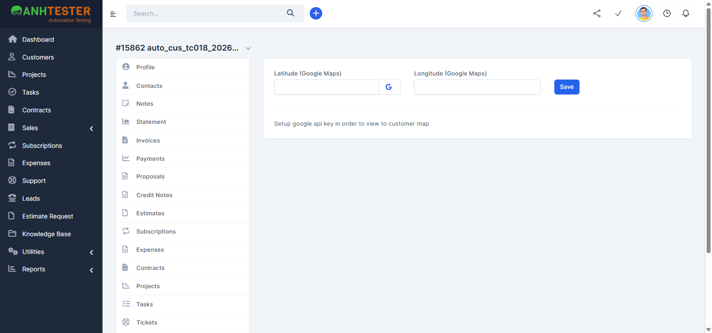 |
| Tái hiện được? | Có — KH test chuẩn vừa tạo (id 15862), chưa lưu toạ độ |
| Nhận định | Nghi nút `Open in Google Map` **chỉ xuất hiện khi KH đã lưu toạ độ** — TC dùng KH chưa có toạ độ (pre-condition), trong khi REQ-CUS-135 liệt kê nút này không kèm điều kiện. Cần đối chiếu lại REQ/TC trước khi coi là bug |

### FAIL #2 — CRM_CUS_TC_032 · Tooltip tiêu đề cột Active giải thích tác dụng của công tắc

| | |
|---|---|
| REQ ID | REQ-CUS-17 |
| Priority | Medium |
| Bước fail | Bước 1 — bước 2 đạt |
| **Expected** | Rê chuột lên tiêu đề cột `Active` → tooltip nguyên văn `Won't be shown in dropdowns when creating new records` |
| **Actual** | Tiêu đề cột (`th#th-active`) **không** có tooltip — không có `title` / `data-toggle`; rê chuột chỉ hiện mũi tên sắp xếp. Tooltip đúng nguyên văn trên lại gắn ở **công tắc của từng dòng** (`div.onoffswitch[data-toggle=tooltip]`) — rê chuột lên công tắc thì hiện |
| 🔧 Ghi chú kỹ thuật | DOM: `<th id="th-active" …>Active</th>`; chuỗi tooltip chỉ có trong `data-title` của 25 `div.onoffswitch` |
| Evidence | 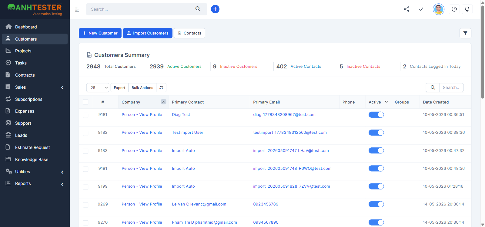 |
| Tái hiện được? | Có — rê chuột 2 lần (hover thường + hover có chờ) đều không có tooltip ở tiêu đề |
| Nhận định | REQ-CUS-17 ghi "tiêu đề cột Active có tooltip" — có khả năng REQ mô tả nhầm vị trí. Cần đối chiếu lại REQ/TC trước khi coi là bug |

### FAIL #3 — CRM_CUS_TC_042 · Company chỉ gồm khoảng trắng bị chặn như bỏ trống

| | |
|---|---|
| REQ ID | REQ-CUS-31 |
| Priority | High |
| Bước fail | Bước 3 · biến thể `CRM_CUS_TC_042-a` (3 dấu cách) · `CRM_CUS_TC_042-b` (1 dấu cách) |
| **Expected** | Trang không chuyển đi, không có `Customer added successfully.`; dưới ô Company `This field is required.`; URL vẫn `/admin/clients/client` |
| **Actual** | Cả 2 biến thể đều **tạo được KH tên rỗng**: `a` → id 15870, `b` → id 15871. Trang chuyển sang `/admin/clients/client/<id>`, tiêu đề trái chỉ `#15871`, tiêu đề tab `Perfex CRM \| Anh Tester Demo`, ô Company rỗng (khoảng trắng đã bị cắt khi lưu) |
| Evidence |  |
| Tái hiện được? | Có — 2/2 biến thể |
| Nhận định | Khớp hiện trạng ghi trong TC (`@KnownBug`, `AMB-CUS-01` — user đã yêu cầu mở bug). 2 KH rỗng đã xoá ngay (404) |

### FAIL #4 — CRM_CUS_TC_044 · Company vượt 191 ký tự bị chặn kèm thông báo, không cắt dữ liệu âm thầm

| | |
|---|---|
| REQ ID | REQ-CUS-32 |
| Priority | High |
| Bước fail | Bước 3 · biến thể `CRM_CUS_TC_044-a` (192 ký tự) · `CRM_CUS_TC_044-b` (206 ký tự) |
| **Expected** | Không tạo KH, trang không chuyển; dưới ô Company `Please enter no more than 191 characters.` |
| **Actual** | Ô Company nhận đủ 192 / 206 ký tự (không có `maxlength`); bấm `Save` → `Customer added successfully.`, chuyển sang hồ sơ (`a` id 15874, `b` id 15875). Ô Company lưu **191** ký tự, kết thúc `xx` — mất phần đuôi (có `Z`) mà không báo gì |
| Evidence | 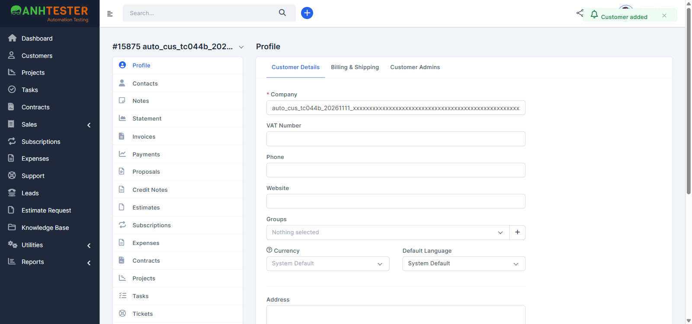 |
| Tái hiện được? | Có — 2/2 biến thể |
| Nhận định | Khớp hiện trạng ghi trong TC (`@KnownBug`, `AMB-CUS-02`) |

### FAIL #5 — CRM_CUS_TC_045 · Company có tiếng Việt, chữ Trung, emoji, ký tự đặc biệt, khoảng trắng đầu/cuối

| | |
|---|---|
| REQ ID | REQ-CUS-48 |
| Priority | Medium |
| Bước fail | Bước 4 · biến thể `CRM_CUS_TC_045-e` (`   auto_cus_tc045e_20261111   `) — `a`, `b`, `c`, `d` PASS |
| **Expected** | Tiêu đề hồ sơ và ô Company đã bỏ khoảng trắng đầu/cuối |
| **Actual** | Tiêu đề trái và tiêu đề tab **trông** đã gọn (`#15880 auto_cus_tc045e_20261111`) vì HTML gộp khoảng trắng, nhưng ô Company sau F5 vẫn là `"   auto_cus_tc045e_20261111   "` (30 ký tự — 3 dấu cách mỗi đầu, chữ lùi vào trong ảnh). Trên danh sách, dòng 15880 đứng **đầu** khi Company xếp tăng dần — dấu hiệu giá trị lưu có khoảng trắng đầu |
| Evidence | 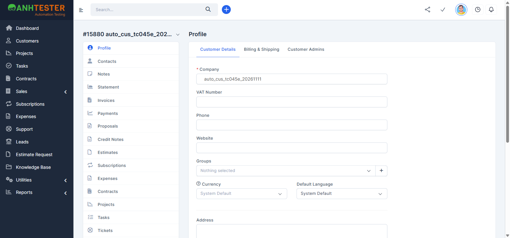 |
| Tái hiện được? | Có — đọc lại sau F5 |
| Nhận định | Hệ thống **không** cắt khoảng trắng đầu/cuối của Company khi lưu (trong khi Company toàn khoảng trắng ở `TC_042` lại lưu thành rỗng). Có thể gây trùng tên "ẩn" và lệch thứ tự sắp xếp. Đề nghị đối chiếu REQ-CUS-48 trước khi mở bug |

### FAIL #6 — CRM_CUS_TC_059 · Currency có 3 lựa chọn, tooltip cảnh báo, đổi lựa chọn được lưu

| | |
|---|---|
| REQ ID | REQ-CUS-44 |
| Priority | Medium |
| Bước fail | Bước 3 — bước 2, 4, 5 đạt |
| **Expected** | Đúng 3 lựa chọn theo thứ tự `System Default` · `USD` · `EUR`; `System Default` đang chọn |
| **Actual** | Có 3 dòng, nhưng dòng đầu **trống chữ** (`<option value="">` rỗng — chữ `System Default` chỉ là chữ giữ chỗ trên nút khi chưa chọn); 2 dòng sau là `USD $` · `EUR €` (kèm ký hiệu tiền tệ chữ xám) |
| Evidence | 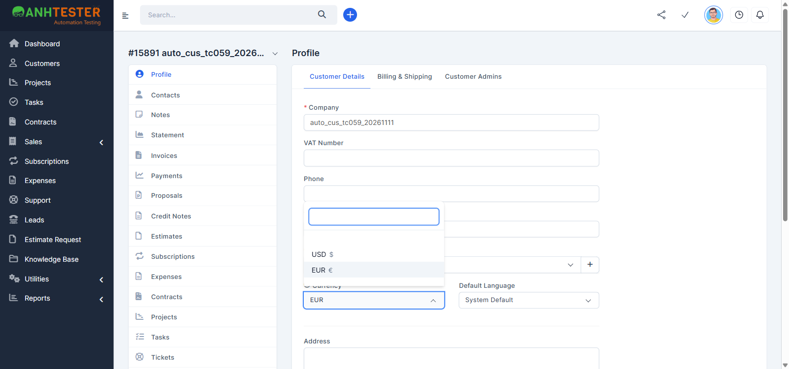 — ảnh chụp sau khi đã chọn `EUR` (dòng trống vẫn đứng đầu) |
| Tái hiện được? | Có — mọi lần mở danh sách |
| Nhận định | Nghi TC/REQ mô tả theo nhãn trên nút chứ không theo danh sách thật. Mức ảnh hưởng thấp — đề nghị đối chiếu lại TC bằng `/review-testcases` trước khi coi là bug |

### FAIL #7 — CRM_CUS_TC_090 · Bulk Confirm không chọn nhóm và không tích Mass Delete không được gỡ nhóm âm thầm

| | |
|---|---|
| REQ ID | REQ-CUS-82 |
| Priority | High |
| Bước fail | Bước 3 (và bước 4) |
| **Expected** | Hệ thống chặn thao tác kèm thông báo lỗi nhìn thấy được (hoặc cảnh báo riêng trước khi gỡ toàn bộ nhóm); cột Groups vẫn `customer group b` |
| **Actual** | Chỉ hiện hộp xác nhận chung `Are you sure you want to perform this action?` (TC ghi rõ không tính); bấm `OK` → trang tải lại, **không** có thông báo nào; cột Groups của `auto_cus_tc090_20261111` (id 15932) **trống** — nhóm `customer group b` bị gỡ |
| Evidence | 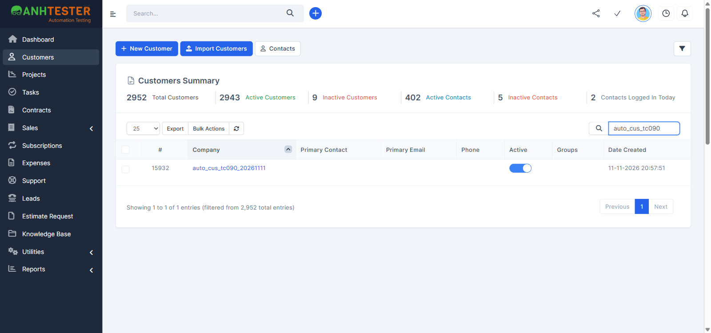 |
| Tái hiện được? | Có — khớp hiện trạng `AMB-CUS-10` ghi trong TC |
| Nhận định | Khớp `@KnownBug`. Lưu ý: hộp thoại Bulk Actions **có** dòng chú thích tĩnh `If you do not select any group all groups assigned to the selected customers will be removed.` dưới ô nhóm (thấy ở `TC_083`) — PO cần quyết định dòng chú thích này có đủ thay cho "cảnh báo riêng" mà TC yêu cầu hay không, trước khi mở bug |

### FAIL #8 — CRM_CUS_TC_103 · Note trống bị chặn, không tạo note rác

| | |
|---|---|
| REQ ID | REQ-CUS-99 |
| Priority | Medium |
| Bước fail | Bước 3–4 · biến thể `CRM_CUS_TC_103-a` (để trống) · `CRM_CUS_TC_103-b` (3 dấu cách) |
| **Expected** | Không có `Note added successfully.`; dưới `Note description` chữ đỏ `This field is required.`; bảng vẫn 1 dòng; menu `Notes` vẫn `1` |
| **Actual** | Cả 2 biến thể: trang tải lại, thông báo `Note added successfully.`, bảng thêm dòng Description **rỗng** (Added From `Admin Example`), menu `Notes` tăng lên `2`, không có lỗi dưới ô nhập |
| Evidence | 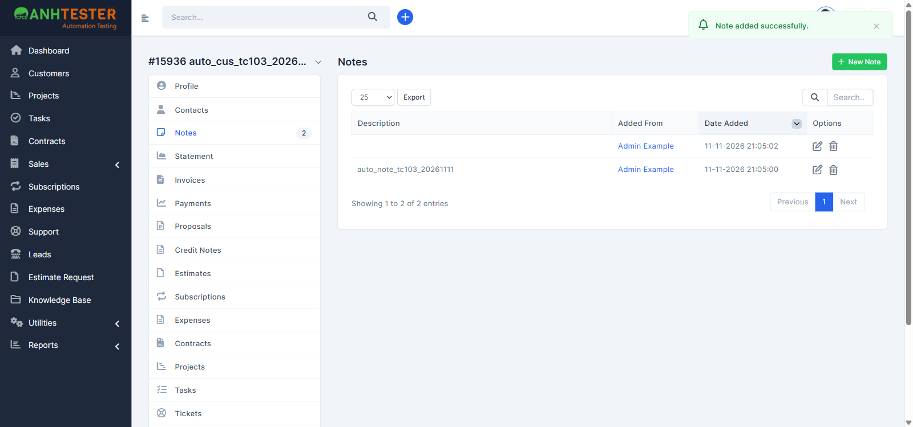 |
| Tái hiện được? | Có — 2/2 biến thể, khớp hiện trạng `AMB-CUS-15` ghi trong TC |
| Nhận định | Khớp `@KnownBug`. 2 note rỗng đã xoá ngay sau mỗi biến thể (KH 15936 về lại 1 note) |

### FAIL #9 — CRM_CUS_TC_116 · Send File để trống báo Email Address bắt buộc, hộp thoại không đóng

| | |
|---|---|
| REQ ID | REQ-CUS-110 |
| Priority | Low |
| Bước fail | Bước 3 và 4 |
| **Expected** | Không gửi đi; hộp thoại vẫn mở, dưới `Email Address` chữ đỏ `This field is required.` |
| **Actual** | 3 ô đều trống, bấm `Send File` → hộp thoại **đóng**, không có thông báo / lỗi nào; trình duyệt **vẫn gửi** request `POST /admin/misc/send_file/` lên máy chủ (không kiểm được máy chủ xử lý ra sao) |
| 🔧 Ghi chú kỹ thuật | Bắt request bằng Playwright: đúng 1 POST tới `/admin/misc/send_file/` sau khi bấm |
| Evidence | 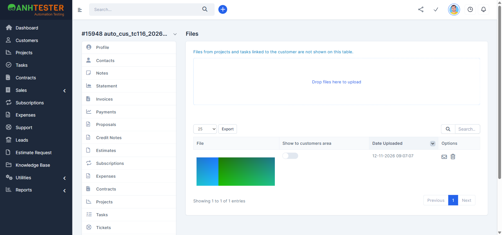 |
| Tái hiện được? | Có — khớp hiện trạng `AMB-CUS-16` ghi trong TC |
| Nhận định | Khớp `@KnownBug`. Chi tiết mới: form được gửi lên máy chủ dù trống — không có kiểm tra phía trình duyệt |

### FAIL #10 — CRM_CUS_TC_122 · Period có ngày bắt đầu sau ngày kết thúc bị chặn kèm thông báo

| | |
|---|---|
| REQ ID | REQ-CUS-117 |
| Priority | Medium |
| Bước fail | Bước 4 |
| **Expected** | Sao kê không nạp theo khoảng đảo ngược — dòng dưới `Account Summary` **không** là `11-11-2026 To 01-01-2026`; có thông báo lỗi nhìn thấy được |
| **Actual** | Sao kê nạp lại với `11-11-2026 To 01-01-2026`, câu `Showing all invoices and payments between 11-11-2026 and 01-01-2026`; không có thông báo lỗi nào |
| Evidence | 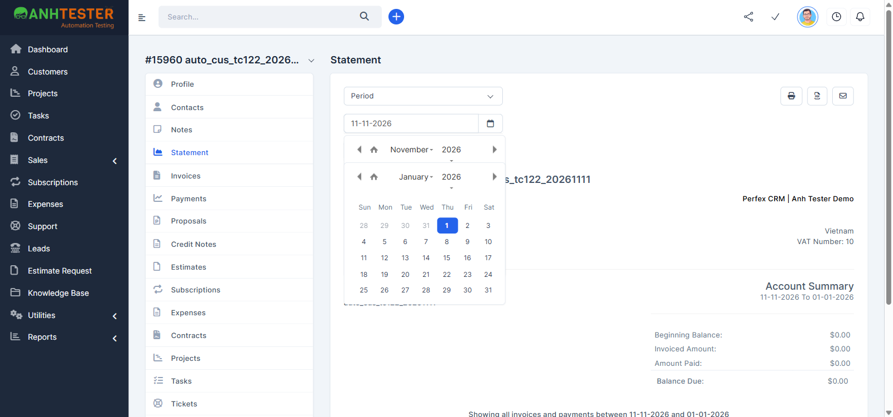 |
| Tái hiện được? | Có — KH 15960 |
| Nhận định | Khớp `@KnownBug` (`AMB-CUS-17`) |

### FAIL #11 — CRM_CUS_TC_124 · Gõ ngày không hợp lệ vào ô Period không nạp sao kê sai

| | |
|---|---|
| REQ ID | REQ-CUS-116 |
| Priority | Low |
| Bước fail | Bước 3 · biến thể `CRM_CUS_TC_124-a` (`31-02-2026`) · `CRM_CUS_TC_124-b` (`abc`) |
| **Expected** | Sao kê **không** hiện khoảng chứa chuỗi đã gõ; ô ngày bị xoá về trống hoặc tự sửa thành ngày hợp lệ ⚠️ chưa có evidence |
| **Actual** | `a`: ô giữ nguyên `31-02-2026`; sao kê nạp lại `31-02-2026 To 30-11-2026`, câu `Showing … between 31-02-2026 and 30-11-2026` — hiện đúng chuỗi ngày không tồn tại. `b`: ô giữ nguyên `abc` (không xoá, không sửa); sao kê **không** đổi (vẫn khoảng `This Month` `01-11-2026 To 30-11-2026` từ lúc mở trang), không có thông báo lỗi nào |
| 🔧 Ghi chú kỹ thuật | `b`: request `GET /admin/clients/statement?customer_id=15962&from=abc&to=30-11-2026` trả mã `500` (console trình duyệt) — lỗi máy chủ bị nuốt, người dùng không biết sao kê đang hiển thị khoảng cũ |
| Evidence | 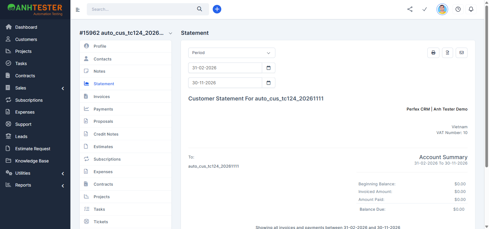 |
| Tái hiện được? | Có — `a` chạy 2 lần cùng kết quả |
| Nhận định | `@NeedsVerify` — Expected chưa có evidence, **đối chiếu lại TC trước khi báo bug** (`/review-testcases`). Riêng lỗi `500` ở `b` là hành vi máy chủ đáng ghi nhận dù TC chốt Expected thế nào |

### FAIL #12 — CRM_CUS_TC_128 · Gửi sao kê khi chưa chọn người nhận bị chặn ở ô Email to

| | |
|---|---|
| REQ ID | REQ-CUS-121 |
| Priority | Medium |
| Bước fail | Bước 3 và 4 |
| **Expected** | Không gửi đi; hộp thoại vẫn mở, dưới ô `Email to` chữ đỏ `This field is required.` |
| **Actual** | `Email to` trống, bấm `Send` → trình duyệt gửi `POST /admin/clients/send_statement?customer_id=15965&from=01-11-2026&to=30-11-2026`; trang tải lại, hộp thoại **đóng**, góc phải hiện thông báo đỏ bắt đầu bằng `Problem while…` (tự ẩn sau vài giây); không có lỗi dưới ô `Email to` |
| 🔧 Ghi chú kỹ thuật | Không có kiểm tra phía trình duyệt — form trống vẫn được gửi lên máy chủ; máy chủ từ chối (không có địa chỉ nhận) |
| Evidence | 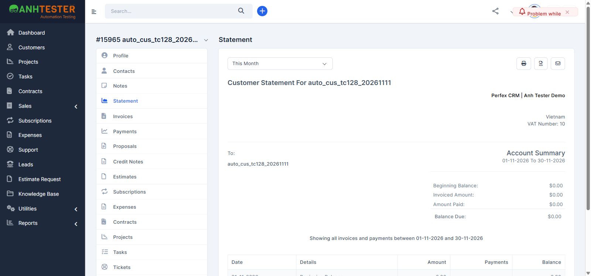 |
| Tái hiện được? | Có — khớp hiện trạng `AMB-CUS-18` ghi trong TC (`Problem while sending the statement`) |
| Nhận định | Khớp `@KnownBug`. Cùng kiểu lỗi với `TC_116` (Send File) |

### FAIL #13 — CRM_CUS_TC_135 · Port ngoài khoảng 1–65535 bị chặn

| | |
|---|---|
| REQ ID | REQ-CUS-126 |
| Priority | Medium |
| Bước fail | Bước 4–5 · biến thể `CRM_CUS_TC_135-a` (`0`) · `CRM_CUS_TC_135-b` (`65536`) · `CRM_CUS_TC_135-c` (`70000`) · `CRM_CUS_TC_135-d` (`-1`) |
| **Expected** | Không lưu; hộp thoại vẫn mở, ô `Port` có thông báo lỗi nhìn thấy được; trang Vault không thêm thẻ |
| **Actual** | Cả 4 biến thể đều lưu thành công, hộp thoại đóng, thêm thẻ mới: `a` → `Port: Not provided` (giá trị `0` bị coi như trống) · `b` → `Port: 65536` · `c` → `Port: 70000` · `d` → `Port: -1`. Không có thông báo lỗi nào |
| 🔧 Ghi chú kỹ thuật | Ô `Port` là `type=number` nhưng không khai `min` / `max` — trình duyệt không chặn; máy chủ cũng không kiểm khoảng |
| Evidence | 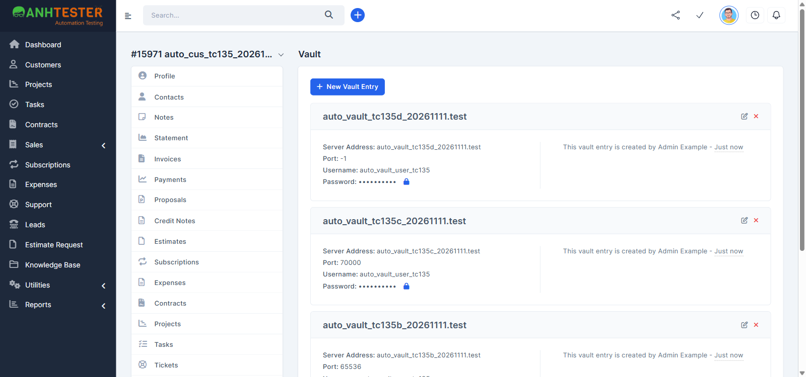 |
| Tái hiện được? | Có — 4/4 biến thể (KH 15971) |
| Nhận định | Khớp `@KnownBug` (`AMB-CUS-19`). Chi tiết mới: `0` không bị báo lỗi mà lặng lẽ thành `Not provided` |

### FAIL #14 — CRM_CUS_TC_146 · Latitude không phải số hoặc ngoài [-90, 90] bị chặn

| | |
|---|---|
| REQ ID | REQ-CUS-137 |
| Priority | Low |
| Bước fail | Bước 3–4 · biến thể `CRM_CUS_TC_146-a` (`abc`) · `CRM_CUS_TC_146-b` (`91`) · `CRM_CUS_TC_146-c` (`-91`) |
| **Expected** | Có thông báo lỗi nhìn thấy được ở ô Latitude; sau F5 Latitude vẫn `10.762622` |
| **Actual** | Cả 3 biến thể: bấm `Save` → trang tải lại, không có thông báo nào; sau F5 Latitude là đúng giá trị sai đã nhập (`abc` / `91` / `-91`), Longitude giữ `106.660172` |
| 🔧 Ghi chú kỹ thuật | 2 ô toạ độ là `type=text`, không có ràng buộc phía trình duyệt; máy chủ lưu nguyên chuỗi |
| Evidence |  |
| Tái hiện được? | Có — 3/3 biến thể (KH 15980); trước mỗi biến thể đã lưu lại toạ độ tiền điều kiện |
| Nhận định | Khớp `@KnownBug` (`AMB-CUS-20`) |

### FAIL #15 — CRM_CUS_TC_147 · Longitude không phải số hoặc ngoài [-180, 180] bị chặn

| | |
|---|---|
| REQ ID | REQ-CUS-137 |
| Priority | Low |
| Bước fail | Bước 3–4 · biến thể `CRM_CUS_TC_147-a` (`999`) · `CRM_CUS_TC_147-b` (`181`) · `CRM_CUS_TC_147-c` (`-181`) · `CRM_CUS_TC_147-d` (`xyz`) |
| **Expected** | Có thông báo lỗi nhìn thấy được ở ô Longitude; sau F5 Longitude vẫn `106.660172` |
| **Actual** | Cả 4 biến thể: lưu không báo lỗi; sau F5 Longitude là đúng giá trị sai đã nhập (`999` / `181` / `-181` / `xyz`), Latitude giữ `10.762622` |
| Evidence | 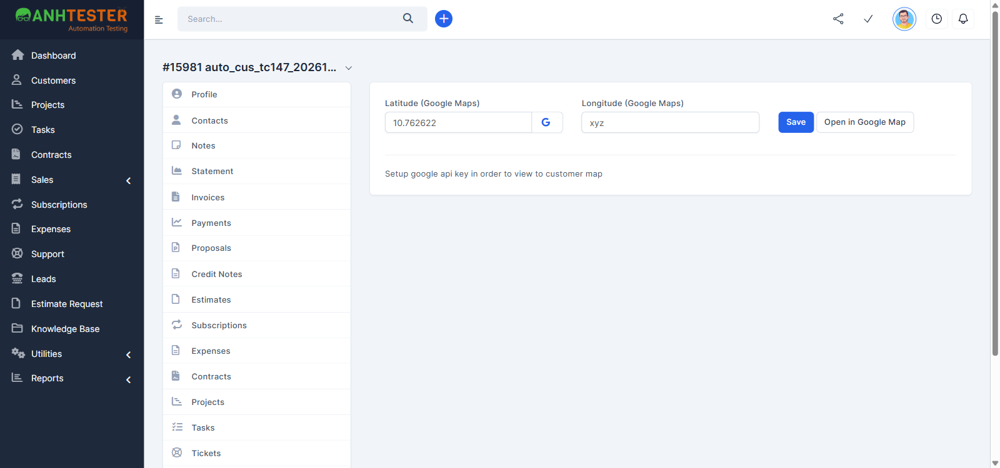 |
| Tái hiện được? | Có — 4/4 biến thể (KH 15981) |
| Nhận định | Khớp `@KnownBug` (`AMB-CUS-20`) |

### FAIL #16 — CRM_CUS_TC_153 · Bấm công tắc Active 2 lần liên tiếp — trạng thái cuối khớp sau khi tải lại

| | |
|---|---|
| REQ ID | REQ-CUS-66 |
| Priority | Medium |
| Bước fail | Bước 3 |
| **Expected** | Bước 2 công tắc trở về **bật**; bước 3 sau F5 công tắc vẫn **bật** ⚠️ chưa có evidence |
| **Actual** | Bước 2 đạt — công tắc hiện **bật**. Sau F5 công tắc **tắt**; bộ đếm `Inactive Customers` tăng 1 (9 → 10). Màn hình báo bật nhưng dữ liệu đã lưu là tắt, không có thông báo nào |
| 🔧 Ghi chú kỹ thuật | Bấm đúp gửi 2 request gần như cùng lúc: `GET /admin/clients/change_client_status/15986/0` rồi `…/15986/1`. Máy chủ xử lý không theo thứ tự gửi → lần ghi cuối là `0` (tắt) |
| Evidence | 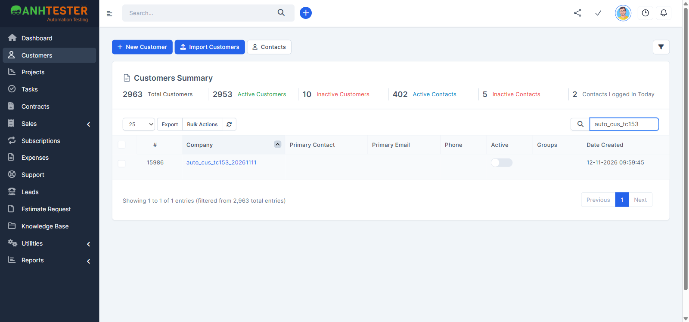 |
| Tái hiện được? | **Chập chờn** — 3/10 lần (lần đầu + 2/9 lần thử lại trên KH 15986); 7 lần còn lại trạng thái giữ đúng `bật`. KH đã được bật lại trước khi xoá |
| Nhận định | `@NeedsVerify` — Expected chưa có evidence, **đối chiếu lại TC trước khi báo bug** (`/review-testcases`). Hành vi tranh chấp request (race condition) đáng báo dev dù TC chốt Expected thế nào |

### FAIL #17 — CRM_CUS_TC_156 · Company chứa mã script hoặc câu lệnh CSDL được lưu như chữ, không bị thực thi

| | |
|---|---|
| REQ ID | REQ-CUS-48 |
| Priority | High |
| Bước fail | Bước 3–4 · biến thể `CRM_CUS_TC_156-b` (`auto_cus_tc156b_20261111`) — `a`, `c`, `d` đạt |
| **Expected** | 3. Không hộp thoại; tên hiện dạng chữ (phần thẻ HTML có thể đã bị loại bỏ) · 4. Bảng còn đúng **1** dòng tên chứa `auto_cus_tc156b_20261111` |
| **Actual** | 3. Không hộp thoại nào (không thực thi). Nhưng Company được lưu thành đúng `` — **toàn bộ chữ `auto_cus_tc156b_20261111` bị mất**; tiêu đề trái hồ sơ `#15996` kèm một phần tử `` **thật** (không được mã hoá), ô Company hiện ``, tiêu đề tab ``. 4. Tìm `auto_cus_tc156b` → `No matching records found` (0 dòng) |
| 🔧 Ghi chú kỹ thuật | Bộ lọc XSS phía máy chủ gỡ thuộc tính `src` / `onerror` và nuốt phần chữ phía sau thẻ; phần còn lại được in thẳng ra HTML ở tiêu đề hồ sơ (không escape). Cùng gốc với `TC_157-b`, `TC_159-b` |
| Evidence | 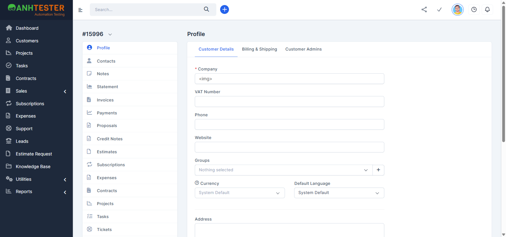 |
| Tái hiện được? | Chưa thử lại — 1 lần (KH 15996) |
| Nhận định | `@NeedsVerify` — Expected chưa có evidence, đối chiếu TC trước. Bước 7 dừng đúng quy tắc của TC (số dòng khác 1 → **không** xoá qua danh sách); KH 15996 đã dọn qua hồ sơ ở teardown. Mất dữ liệu người dùng nhập + chèn được thẻ HTML vào trang là điểm cần chuyển Dev/bảo mật đánh giá |

### FAIL #18 — CRM_CUS_TC_157 · Note chứa mã script được hiển thị như chữ, không bị thực thi

| | |
|---|---|
| REQ ID | REQ-CUS-98 |
| Priority | High |
| Bước fail | Bước 3 · biến thể `CRM_CUS_TC_157-b` (`auto_note_tc157b_20261111`) — `a` đạt |
| **Expected** | Không hộp thoại; Description hiện dạng chữ (phần thẻ HTML có thể đã bị loại bỏ) |
| **Actual** | Không hộp thoại nào (lưu, F5, mở sửa). Description của note **trống** trên màn hình: ô chứa một phần tử `` thật không thuộc tính, chữ `auto_note_tc157b_20261111` bị mất; ô sửa note hiện `` |
| Evidence | 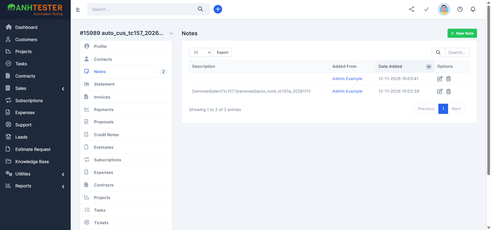 |
| Tái hiện được? | Chưa thử lại — 1 lần (KH 15989, note id 27) |
| Nhận định | `@NeedsVerify` — đối chiếu TC trước khi báo bug. Cùng gốc với FAIL #17 |

### FAIL #19 — CRM_CUS_TC_164 · Danh sách KH dùng được ở các độ rộng màn hình đã chốt

| | |
|---|---|
| REQ ID | REQ-CUS-06 |
| Priority | Low |
| Bước fail | Bước 2 · biến thể `CRM_CUS_TC_164-c` (cửa sổ 768×1024) — `a`, `b` đạt |
| **Expected** | Không thanh cuộn ngang của cả trang; khối Summary và **3 nút đầu trang** không đè chữ lên nhau ⚠️ chưa có evidence |
| **Actual** | Cửa sổ rộng 768 → vùng nhìn còn 752px (< 768, mốc màn hình nhỏ của giao diện): nút `Import Customers` **bị ẩn** (lớp `hidden-xs`), đầu trang chỉ còn `New Customer` · `Contacts` (xếp dọc, kéo dài hết chiều ngang) và nút phễu. Không thanh cuộn ngang của cả trang, Summary xếp 2 cột không chồng nhau, đủ 9 cột (bảng cuộn ngang trong khung), `Export` · `Bulk Actions` · ô tìm kiếm bấm được. Ở vùng nhìn **đúng** 768px thì đủ 3 nút, không chồng nhau |
| Evidence | 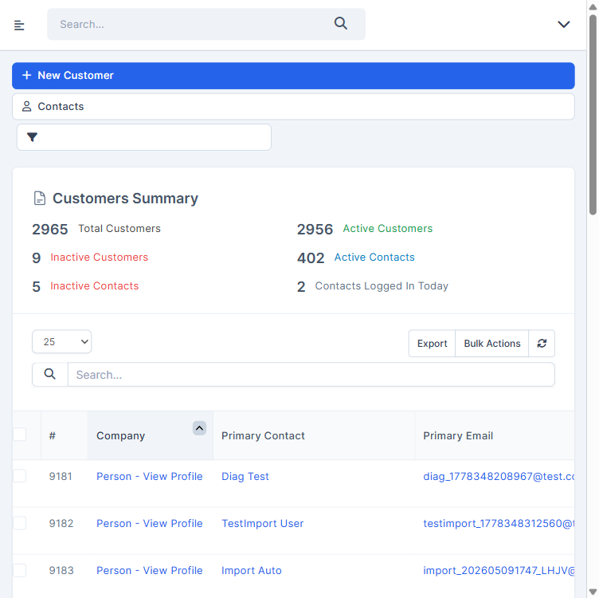 |
| Tái hiện được? | Có — ẩn theo lớp CSS cố định, không ngẫu nhiên |
| Nhận định | `@NeedsVerify` — ẩn nút có chủ đích của giao diện. Đối chiếu TC (`/review-testcases`): chốt `768` là cửa sổ hay vùng nhìn, và có chấp nhận ẩn `Import Customers` ở màn hình hẹp không. Chiều cao biến thể `c` chạy ở 750 (không vượt cửa sổ headed) — Expected không phụ thuộc chiều cao |

## 4. TC BLOCKED

| TC ID | Nguyên nhân chặn | Cần gì để chạy được |
|---|---|---|
| CRM_CUS_TC_034 | `@Skip` — tải tệp Export CSV trên môi trường dùng chung chưa được phép (`AMB-CUS-12` ⏭️) | PO/user cho phép tải tệp, hoặc chạy trên môi trường riêng |
| CRM_CUS_TC_040 | `@Skip` — bộ lọc lưu dùng chung toàn hệ thống, chưa được phép tạo (`AMB-CUS-21`) | PO/user cho phép tạo bộ lọc `auto_filter_…` (và xoá sau khi chạy), hoặc môi trường riêng |
| CRM_CUS_TC_058 | `@Skip` — nhóm KH dùng chung, không xoá được vì khu Setup bị chặn (`RISK-CUS-03`, `AMB-SYS-01`) | Môi trường riêng, hoặc quyền xoá nhóm KH ở Setup |
| CRM_CUS_TC_071 | TC thiếu bước: rule `Customers assigned to me` bắt chọn `Yes`/`No` thì `Apply` mới mở | `/review-testcases` thêm bước chọn `Yes` vào bước 1–2 |
| CRM_CUS_TC_078 | TC thiếu bước: `Save as Draft` bị chặn `Enter at least one item.` khi hoá đơn chưa có dòng hàng | `/review-testcases` thêm bước nhập 1 dòng hàng (VD `auto_item_tc078`, SL 1, đơn giá 1) và ghi rõ bước dọn hoá đơn |
| CRM_CUS_TC_081 | `@Skip` — không được xoá dữ liệu có chứng từ trên môi trường dùng chung | Môi trường riêng |
| CRM_CUS_TC_098 · 099 · 101 | `@Skip` — Import thật chưa được phép, có thể gửi email tới contact (`AMB-CUS-12` ⏭️) | PO cho phép Import thật với dữ liệu `auto_imp_tc…` (và dọn sau khi chạy), hoặc môi trường riêng. Tệp CSV mẫu đã có sẵn (cấu trúc 27 cột kiểm chứng ở `TC_093`) |
| CRM_CUS_TC_100 | `@Skip` — chưa được phép tải tệp (`AMB-CUS-12` ⏭️) | PO/user cho phép tải tệp |
| CRM_CUS_TC_110 | Biến thể `c` (`.exe`) bị Auto-Skip — tải tệp thực thi lên môi trường dùng chung; 4 biến thể còn lại đạt | Chạy tay có giám sát biến thể `c` (tệp văn bản đổi đuôi `.exe`), hoặc PO chấp nhận bằng chứng cấu hình `acceptedFiles` |
| CRM_CUS_TC_114 | `@Skip` — cổng khách hàng ngoài phạm vi đợt này | Contact đăng nhập được cổng khách hàng |
| CRM_CUS_TC_117 | `@Skip` — không gửi email trên môi trường dùng chung (`AMB-CUS-25` ⏭️) | Hộp thư test + PO cho phép gửi |
| CRM_CUS_TC_126 | `@Skip` — chưa được phép mở/tải PDF sao kê (`AMB-CUS-12` ⏭️) | PO/user cho phép mở PDF |
| CRM_CUS_TC_129 | `@Skip` — không gửi email trên môi trường dùng chung (`AMB-CUS-25` ⏭️) | KH có contact nhận thông báo Invoice + hộp thư test + PO cho phép gửi |
| CRM_CUS_TC_143 | `@Skip` — hệ thống chỉ có role Admin, cần staff thứ hai không phải administrator (`AMB-CUS-23` ⏭️) | Tài khoản staff không phải admin có quyền xem KH |
| CRM_CUS_TC_148 | `@Skip` — cấu hình Google API key ở Setup đang bị chặn (`AMB-SYS-01`) | Quyền Setup + Google API key cho môi trường test |
| CRM_CUS_TC_168 | Playwright MCP của agent chỉ chạy Google Chrome | QA chạy tay trên Microsoft Edge và Firefox bản mới nhất, hoặc cấu hình thêm trình duyệt cho MCP |

## 5. Dữ liệu đã tạo & dọn dẹp

| Dữ liệu | ID | Nơi tạo | Đã xoá? |
|---|---|---|---|
| auto_cus_tc006_20261111 | 15851 | /admin/clients/client | ✅ |
| auto_cus_tc007_20261111 | 15852 | /admin/clients/client | ✅ |
| auto_cus_tc008_20261111 | 15853 | /admin/clients/client | ✅ |
| auto_cus_tc009_20261111 | 15854 | /admin/clients/client (không tạo contact) | ✅ |
| auto_cus_tc010_20261111 | 15855 | /admin/clients/client | ✅ |
| auto_cus_tc011_20261111 | 15856 | /admin/clients/client | ✅ |
| auto_cus_tc012_20261111 → đổi tên `auto_cus_tc012e_20261111` | 15857 | /admin/clients/client | ✅ |
| auto_cus_tc014_20261111 | 15858 | /admin/clients/client | ✅ |
| auto_cus_tc015_20261111 | 15859 | /admin/clients/client | ✅ |
| auto_cus_tc016_20261111 | 15860 | /admin/clients/client | ✅ |
| auto_cus_tc017_20261111 | 15861 | /admin/clients/client | ✅ |
| auto_cus_tc018_20261111 | 15862 | /admin/clients/client | ✅ |
| auto_cus_tc019_20261111 | 15863 | /admin/clients/client | ✅ |
| Tệp `auto_cus_tc019.png` (PNG 1×1, 70 byte) | — | Tab Files của KH 15863 | ✅ theo KH — xoá KH kéo theo tệp; URL xem trước cũ chỉ còn trả ảnh thay thế 6 KB, không phải tệp đã upload |
| auto_cus_tc022_20261111 (đã tắt rồi bật lại Active) | 15864 | /admin/clients/client | ✅ |
| auto_cus_tc027a_20261111 | 15865 | /admin/clients/client | ✅ |
| auto_cus_tc027b_20261111 | 15866 | /admin/clients/client | ✅ |
| auto_cus_tc030_20261111 | 15867 | /admin/clients/client | ✅ |
| auto_cus_tc038_20261111 (Inactive) | 15868 | /admin/clients/client | ✅ |
| auto_cus_tc028_20261111 (Phone `0918028028`) | 15869 | /admin/clients/client | ✅ |

> Xoá từng KH qua menu `⌄` → `Delete` trên hồ sơ (không dùng Mass Delete); trước khi xoá đã đối chiếu tên có tiền tố `auto_cus_tc…_20261111`. Sau dọn: 19/19 id (15851–15869) trả `404`; lọc danh sách theo `auto_cus_tc` → `0 entries`.
>
> Đối chiếu số liệu hệ thống: `Total` / `Active` / `Inactive Customers` trước phiên 3 = `2942 / 2933 / 9` → sau dọn `2942 / 2933 / 9` ✅ môi trường trả về nguyên trạng (môi trường dùng chung, số liệu có thể biến động do người khác).
>
> Không tạo contact, note, vault entry, nhóm KH, **bộ lọc đã lưu** nào (các hộp thoại đều đóng không lưu; `Save Filter` không bật — danh sách bộ lọc giữ 11 mục).

**Phiên 4 (`TC_041` → `TC_080`)** — 52 KH (dải id liên tục **15870 → 15921**) + 1 hoá đơn nháp:

| Dữ liệu | ID | Nơi tạo | Đã xoá? |
|---|---|---|---|
| KH tên rỗng do lỗi `TC_042` (biến thể `a` · `b`) | 15870 · 15871 | /admin/clients/client | ✅ xoá ngay sau khi chụp evidence |
| `auto_cus_tc043a/b_20261111_…` (191 / 190 ký tự) | 15872 · 15873 | /admin/clients/client | ✅ |
| `auto_cus_tc044a/b_20261111_…` (bị cắt còn 191 ký tự) | 15874 · 15875 | /admin/clients/client | ✅ |
| `auto_cus_tc045a…e_20261111` (tiếng Việt · chữ Trung · emoji · ký tự đặc biệt · khoảng trắng) | 15876 → 15880 | /admin/clients/client | ✅ |
| KH test chuẩn `auto_cus_tc046` → `auto_cus_tc080c` (tiền điều kiện 046–055, 059, 061–080) | 15881 → 15917 | /admin/clients/client | ✅ (15915–15917 xoá trong chính `TC_080`) |
| Bản trùng tên `auto_cus_tc048_20261111` | 15918 · 15919 | /admin/clients/client | ✅ |
| `auto_cus_tc056_20261111` (nhóm `customer group b` + `Gold`) | 15920 | /admin/clients/client | ✅ |
| `auto_cus_tc080a_20261111` tạo lại để chạy lại biến thể `a` | 15921 | /admin/clients/client | ✅ xoá trong `TC_080` |
| Gán Customer Admin `Admin Example` | KH 15900 · 15901 · 15902 | Tab Customer Admins | ✅ theo KH (15901 đã gỡ trong `TC_070`) |
| Hoá đơn nháp `INV-DRAFT` (1 dòng `auto_item_tc078`, $1) | 104 | /admin/invoices/invoice | ✅ `Invoice deleted`, mở lại → `not_found` |

> Xoá từng KH qua menu `⌄` → `Delete` trên hồ sơ (không dùng Mass Delete); trước mỗi lần xoá đã đối chiếu tên có `auto_cus_tc` và `20261111`. Sau dọn: 52/52 id (15870–15921) trả `404`; lọc danh sách theo `auto_cus_tc` → `0 entries`; tìm hoá đơn theo `auto_cus_tc078` → `No matching records found`.
>
> Đối chiếu số liệu hệ thống: `Total` / `Active` / `Inactive Customers` trước phiên 4 = `2942 / 2933 / 9` → sau dọn `2942 / 2933 / 9` ✅ môi trường trả về nguyên trạng.
>
> Không tạo nhóm KH (`TC_057` chỉ thử Name trống — số nhóm 317 → 317; `TC_058` không chạy), không lưu bộ lọc (`TC_071` không bật Save Filter), không tạo Estimate / Proposal / Project (`TC_077` rời trang không lưu). Default Language / Currency / địa chỉ chỉ đổi trên KH test, đã xoá theo KH.

**Phiên 5–6 (`TC_081` → `TC_120`)** — 24 KH (15926–15932, 15935–15951; 15933 · 15934 là của người khác, **không** đụng tới):

| Dữ liệu | ID | Nơi tạo | Đã xoá? |
|---|---|---|---|
| `auto_cus_tc082a/b/c_20261111` | 15926 · 15927 · 15928 | /admin/clients/client | ✅ |
| `auto_cus_tc088a/b_20261111` (bulk gán `customer group b`) | 15929 · 15930 | /admin/clients/client | ✅ |
| `auto_cus_tc089_20261111` (`customer group b` → `Gold`) | 15931 | /admin/clients/client | ✅ |
| `auto_cus_tc090_20261111` (nhóm bị gỡ do `@KnownBug`) | 15932 | /admin/clients/client | ✅ |
| `auto_cus_tc102` → `auto_cus_tc106_20261111` + 9 note `auto_note_tc10x_…` | 15935 → 15939 | /admin/clients/client · tab Notes | ✅ theo KH (2 note rỗng của `TC_103` xoá ngay; note của `TC_106` xoá trong TC) |
| `auto_cus_tc107` → `auto_cus_tc120_20261111` (không có 114, 117) + 16 tệp đã upload | 15940 → 15951 | /admin/clients/client · tab Files | ✅ theo KH (tệp của `TC_118` xoá trong TC) |

> Xoá từng KH qua menu `⌄` → `Delete` trên hồ sơ (không dùng Mass Delete); trước mỗi lần xoá đã đối chiếu tiêu đề hồ sơ khớp mẫu `auto_cus_tc<NNN>[a-z]_20261111` — 24/24 `Customer deleted`. Sau dọn: 24/24 id trả `404`; tìm `auto_cus_tc` và `auto_imp_tc` → `0 entries`.
>
> Đối chiếu số liệu: `Total` / `Active` / `Inactive Customers` ngay trước khi dọn (12-11-2026) = `2976 / 2967 / 9` → sau dọn `2952 / 2943 / 9` — giảm đúng 24, Inactive giữ nguyên ✅. So với trước phiên 5 (`2945 / 2936 / 9`) chênh +7 do người khác tạo KH qua đêm (môi trường dùng chung).
>
> Simulate Import (`TC_092`–`TC_097`) không tạo KH nào (đã kiểm `auto_imp_tc` → 0). Không gửi email: `TC_116` có gửi 1 request `POST /admin/misc/send_file/` với 3 ô trống (do lỗi `@KnownBug`), không có địa chỉ nhận. Không tạo nhóm KH, không lưu bộ lọc. Tệp mẫu nằm ở `.playwright-mcp/test-files/` (đã `.gitignore`).

**Phiên 7 (`TC_121` → `TC_150`)** — 25 KH (dải id liên tục **15959 → 15983**) + 17 vault entry:

| Dữ liệu | ID | Nơi tạo | Đã xoá? |
|---|---|---|---|
| KH test chuẩn `auto_cus_tc121` → `auto_cus_tc147_20261111` (không có 126, 129, 142, 143 — TC không chạy) | 15959 → 15981 | /admin/clients/client | ✅ |
| `auto_cus_tc149_20261111` (bấm đúp Save — chỉ tạo 1 bản) | 15982 | /admin/clients/client | ✅ |
| `auto_cus_tc150_20261111` (F5 / Back — không tạo trùng) | 15983 | /admin/clients/client | ✅ |
| Vault entry `auto_vault_tc134a…d` (Port hợp lệ) | KH 15970 | Tab Vault | ✅ theo KH |
| Vault entry `auto_vault_tc135a…d` (Port sai bị lưu do `@KnownBug`) | vault id 7 → 10 · KH 15971 | Tab Vault | ✅ xoá ngay bằng `×` trong TC |
| Vault entry `auto_vault_tc136` · `137a/b` · `138` · `139` · `141` · `144a/b/c` | KH 15972 → 15978 | Tab Vault | ✅ theo KH |
| Vault entry `auto_vault_tc140` | KH 15976 | Tab Vault | ✅ xoá trong chính `TC_140` |
| Toạ độ Map (giá trị hợp lệ và giá trị sai `abc` / `91` / `999` / `xyz`…) | KH 15979 · 15980 · 15981 | Tab Map | ✅ theo KH |

> Xoá từng KH qua menu `⌄` → `Delete` trên hồ sơ (không dùng Mass Delete); trước mỗi lần xoá đã đối chiếu tiêu đề hồ sơ khớp mẫu `auto_cus_tc<NNN>_20261111` — 25/25 `Customer deleted`. Sau dọn: 25/25 id trả `404`; tìm `auto_cus_tc` → `Showing 0 to 0 of 0 entries (filtered from 2,952 total entries)`. Vault entry gắn với KH nên không còn truy cập được sau khi xoá KH (không kiểm được bảng vault ở CSDL).
>
> Đối chiếu số liệu hệ thống: `Total` / `Active` / `Inactive Customers` trước phiên 7 = `2952 / 2943 / 9` → sau dọn `2952 / 2943 / 9` ✅ môi trường trả về nguyên trạng.
>
> Không gửi email: `TC_128` có gửi 1 request `POST /admin/clients/send_statement` với `Email to` trống (do lỗi `@KnownBug`), máy chủ báo `Problem while…`, không có địa chỉ nhận. Không mở / tải PDF (`TC_125` chỉ đọc đích của nút). Không xem mật khẩu Vault (`TC_142` bỏ qua).

**Phiên 8 (`TC_151` → `TC_169`)** — 16 KH (dải id liên tục **15984 → 15999**) + note + vault entry:

| Dữ liệu | ID | Nơi tạo | Đã xoá? |
|---|---|---|---|
| KH test chuẩn `auto_cus_tc151` · `152` · `153` · `154` · `155` · `157` · `158` · `159` · `161` · `167` · `169_20261111` (`169` thuộc `customer group b`) | 15984 → 15994 | /admin/clients/client | ✅ |
| `auto_cus_tc156a` · `c` · `d` (Company chứa chuỗi thử script / SQL) | 15995 · 15997 · 15998 | /admin/clients/client | ✅ xoá trong chính `TC_156` bước 8 |
| KH biến thể `TC_156-b` — tên bị lưu thành `` | 15996 | /admin/clients/client | ✅ xoá ở teardown qua hồ sơ (đã đối chiếu id + tiêu đề `` + giờ tạo 12-11-2026 10:02) |
| `auto_cus_tc163_20261111` | 15999 | /admin/clients/client | ✅ |
| Note `auto_note_tc152` · 2 note thử script của `TC_157` | KH 15985 · 15989 | Tab Notes | ✅ theo KH |
| Vault entry `tc154` · `tc158a/b` · `tc159a/b` · `tc161` · `tc167` | KH 15987 · 15990 · 15991 · 15992 · 15993 | Tab Vault | ✅ theo KH |
| `auto_cus_tc162_20261111` | — | Không được tạo (phiên đã đăng xuất) | — (sau khi đăng nhập lại: tìm tên → 0 dòng, Total 2952) |

> Xoá từng KH qua menu `⌄` → `Delete` trên hồ sơ (không dùng Mass Delete); trước mỗi lần xoá đã đối chiếu tiêu đề hồ sơ khớp mẫu `auto_cus_tc1<NN>_20261111` (riêng 15996 là ``) — 13/13 `Customer deleted` (cộng 3 KH xoá trong `TC_156`). Sau dọn: 16/16 id trả `404`; tìm `auto_cus_tc` và `tc156` → `0 entries`.
>
> Đối chiếu số liệu hệ thống: `Total` / `Active` / `Inactive Customers` trước phiên 8 = `2952 / 2943 / 9` → sau dọn `2952 / 2943 / 9` ✅ môi trường trả về nguyên trạng. `TC_153` có lúc để KH 15986 ở Inactive (Inactive 9 → 10) — đã bật lại trước khi xoá.
>
> `TC_169` bấm `Confirm` 2 lần khi **không** tích dòng nào: request không kèm id → không KH nào bị đổi (`Total Customers` giữ 2965 trong lúc chạy). Không tạo nhóm KH, không lưu bộ lọc. `TC_160` chỉ tìm kiếm, không sửa 4 KH có sẵn tên chứa `' OR '1'='1`.

## 6. Đề xuất bước tiếp theo

- **FAIL #1 (`TC_018`, Low)** → đối chiếu lại REQ-CUS-135 / TC bằng `/review-testcases` mode FIX. **Phiên 7 đã xác nhận nhận định**: ở `TC_145`–`TC_147`, sau khi KH lưu toạ độ thì hàng nút có thêm `Open in Google Map` — nút này chỉ hiện khi đã có toạ độ. Sửa REQ + TC, **không** mở bug.
- **FAIL #2 (`TC_032`, Medium)** → đối chiếu lại REQ-CUS-17 / TC: tooltip có thật nhưng nằm ở công tắc từng dòng, không ở tiêu đề cột. Nếu PO xác nhận tooltip phải ở tiêu đề → `/create-bug-report`; nếu không → sửa REQ + TC.
- **FAIL #3 (`TC_042`, High) · FAIL #4 (`TC_044`, High)** — `@KnownBug` (`AMB-CUS-01`, `AMB-CUS-02`), tái hiện 2/2 biến thể → `/create-bug-report` (user đã yêu cầu mở bug cho `AMB-CUS-01`).
- **FAIL #5 (`TC_045-e`, Medium)** — Company giữ nguyên khoảng trắng đầu/cuối khi lưu. Đối chiếu REQ-CUS-48 với PO; nếu REQ yêu cầu cắt khoảng trắng thì `/create-bug-report`.
- **FAIL #6 (`TC_059`, Medium)** — dòng `System Default` hiển thị trống trong danh sách Currency. Nghi TC mô tả theo nhãn nút → `/review-testcases` mode FIX trước, **chưa** mở bug.
- **FAIL #7 (`TC_090`, High) · FAIL #8 (`TC_103`, Medium) · FAIL #9 (`TC_116`, Low)** — `@KnownBug` (`AMB-CUS-10`, `AMB-CUS-15`, `AMB-CUS-16`) → `/create-bug-report`. Riêng `TC_090`: hỏi PO trước về dòng chú thích tĩnh `If you do not select any group…` (xem FAIL #7).
- **FAIL #10 (`TC_122`, Medium) · FAIL #12 (`TC_128`, Medium) · FAIL #13 (`TC_135`, Medium) · FAIL #14 (`TC_146`, Low) · FAIL #15 (`TC_147`, Low)** — `@KnownBug` (`AMB-CUS-17`, `AMB-CUS-18`, `AMB-CUS-19`, `AMB-CUS-20`), tái hiện đủ biến thể → `/create-bug-report`. Chi tiết mới nên đưa vào bug: `TC_135` Port `0` lặng lẽ thành `Not provided`; `TC_128` form trống vẫn gửi lên máy chủ.
- **FAIL #11 (`TC_124`, Low, `@NeedsVerify`)** → `/review-testcases` mode FIX trước: chốt Expected cho ngày không tồn tại / chuỗi không phải ngày. Riêng request trả `500` khi `from=abc` nên báo dev xem dù Expected chốt thế nào.
- **`TC_142` SKIPPED** (`@PersonalOnly`) — QA tự chạy, tự gõ mật khẩu đăng nhập. **`TC_126`, `TC_129`, `TC_143`, `TC_148` BLOCKED** (`@Skip`) — xem mục 4.
- **`TC_021`, `TC_085`, `TC_086`, `TC_087` SKIPPED** (Mass Delete) và **`TC_034`, `TC_040`, `TC_058`, `TC_081`, `TC_098`–`TC_101`, `TC_114`, `TC_117` BLOCKED** (`@Skip`) → chạy tay có giám sát hoặc trên môi trường riêng khi PO cho phép. `TC_110` chỉ còn thiếu biến thể `.exe`.
- **Ghi nguyên văn thông báo vào Expected** (đã quan sát): `TC_097` → `File extension not allowed` · `TC_111` → `The uploaded file exceeds the MAX_FILE_SIZE directive that was specified in the HTML form (128 MB)`.
- **Hành vi ngoài TC nên ghi vào REQ khi recon lại**: bấm công tắc `Show to customers area` (`TC_113`) và xoá tệp (`TC_118`) làm cả trang tải lại; Bulk Actions `Confirm` tải lại trang và xoá ô tìm kiếm (`TC_088`); Simulate Import hiện `/` ở cột `Stripe id` khi tệp để trống (`TC_093`); chuỗi note dài liền mạch đẩy các cột ra ngoài khung (`TC_104`); mở sửa note sau `Cancel` vẫn giữ chữ đã gõ (`TC_105`).
- **Phiên 8 — FAIL `@NeedsVerify`** → `/review-testcases` mode FIX trước, **chưa** mở bug:
  - **FAIL #16 (`TC_153`, Medium)** — bấm đúp công tắc Active lưu sai trạng thái 3/10 lần. Dù TC chốt thế nào, tranh chấp 2 request `change_client_status` nên báo dev.
  - **FAIL #17 (`TC_156-b`, High) · FAIL #18 (`TC_157-b`, High)** — cùng gốc với ghi chú `TC_158-b` / `TC_159-b`: chuỗi `` bị gỡ thuộc tính nhưng **nuốt phần chữ** phía sau và để lại thẻ `` thật trong trang. Không có script nào chạy, nhưng dữ liệu người dùng bị đổi và trang chèn được HTML → chuyển Dev/bảo mật đánh giá song song với việc chốt Expected.
  - **FAIL #19 (`TC_164-c`, Low)** — chốt `768` là cửa sổ hay vùng nhìn, và việc ẩn `Import Customers` ở màn hình hẹp có được chấp nhận không.
- **`TC_168` BLOCKED** → chạy tay trên Edge và Firefox.
- **Sửa câu chữ TC (phiên 8)**: `TC_163` bước 4 — `Back` từ trang lỗi mạng đưa về **danh sách KH**, không về form · `TC_167` bước 2 — mở hộp thoại thì con trỏ nằm ở khung hộp thoại, Tab 1 lần tới `×` rồi mới tới `Server Address` · `TC_155` có thể ghi rõ chạy bằng ngữ cảnh trình duyệt mới không cookie.
- **Gỡ `@NeedsVerify` (phiên 8)**: `TC_151` · `TC_152` · `TC_154` · `TC_155` · `TC_158` · `TC_159` · `TC_162` · `TC_163` · `TC_165` · `TC_166` · `TC_167` · `TC_169`.
- **`TC_071`, `TC_078` BLOCKED do TC thiếu bước** → `/review-testcases` mode FIX: `071` thêm bước chọn `Yes`; `078` thêm bước nhập 1 dòng hàng. Chạy tham khảo đều cho kết quả đúng kỳ vọng — sửa TC xong chạy lại 2 TC này.
- **Sửa câu chữ TC**: placeholder ô tìm kiếm thật là `Search...` (3 chấm), TC ghi `Search..` (`TC_014`, `TC_067` và các TC khác dùng cùng mẫu).
- **Gỡ `@NeedsVerify`** (đã xác nhận trên UI): `TC_004` mục 3 · `TC_018` mục 3 · `TC_019` bước 6 · `TC_045` `b` `c` · `TC_052` · `TC_053` · `TC_054` · `TC_055` · `TC_056` · `TC_060` · `TC_063` `b` · `TC_066` · `TC_075` · `TC_077` · `TC_084` · `TC_097` · `TC_104` `b` `c` · `TC_111` · `TC_112` · `TC_149` · `TC_150`.
- **REQ-CUS-103 / `ASM-CUS-01`**: nút `Choose from Google Drive` có trong DOM nhưng trong suốt (`opacity: 0`) — cập nhật REQ cho khớp thực tế khi recon lại.
- ⚙️ **Môi trường agent:** phiên 4 MCP server `playwright` còn chạy với thư mục gốc của project `course-ai-test-automation` (đã chuyển 4 ảnh `TC_042` · `TC_044` · `TC_045` · `TC_059` về đúng `evidence/`). Từ phiên 5 server đã chạy đúng gốc project này — ảnh evidence ghi thẳng vào `evidence/`.
