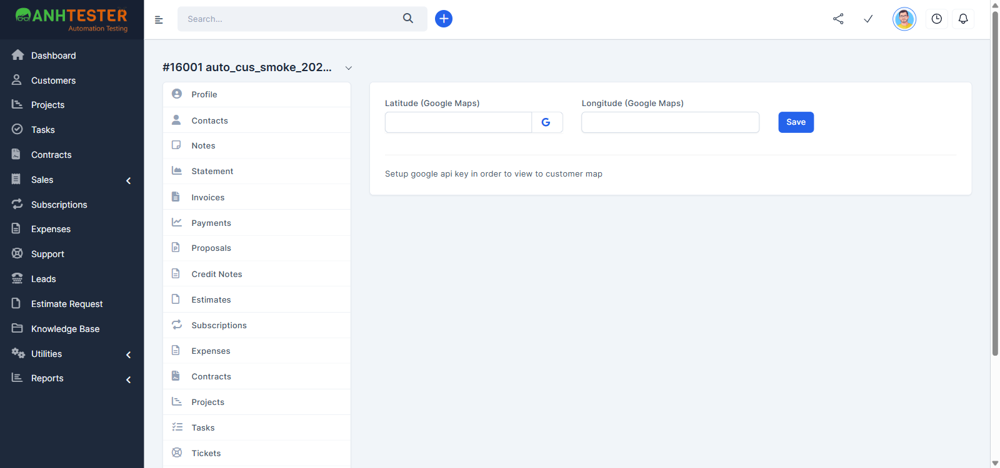

# Execution Report — Customers · Checklist Smoke

| Thông tin | Nội dung |
|---|---|
| Run ID | run_1794468325 |
| Nền tảng | `web` |
| Loại nguồn | `Checklist smoke` · `CL-smoke_20261112` |
| Nguồn checklist | [`docs/checklists/customers/web/checklist_smoke_20261112.md`](../../../../checklists/customers/web/checklist_smoke_20261112.md) |
| Phạm vi | 19 mục (toàn bộ checklist) · không có mục `@Deprecated` |
| Môi trường | `https://crm.anhtester.com/admin` — môi trường demo dùng chung (Perfex CRM) |
| Build / Version | Không xác định |
| Tài khoản | Admin (tester tự đăng nhập sẵn trước khi chạy) |
| Người thực hiện | Tester (agent hỗ trợ) |
| Bắt đầu → Kết thúc | 12-11-2026 14:25 → 14:32 |
| Môi trường dùng chung? | Có — không thực hiện Mass Delete; dữ liệu dọn bằng xoá từng KH sau khi kiểm đúng tên |

## 1. Tổng kết

| Trạng thái | Số lượng | Tỷ lệ |
|---|---|---|
| ✅ PASS | 17 | 89.5% |
| ❌ FAIL | 1 | 5.3% |
| ⚠️ BLOCKED | 1 | 5.3% |
| ⏭️ SKIPPED | 0 | 0% |
| **Tổng** | **19** | 100% |

> **Pass rate (không tính SKIPPED):** 17/19 = 89.5%
>
> Kết quả checklist **không** cộng vào pass rate của bộ TC.

## 2. Kết quả từng mục

| TC ID | Hạng mục kiểm tra | Kết quả | Priority | REQ ID | TC ID liên quan | Ghi chú |
|---|---|---|---|---|---|---|
| CL-smoke_20261112-01 | Menu Customers, khối Summary, thanh nút đầu trang | ✅ PASS | P1 | REQ-CUS-01, REQ-CUS-05 | CRM_CUS_TC_001 | — |
| CL-smoke_20261112-02 | Thanh công cụ và bảng KH mặc định | ✅ PASS | P2 | REQ-CUS-06, REQ-CUS-08, REQ-CUS-09, REQ-CUS-10, REQ-CUS-11 | CRM_CUS_TC_002 | 25 dòng đầu có Company rỗng (dữ liệu nền) nên không chứng minh được thứ tự chữ cái; mũi tên sắp xếp tăng dần có mặt và thứ tự không vi phạm |
| CL-smoke_20261112-03 | Form tạo KH, tab `Customer Details` | ✅ PASS | P2 | REQ-CUS-28, REQ-CUS-29, REQ-CUS-40, REQ-CUS-44, REQ-CUS-46, REQ-CUS-47 | CRM_CUS_TC_003 | — |
| CL-smoke_20261112-04 | Tab `Billing & Shipping` và tooltip | ✅ PASS | P3 | REQ-CUS-51 | CRM_CUS_TC_004 | `@NeedsVerify`: 8 ô chữ trống, 2 ô Country hiện `Nothing selected` — đã xác nhận, đề nghị gỡ `@NeedsVerify` |
| CL-smoke_20261112-05 | Tạo KH A (chỉ Company) | ✅ PASS | P1 | REQ-CUS-48 | CRM_CUS_TC_006 | KH A = id 16001 |
| CL-smoke_20261112-06 | Tạo KH B (đủ 12 field) | ✅ PASS | P1 | REQ-CUS-48, REQ-CUS-29 | CRM_CUS_TC_007 | KH B = id 16002; nhóm `customer group b` có sẵn |
| CL-smoke_20261112-07 | Tìm KH B, đối chiếu dòng | ✅ PASS | P1 | REQ-CUS-50, REQ-CUS-12, REQ-CUS-18, REQ-CUS-19 | CRM_CUS_TC_008 | Date Created `12-11-2026 14:27:34` |
| CL-smoke_20261112-08 | `Save and create contact` rồi đóng hộp thoại | ✅ PASS | P2 | REQ-CUS-49 | CRM_CUS_TC_009 | KH = id 16003. Sau `×` thanh địa chỉ đổi về `/admin/clients/client/16003` (mất `?group=contacts&new_contact=true`) — checklist không quy định |
| CL-smoke_20261112-09 | Hồ sơ KH A: menu 19 mục, tiêu đề, menu `⌄` | ✅ PASS | P2 | REQ-CUS-55, REQ-CUS-56, REQ-CUS-60 | CRM_CUS_TC_010 | — |
| CL-smoke_20261112-10 | Tab con Profile và chân form | ✅ PASS | P2 | REQ-CUS-57, REQ-CUS-58 | CRM_CUS_TC_011 | — |
| CL-smoke_20261112-11 | Tab `Notes`, bấm `New Note` hai lần | ✅ PASS | P3 | REQ-CUS-96, REQ-CUS-97 | CRM_CUS_TC_014 | — |
| CL-smoke_20261112-12 | Tab `Files` | ✅ PASS | P3 | REQ-CUS-103 | CRM_CUS_TC_015 | Không đối chiếu nút Google Drive (`ASM-CUS-01`) |
| CL-smoke_20261112-13 | Tab `Statement` | ✅ PASS | P2 | REQ-CUS-113, REQ-CUS-114, REQ-CUS-118 | CRM_CUS_TC_016 | — |
| CL-smoke_20261112-14 | Tab `Vault`, hộp thoại `Vault Entry` | ✅ PASS | P2 | REQ-CUS-123, REQ-CUS-124 | CRM_CUS_TC_017 | Bấm `Close`, không `Save` |
| CL-smoke_20261112-15 | Tab `Map` | ❌ FAIL | P3 | REQ-CUS-135 | CRM_CUS_TC_018 | Thiếu nút `Open in Google Map` — xem chi tiết #1 |
| CL-smoke_20261112-16 | Sửa 11 field KH A, Save, F5 | ✅ PASS | P1 | REQ-CUS-59, REQ-CUS-60 | CRM_CUS_TC_012 | Toast `Customer updated successfully.` |
| CL-smoke_20261112-17 | Trang `Import Customers` | ✅ PASS | P2 | REQ-CUS-83, REQ-CUS-84, REQ-CUS-85 | CRM_CUS_TC_013 | Không bấm nút nào ở cuối form |
| CL-smoke_20261112-18 | Hộp thoại `Bulk Actions` và `Add New Customer Group` | ✅ PASS | P2 | REQ-CUS-41, REQ-CUS-75 | CRM_CUS_TC_019 | `@NeedsVerify`: phím `Esc` **không** đóng cả 2 hộp thoại. Bulk Actions mặc định `Mass Delete` bỏ tích, `Groups` = `Nothing selected`. Không bấm `Confirm` / `Save` |
| CL-smoke_20261112-19 | Xoá KH A | ⚠️ BLOCKED | P1 | REQ-CUS-70, REQ-CUS-71 | CRM_CUS_TC_079, CRM_CUS_TC_080 | Xem mục 4 |

## 3. Chi tiết mục FAIL

### FAIL #1 — CL-smoke_20261112-15 · Tab `Map`

| | |
|---|---|
| REQ ID | REQ-CUS-135 |
| Priority | P3 |
| TC ID liên quan | CRM_CUS_TC_018 |
| Bước fail | Đối chiếu trang `?group=map` của KH A (chưa lưu toạ độ) |
| **Expected** | Cùng một hàng: ô `Latitude (Google Maps)` (có nút `G`) · ô `Longitude (Google Maps)` · nút `Save` · nút `Open in Google Map`; dưới hàng có dòng `Setup google api key in order to view to customer map` |
| **Actual** | Hàng chỉ có ô Latitude (nút `G`), ô Longitude và nút `Save`; **không có** nút `Open in Google Map` (không tồn tại trong DOM, không phải bị ẩn bằng CSS). Hai ô toạ độ trống. Dòng `Setup google api key…` hiện đúng |
| Evidence |  |
| Tái hiện được? | Chưa thử lại; DOM xác nhận nút không có |
| Ghi chú | Checklist gắn `@NeedsVerify` cho trạng thái toạ độ trống. Nhiều khả năng nút chỉ hiện khi KH đã có toạ độ. **Đối chiếu lại TC bằng `/review-testcases` trước khi báo bug** — chưa kết luận được lỗi hệ thống hay Expected sai |

## 4. Mục BLOCKED

| TC ID | Nguyên nhân chặn | Cần gì để chạy được |
|---|---|---|
| CL-smoke_20261112-19 | Phần kiểm chứng được đã khớp: hộp xác nhận hiện đúng `Are you sure you want to perform this action?`; sau `OK` chuyển về `/admin/clients`; KH A (id 16001) biến mất khỏi danh sách và tổng KH trở lại số ban đầu. **Riêng thông báo `Customer deleted` không quan sát được** — thông báo đã tắt trước khi script đọc (lỗi thao tác của người chạy, không phải lỗi hệ thống). KH A đã xoá nên không chạy lại được trên KH A | Chạy lại mục 19 trên một KH mới, đọc thông báo ngay sau `OK` |

## 5. Dữ liệu đã tạo & dọn dẹp

| Dữ liệu | ID | Nơi tạo | Đã xoá? |
|---|---|---|---|
| KH A: `auto_cus_smoke_20261112_05` → đổi tên `_16e` ở mục 16 | 16001 | /admin/clients | ✅ Xoá ở mục 19 |
| KH B: `auto_cus_smoke_20261112_06` | 16002 | /admin/clients | ✅ Xoá từng KH ở bước dọn |
| KH mục 8: `auto_cus_smoke_20261112_08` | 16003 | /admin/clients | ✅ Xoá từng KH ở bước dọn |

> Trước khi xoá đã đối chiếu đúng tên và id từng KH. Không dùng `Mass Delete` vì môi trường dùng chung. Tìm `auto_cus_smoke_20261112` cho kết quả 0 dòng. `Total Customers` trước 2953 → sau 2953 ✅ môi trường trả về nguyên trạng. Không tạo nhóm KH hay dữ liệu nào khác.

## 6. Đề xuất bước tiếp theo

- **CL-smoke_20261112-15** (P3): chạy `/review-testcases` mode FIX để xác định `CRM_CUS_TC_018` có cần sửa Expected (nút `Open in Google Map` chỉ hiện khi có toạ độ?). Nếu TC đúng thì mới `/create-bug-report`.
- **CL-smoke_20261112-19** (P1): chạy lại trên một KH mới để xác nhận thông báo `Customer deleted`.
- `@NeedsVerify` đã xác nhận ở mục 4 (đề nghị gỡ tag) và mục 18 (`Esc` không đóng hộp thoại — cần ghi vào TC `CRM_CUS_TC_019`).
- Mục 2: dữ liệu nền có 25 dòng đầu Company rỗng — nếu cần chứng minh sắp xếp theo chữ, chạy `CRM_CUS_TC_023` → `040` bằng bộ TC.
