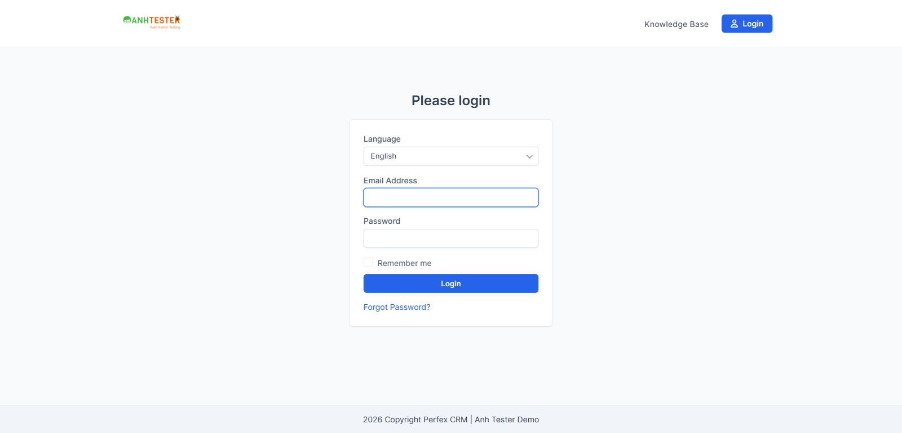

# Execution Report — Login · Smoke

| Thông tin | Nội dung |
|---|---|
| Run ID | run_1792568115 |
| Nền tảng | `web` |
| Loại nguồn | `Bộ TC` |
| Nguồn TC | docs/testcases/login/web/parts/part_01_web_smoke_form_login.md (001–008) · docs/testcases/login/web/parts/part_03_web_technical_nonfunc.md (049) |
| Phạm vi | 9 TC tag `@Smoke` (001 → 008 · 049) · loại 0 TC `@Deprecated` |
| Môi trường | `https://crm.anhtester.com` — demo công khai |
| Build / Version | (không có thông tin) |
| Tài khoản | Tài khoản Admin trong `.env` (role Admin) — **người dùng tự nhập** thông tin đăng nhập ở TC_006, agent chỉ quan sát |
| Người thực hiện | tnphonglan (agent hỗ trợ) |
| Bắt đầu → Kết thúc | 21-10-2026 14:35 → 14:41 (không tính thời gian chờ người dùng đăng nhập) |
| Môi trường dùng chung? | Có — auto-skip TC phá huỷ đang BẬT (không TC nào trong phạm vi bị skip) |
| Trình duyệt | Google Chrome qua Playwright MCP, headed · viewport 1600×780 đo bằng `innerWidth × innerHeight`, không resize. Từ TC_001 chạy trên **context Chrome sạch** riêng, viewport 1600×770 — xem Ghi chú môi trường |

### Ghi chú môi trường

- Profile Playwright dùng chung còn phiên đăng nhập cũ (cookie phiên + cookie ghi nhớ `autologin` — `RISK-LOGIN-07`), lại có **mật khẩu đã lưu** nên trình duyệt tự điền ô Email và Password (`RISK-LOGIN-02`). Đã kiểm HTML máy chủ trả về, không có giá trị điền sẵn, nên nguyên nhân là profile.
- Để dựng đúng Pre-Condition *"cửa sổ ẩn danh mới, không cookie, không mật khẩu đã lưu"*, agent mở một context trình duyệt sạch trong cùng Chrome và xoá cookie của context này trước mỗi TC có Pre-Condition đó. Agent cũng đã **xoá cookie của profile chính** (gồm `autologin`), nên profile đó không còn đăng nhập sẵn. Mật khẩu đã lưu trong profile **vẫn còn**.
- Context sạch bị người dùng đăng nhập trước giờ (người dùng xác nhận). Agent đã xoá phiên và chạy lại từ TC_001, kết quả không bị ảnh hưởng.

## 1. Tổng kết

| Trạng thái | Số lượng | Tỷ lệ |
|---|---|---|
| ✅ PASS | 8 | 88.9% |
| ❌ FAIL | 1 | 11.1% |
| ⚠️ BLOCKED | 0 | 0% |
| ⏭️ SKIPPED | 0 | 0% |
| **Tổng** | **9** | 100% |

> **Pass rate (không tính SKIPPED):** 8/9 = 88.9% · 3 TC `@CriticalPath` (006 · 008 · 049) đều PASS — luồng đăng nhập, đăng xuất và chặn truy cập hoạt động.

## 2. Kết quả từng TC

| TC ID | Test Scenario | Kết quả | Bước fail | Ghi chú |
|---|---|---|---|---|
| CRM_LOGIN_TC_001 | Trang Login hiển thị đủ thành phần, đúng nhãn, đúng trạng thái mặc định | ✅ PASS | — | 6/6 mục Bảng kiểm đạt: thứ tự logo `ANHTESTER Automation Testing` → `Login` → `Email Address` → `Password` → `Remember me` → nút xanh `Login` → `Forgot Password?`. Hai ô trống, không chữ gợi ý. Không có ô "Tôi không phải người máy", không có bộ chọn ngôn ngữ. Tiêu đề tab có `Login`. Ô Email có viền xanh, đang được chọn sẵn. Evidence: `evidence/CRM_LOGIN_TC_001_login_mac_dinh.png` |
| CRM_LOGIN_TC_002 | Ô Password che ký tự đã gõ và không có nút hiện mật khẩu | ✅ PASS | — | Gõ 15 ký tự thì ô hiện 15 dấu chấm tròn. Trong ô và sát bên phải không có biểu tượng nào. Evidence: `evidence/CRM_LOGIN_TC_002_o_password_che.png` |
| CRM_LOGIN_TC_003 | Trang Forgot Password hiển thị đủ thành phần, đúng nhãn, đúng trạng thái mặc định | ✅ PASS | — | 5/5 mục Bảng kiểm đạt: logo → `Forgot Password` → ô `Email Address` → nút xanh `Confirm`. Ô trống, không có viền chọn. Liên kết duy nhất trên trang là logo, không có ô "Tôi không phải người máy". Evidence: `evidence/CRM_LOGIN_TC_003_forgot_mac_dinh.png` |
| CRM_LOGIN_TC_004 | Liên kết "Forgot Password?" mở trang Forgot Password | ✅ PASS | — | Chuyển trang trong cùng tab. Đích là `/admin/authentication/forgot_password`, có tiêu đề `Forgot Password`, ô `Email Address`, nút `Confirm` |
| CRM_LOGIN_TC_005 | Logo trên trang Login là liên kết về trang chủ phía khách hàng | ❌ FAIL | 4 | `@NeedsVerify`: Expected chưa có evidence, cần đối chiếu lại TC trước khi báo bug. Xem chi tiết FAIL #1 |
| CRM_LOGIN_TC_006 | Đăng nhập thành công bằng tài khoản Admin hợp lệ, không tích Remember me | ✅ PASS | — | Người dùng tự nhập thông tin đăng nhập, agent quan sát. Trang đích `/admin/`, tiêu đề tab `Dashboard`, có menu bên trái và ảnh đại diện góc trên phải, không có khung đỏ. Bước 4 kiểm gián tiếp: không có mục ghi nhớ đăng nhập, nghĩa là ô Remember me không được tích. Evidence: `evidence/CRM_LOGIN_TC_006_header_dashboard.png` (chỉ dải header) |
| CRM_LOGIN_TC_007 | Menu ảnh đại diện trên header có đủ 5 mục, mục cuối là Logout | ✅ PASS | — | Menu mở ngay dưới ảnh đại diện, có đúng 5 mục theo thứ tự `My Profile` · `My Timesheets` · `Edit Profile` · `Language` ► · `Logout`. Evidence: `evidence/CRM_LOGIN_TC_007_menu_avatar.png` (cắt góc phải trên) |
| CRM_LOGIN_TC_008 | Bấm Logout đưa người dùng về trang Login | ✅ PASS | — | Pre-Condition đạt: không có bộ đếm giờ chấm công nào đang chạy. Bấm `Logout` thì đăng xuất ngay, không có hộp thoại xác nhận. Trang đích `/admin/authentication`, tiêu đề `Login`, có form, không có khung đỏ. Ngoài phạm vi TC: cookie phiên đổi sau đăng xuất. Evidence: `evidence/CRM_LOGIN_TC_008_sau_logout.png` |
| CRM_LOGIN_TC_049 | Chưa đăng nhập mở trang nội bộ bị đưa về trang Login | ✅ PASS | — | 4/4 biến thể (`a` `/admin/` · `b` `/admin/clients` · `c` `/admin/invoices/invoice` · `d` `/admin/profile`) đều dừng ở `/admin/authentication`, tiêu đề `Login`, có form đăng nhập. Không có khung đỏ, không có menu bên trái, không lộ dữ liệu nội bộ |

## 3. Chi tiết TC FAIL

### FAIL #1 — CRM_LOGIN_TC_005 · Logo trên trang Login là liên kết về trang chủ phía khách hàng

| | |
|---|---|
| REQ ID | REQ-LOGIN-06 |
| Priority | Low |
| Bước fail | Bước 4. Bước 1–3 PASS: rê chuột lên logo thì con trỏ đổi thành bàn tay, liên kết trỏ tới gốc `https://crm.anhtester.com/` (không có `/admin/`), bấm thì trình duyệt chuyển trang |
| **Expected** | Thanh địa chỉ là trang gốc `/` — trang chủ phía khách hàng, **không** phải trang quản trị |
| **Actual** | Thanh địa chỉ là `/authentication/login`. Trang này là trang đăng nhập của cổng khách hàng: tiêu đề `Please login`, có ô `Language`, `Email Address`, `Password`, `Remember me`, nút `Login`, liên kết `Forgot Password?`, thanh trên có `Knowledge Base` và nút `Login`. Không phải trang quản trị (không có menu bên trái) |
| 🔧 Ghi chú kỹ thuật | Trang gốc `/` khi chưa đăng nhập tự chuyển hướng sang `/authentication/login` |
| Evidence |  |
| Tái hiện được? | Có — kiểm lại riêng địa chỉ `/` cho cùng kết quả chuyển hướng |
| Đánh giá | Ý định của REQ-06 vẫn đạt: logo đưa người dùng ra phía khách hàng, không vào khu quản trị. Chỗ lệch là TC đoán trang đích dừng ở `/` (`ASM-LOGIN-06`, chưa có evidence). **Đề xuất sửa TC, không báo bug** |
| Bước bị chặn khác | Bước 2 *"góc dưới bên trái trình duyệt hiện địa chỉ đích"*: thanh trạng thái của trình duyệt không chụp được qua công cụ. Đã kiểm qua địa chỉ đích của liên kết, là thứ thanh trạng thái hiển thị |

## 4. TC BLOCKED

| TC ID | Nguyên nhân chặn | Cần gì để chạy được |
|---|---|---|
| — | Không có | — |

## 5. Dữ liệu đã tạo & dọn dẹp

| Dữ liệu | ID | Nơi tạo | Đã xoá? |
|---|---|---|---|
| Không tạo bản ghi nào | — | — | — |
| Phiên đăng nhập của tài khoản Admin trong context sạch | — | `/admin/authentication` | ✅ Đã đăng xuất ở TC_008, context đã đóng |
| Cookie của profile Playwright chính (phiên cũ + `autologin`) | — | profile trình duyệt máy QA | ✅ Đã xoá khi dựng Pre-Condition. Phiên phía máy chủ của cookie cũ không bị đăng xuất chủ động, sẽ tự hết hạn |

> Chỉ thao tác đăng nhập / đăng xuất, không ghi dữ liệu nghiệp vụ nào, môi trường dùng chung giữ nguyên trạng.

## 6. Đề xuất bước tiếp theo

- **FAIL #1 (TC_005, `@NeedsVerify`)** → sửa TC bằng `/review-testcases` mode FIX: Expected bước 4 đổi thành *"Rời khu quản trị, sang trang phía khách hàng (hiện tại là trang `Please login` tại `/authentication/login`)"*, ghi evidence `evidence/CRM_LOGIN_TC_005_trang_dich_logo.png`, gỡ `@NeedsVerify`, cập nhật `ASM-LOGIN-06`. Đề xuất ban đầu là **không** chạy `/create-bug-report`. QA vẫn yêu cầu báo bug (21-10-2026) → [`BUG_login_1792569135_TC005`](../../../../bugs/login/web/BUG_login_1792569135_TC005.md) (Trivial · P3, chờ PO chốt có phải lỗi). Bug đã tái hiện 2/2 lần, ảnh `evidence/CRM_LOGIN_TC_005_tai_hien_bug.png`.
- **Môi trường chạy:** xoá mật khẩu đã lưu khỏi profile Playwright (Chrome → Settings → Password Manager) hoặc luôn chạy trên context sạch. Nếu không, mọi TC kiểm ô trống (001, 010, 014, 018, 019…) sẽ đỏ oan theo `RISK-LOGIN-02`.
- Smoke đã xanh, trừ TC_005 cấp Low. Có thể chạy tiếp Part 1 (TC_009 → 025: validation form Login, không cần đăng nhập thật).
