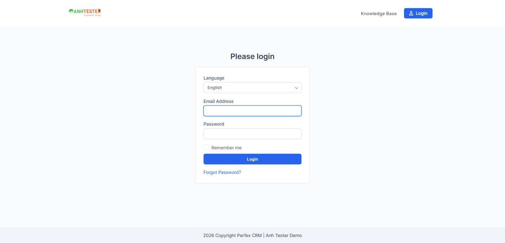
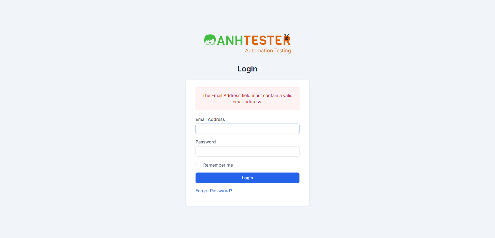
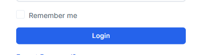
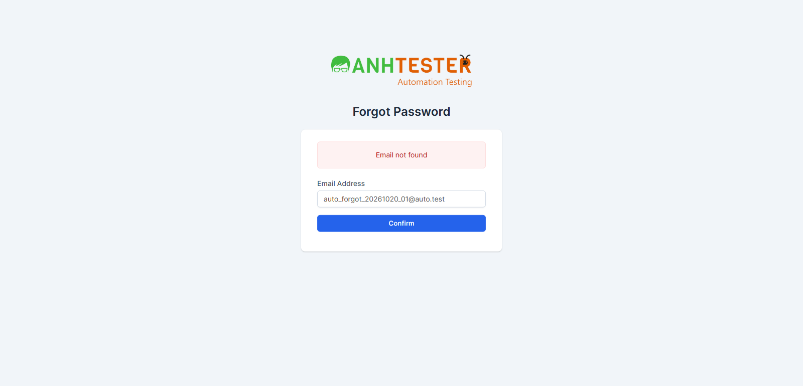
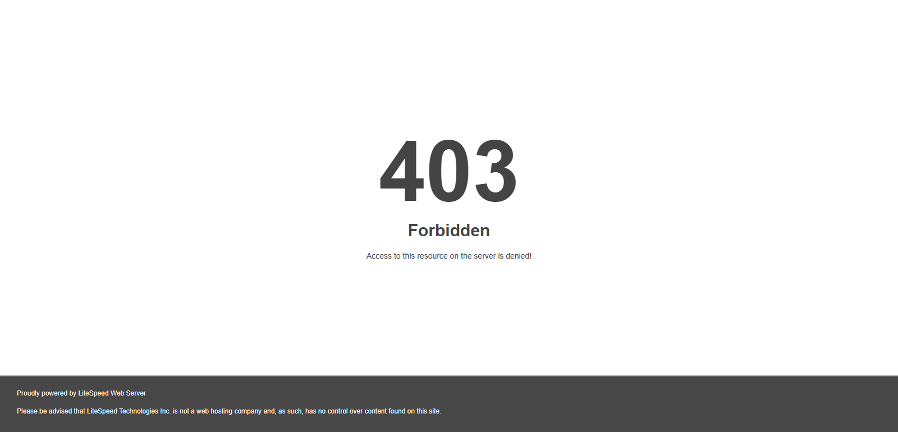

# Execution Report — Login · Toàn bộ bộ TC web

| Thông tin | Nội dung |
|---|---|
| Run ID | run_1792570380 |
| Nền tảng | `web` |
| Loại nguồn | `Bộ TC` |
| Nguồn TC | docs/testcases/login/web/parts/part_01_web_smoke_form_login.md · part_02_web_forgot_phien.md · part_03_web_technical_nonfunc.md |
| Phạm vi | 65 TC (toàn bộ `CRM_LOGIN_TC_001` → `065`) · loại 0 TC `@Deprecated` |
| Môi trường | `https://crm.anhtester.com` — demo công khai |
| Build / Version | (không có thông tin) |
| Tài khoản | Tài khoản Admin trong `.env` (role Admin) — **người dùng tự nhập** thông tin đăng nhập ở các TC cần đăng nhập, agent chỉ quan sát |
| Người thực hiện | tnphonglan (agent hỗ trợ) |
| Bắt đầu → Kết thúc | 21-10-2026 15:13 → 15:44 (31 phút, gồm thời gian chờ người dùng đăng nhập 6 lần) |
| Môi trường dùng chung? | Có — auto-skip TC phá huỷ đang BẬT |
| Trình duyệt | Google Chrome qua Playwright MCP, headed. Chạy trên **context Chrome sạch** riêng (viewport 1600×770, không cookie, không mật khẩu đã lưu), xoá cookie của context trước mỗi TC có Pre-Condition *"cửa sổ ẩn danh mới"* |

### Ghi chú môi trường

- Profile Playwright chính vẫn có **mật khẩu đã lưu** (trình duyệt tự điền 2 ô ở trang Login — `RISK-LOGIN-02`), nên mọi TC chạy trên context sạch.
- Lần mở trang Login đầu tiên trên context sạch (15:13) máy chủ trả `HTTP ERROR 500`; nạp lại thì trả 200 bình thường. `curl` cùng lúc trả 200. Coi là lỗi thoáng qua của máy chủ demo, không gắn vào TC nào.
- Các TC cần đăng nhập được gom theo phiên để giảm số lần người dùng phải nhập mật khẩu: phiên TC_006 dùng tiếp cho 007 · 038 · 039 · 055 · 056 · 060 · 008 · 044 · 045; phiên TC_020-a cho 047; phiên TC_020-b cho 042; phiên TC_040 cho 041 · 043. Ô Ghi chú của từng TC nêu rõ TC chạy trên phiên nào.
- TC_064 chạy mỗi kích thước trong một context riêng có khung nhìn giả lập — cửa sổ chính **không** bị resize. TC_065-a chạy trên Microsoft Edge thật (Playwright mở bằng kênh `msedge`).

## 1. Tổng kết

| Trạng thái | Số lượng | Tỷ lệ |
|---|---|---|
| ✅ PASS | 46 | 70.8% |
| ❌ FAIL | 7 | 10.8% |
| ⚠️ BLOCKED | 11 | 16.9% |
| ⏭️ SKIPPED | 1 | 1.5% |
| **Tổng** | **65** | 100% |

> **Pass rate (không tính SKIPPED):** 46/64 = 71.9% · Trên số TC chạy được tới kết luận (PASS + FAIL): 46/53 = 86.8%.
>
> 3 TC `@CriticalPath` (006 · 008 · 049) đều PASS. Trong 7 FAIL: 1 là `@KnownBug` FAIL đúng dự kiến (028) · 2 là `@NeedsVerify` (005 · 062) · 2 lệch so với giả định của TC (015-b · 016, cùng một nguyên nhân) · 1 do tường lửa máy chủ (053-d) · 1 lỗi giao diện thật (021, cùng nguyên nhân với 062). 10/11 BLOCKED là `@Skip` chờ tài khoản/điều kiện; 065 BLOCKED vì máy chưa có Firefox.
>
> So với run_1792568115 (Smoke, cùng ngày): 9 TC `@Smoke` cho cùng kết quả — 005 vẫn FAIL như cũ, 8 TC còn lại vẫn PASS.

## 2. Kết quả từng TC

| TC ID | Test Scenario | Kết quả | Bước fail | Ghi chú |
|---|---|---|---|---|
| CRM_LOGIN_TC_001 | Trang Login hiển thị đủ thành phần, đúng nhãn, đúng trạng thái mặc định | ✅ PASS | — | 6/6 mục Bảng kiểm đạt: thứ tự logo `ANHTESTER Automation Testing` → `Login` → `Email Address` → `Password` → `Remember me` → nút xanh `Login` → `Forgot Password?`. Hai ô trống, không chữ gợi ý. Remember me chưa tích. Tiêu đề tab `Perfex CRM \| Anh Tester Demo - Login`. Không có ô "Tôi không phải người máy", không có bộ chọn ngôn ngữ. Ô Email đang được chọn, viền xanh. Evidence: `evidence/CRM_LOGIN_TC_001_login_mac_dinh.png` |
| CRM_LOGIN_TC_002 | Ô Password che ký tự đã gõ và không có nút hiện mật khẩu | ✅ PASS | — | Gõ 15 ký tự, ô hiện 15 dấu chấm tròn (`type=password`). Trong ô và bên phải không có biểu tượng hay nút nào. Evidence: `evidence/CRM_LOGIN_TC_002_o_password_che.png` |
| CRM_LOGIN_TC_003 | Trang Forgot Password hiển thị đủ thành phần, đúng nhãn, đúng trạng thái mặc định | ✅ PASS | — | 5/5 mục đạt: logo → `Forgot Password` → ô `Email Address` → nút xanh `Confirm`. Ô trống, không chữ gợi ý, không có viền chọn (không ô nào được chọn sẵn). Liên kết duy nhất là logo. Không có ô "Tôi không phải người máy". Evidence: `evidence/CRM_LOGIN_TC_003_forgot_mac_dinh.png` |
| CRM_LOGIN_TC_004 | Liên kết "Forgot Password?" mở trang Forgot Password | ✅ PASS | — | Chuyển trang trong cùng tab, đích `/admin/authentication/forgot_password`, có tiêu đề `Forgot Password`, ô `Email Address`, nút `Confirm` |
| CRM_LOGIN_TC_005 | Logo trên trang Login là liên kết về trang chủ phía khách hàng | ❌ FAIL | 4 | `@NeedsVerify`: Expected chưa có evidence, cần đối chiếu lại TC trước khi báo bug. Cùng kết quả với run_1792568115. Xem chi tiết FAIL #1 |
| CRM_LOGIN_TC_006 | Đăng nhập thành công bằng tài khoản Admin hợp lệ, không tích Remember me | ✅ PASS | — | Người dùng tự nhập thông tin đăng nhập, agent quan sát. Trang đích `/admin/`, tiêu đề tab `Dashboard`, có menu bên trái và ảnh đại diện góc trên phải, không có khung đỏ. Bước 4: không có cookie `autologin` → ô Remember me không được tích |
| CRM_LOGIN_TC_007 | Menu ảnh đại diện trên header có đủ 5 mục, mục cuối là Logout | ✅ PASS | — | Menu mở ngay dưới ảnh đại diện, đúng 5 mục theo thứ tự `My Profile` · `My Timesheets` · `Edit Profile` · `Language` ► · `Logout`. Evidence: `evidence/CRM_LOGIN_TC_007_menu_avatar.png` (cắt góc phải trên) |
| CRM_LOGIN_TC_008 | Bấm Logout đưa người dùng về trang Login | ✅ PASS | — | Cùng lần Logout với TC_060. Menu có `Logout`; đăng xuất ngay, không có hộp thoại. Đích `/admin/authentication`, tiêu đề `Login`, có form, không có khung đỏ. Evidence: `evidence/CRM_LOGIN_TC_008_sau_logout.png` |
| CRM_LOGIN_TC_009 | Bỏ trống Email Address bị từ chối với thông báo bắt buộc | ✅ PASS | — | Form được gửi (trình duyệt không chặn), trang nạp lại. Vẫn ở `/admin/authentication`, đúng 1 khung nền đỏ nhạt chữ đỏ `The Email Address field is required.` |
| CRM_LOGIN_TC_010 | Bỏ trống Password bị từ chối với thông báo bắt buộc | ✅ PASS | — | Đúng 1 khung đỏ `The Password field is required.` Ô Email trống lại sau khi nạp (REQ-14) |
| CRM_LOGIN_TC_011 | Bỏ trống cả hai ô hiển thị đồng thời hai thông báo bắt buộc | ✅ PASS | — | 2 khung đỏ riêng biệt: `The Password field is required.` và `The Email Address field is required.` |
| CRM_LOGIN_TC_012 | Email Address chỉ gồm khoảng trắng được xử lý như bỏ trống | ✅ PASS | — | `@NeedsVerify`: đã xác nhận trên UI — đề nghị gỡ `@NeedsVerify`. Trình duyệt không chặn, trang nạp lại, đúng 1 khung đỏ `The Email Address field is required.` |
| CRM_LOGIN_TC_013 | Password chỉ gồm khoảng trắng được xử lý như bỏ trống | ✅ PASS | — | `@NeedsVerify`: đã xác nhận trên UI — đề nghị gỡ `@NeedsVerify`. Ô Password hiện 3 dấu chấm, sau khi gửi hiện đúng 1 khung đỏ `The Password field is required.` |
| CRM_LOGIN_TC_014 | Email Address sai định dạng bị trình duyệt chặn, form không gửi đi | ✅ PASS | — | 6/6 biến thể bị trình duyệt chặn (có thông báo kiểm tra của trình duyệt), trang không nạp lại, không có khung đỏ, ô Email giữ nguyên chuỗi, ô Password còn 15 dấu chấm |
| CRM_LOGIN_TC_015 | Email đúng định dạng nhưng không tồn tại bị từ chối với thông báo chung | ❌ FAIL | 5 · biến thể `b` | Biến thể `a`, `c`, `d` PASS. Xem chi tiết FAIL #2 |
| CRM_LOGIN_TC_016 | Email Address rất dài vẫn được xử lý bình thường, không gây lỗi trang | ❌ FAIL | 6 · biến thể `a`, `b`, `c`, `d` | Bước 3 PASS (đuôi `@auto.test` còn nguyên ở cả 4 độ dài). Không có lỗi máy chủ. Thông báo khác Expected. Xem chi tiết FAIL #3 |
| CRM_LOGIN_TC_017 | Password với độ dài cực trị và ký tự đặc biệt được xử lý bình thường | ✅ PASS | — | 5/5 biến thể: ô Password là kiểu che ký tự (kể cả có dấu, emoji), gửi đi trả 200, đúng 1 khung đỏ `Invalid email or password`, không có trang lỗi máy chủ |
| CRM_LOGIN_TC_018 | Sau khi đăng nhập lỗi, ô Email Address bị xoá trống | ✅ PASS | — | `a` → `The Password field is required.` · `b` → `Invalid email or password`; cả hai ô Email trống sau khi nạp. 🔧 Đã kiểm: thẻ ô email sau khi nạp **không** có thuộc tính `value` (đọc thuộc tính trên DOM vừa nạp, thay cho View Source) |
| CRM_LOGIN_TC_019 | Sau khi đăng nhập lỗi, ô Password bị xoá trống | ✅ PASS | — | `a` → `Invalid email or password` · `b` → `The Email Address field is required.`; cả hai ô Password trống, không còn dấu chấm |
| CRM_LOGIN_TC_020 | Email Address viết HOA hoặc thừa khoảng trắng đầu/cuối vẫn đăng nhập được | ✅ PASS | — | `@NeedsVerify`: đã xác nhận trên UI — đề nghị gỡ `@NeedsVerify`. `a` (người dùng nhập email viết HOA): vào `/admin/`, tiêu đề `Dashboard`, có menu — agent không đo dữ liệu gửi đi ở lần này. `b`: lần 1–2 bị từ chối do ô **Password** gõ thừa 2 ký tự (đo được: giá trị gửi đi dài hơn `PASSWORD_ADMIN` 2 ký tự) — lần chạy không hợp lệ, không tính. Lần 3: vào `/admin/`, tiêu đề `Dashboard`. 🔧 Trình duyệt tự cắt khoảng trắng đầu/cuối của ô email (giá trị gửi đi 17 ký tự, không có dấu cách) — máy chủ không nhận được khoảng trắng |
| CRM_LOGIN_TC_021 | Ô Remember me tích/bỏ tích được bằng chuột và bằng phím Space | ❌ FAIL | 4 | Bước 1–3 và 5 PASS: chưa tích → tích → bỏ tích bằng chuột; Space tích được, không gửi form. Bước 4: focus đã tới ô Remember me nhưng **không có viền chọn nhìn thấy được**. Xem chi tiết FAIL #4 |
| CRM_LOGIN_TC_022 | Nhấn Enter trong ô Password gửi form đăng nhập như bấm nút Login | ✅ PASS | — | Enter gửi form, trang nạp lại (200), đúng 1 khung đỏ `Invalid email or password` |
| CRM_LOGIN_TC_023 | Ô Password cho dán vào nhưng không cho sao chép nội dung ra | ✅ PASS | — | Dán được: ô Password 10 dấu chấm, gõ thêm `X9` → 12 dấu chấm. Sau Ctrl+A/Ctrl+C trong ô Password rồi dán vào ô Email, ô Email là `PasteMe_01` (nội dung cũ của bộ nhớ tạm), không phải `PasteMe_01X9` |
| CRM_LOGIN_TC_024 | Bấm nút Login hai lần liên tiếp thật nhanh không gây lỗi trang | ✅ PASS | — | Bấm đúp nhanh vào nút Login, lặp 3 lần: mỗi lần chỉ 1 yêu cầu gửi đi, trang nạp lại bình thường, đúng 1 khung đỏ `Invalid email or password`, không có trang lỗi. Ngoài phạm vi TC: nếu cú bấm thứ hai rơi vào lúc trang **đã nạp xong** (form trống) thì hiện 2 khung bắt buộc nhập, là hành vi đúng của form trống |
| CRM_LOGIN_TC_025 | Mất mạng khi bấm Login, có mạng lại thì gửi lại được bình thường | ✅ PASS | — | 🔧 Giả lập mất mạng bằng chế độ offline của trình duyệt (tương đương DevTools → Network → Offline). Bấm Login → trình duyệt báo ngay `ERR_INTERNET_DISCONNECTED`, không treo. Có mạng lại, mở lại trang Login bình thường, gửi lại → 1 khung đỏ `Invalid email or password`. Evidence: `evidence/CRM_LOGIN_TC_025_mat_mang.png` |
| CRM_LOGIN_TC_026 | Forgot Password: bỏ trống email nhận thông báo "Email not found" | ✅ PASS | — | Trình duyệt không chặn, trang nạp lại, đúng 1 khung đỏ `Email not found` |
| CRM_LOGIN_TC_027 | Forgot Password: email sai định dạng bị trình duyệt chặn, form không gửi đi | ✅ PASS | — | 4/4 biến thể bị trình duyệt chặn, trang không nạp lại, không có khung đỏ, ô Email giữ nguyên chuỗi |
| CRM_LOGIN_TC_028 | Forgot Password: email không tồn tại nhận thông báo trung tính | ❌ FAIL | 4 | `@KnownBug` — **FAIL đúng dự kiến** (`AMB-LOGIN-03`). Hệ thống vẫn báo `Email not found`. Xem chi tiết FAIL #5 |
| CRM_LOGIN_TC_029 | Forgot Password: email đã nhập được giữ nguyên trong ô sau khi gửi | ✅ PASS | — | 4/4 biến thể: trang nạp lại có thông báo, không có lỗi máy chủ, ô Email giữ **đúng** chuỗi đã nhập (giữ chữ HOA, đủ 254 ký tự, đuôi `@auto.test`). Thông báo: `a`–`c` là `Email not found`, `d` là `The Email Address field must contain a valid email address.` (nội dung thông báo kiểm ở TC_028) |
| CRM_LOGIN_TC_030 | Forgot Password: email tồn tại nhận cùng thông báo trung tính như email không tồn tại | ⚠️ BLOCKED | — | `@Skip` — chưa có tài khoản staff test riêng (`AMB-LOGIN-01` ⏭️). CẤM dùng email `.env` |
| CRM_LOGIN_TC_031 | Forgot Password: email tồn tại thì nhận được email đặt lại mật khẩu | ⚠️ BLOCKED | — | `@Skip` — chưa có tài khoản staff test riêng có hộp thư đọc được |
| CRM_LOGIN_TC_032 | Liên kết trong email đặt lại mật khẩu dùng được để đặt mật khẩu mới | ⚠️ BLOCKED | — | `@Skip` — phụ thuộc TC_031 (chưa có hộp thư test) |
| CRM_LOGIN_TC_033 | Forgot Password: email của contact được xử lý như email không tồn tại | ⚠️ BLOCKED | — | `@Skip` — chưa có tài khoản contact có hộp thư |
| CRM_LOGIN_TC_034 | Forgot Password: email của staff bị vô hiệu hoá được xử lý như email không tồn tại | ⚠️ BLOCKED | — | `@Skip` — chưa có staff vô hiệu hoá có hộp thư |
| CRM_LOGIN_TC_035 | Sai mật khẩu với email tồn tại nhận cùng thông báo chung | ⚠️ BLOCKED | — | `@Skip` — chưa có tài khoản staff test riêng. CẤM thử sai trên tài khoản `.env` dùng chung |
| CRM_LOGIN_TC_036 | Không giới hạn số lần đăng nhập sai | ⚠️ BLOCKED | — | `@Skip` — chưa có tài khoản staff test riêng |
| CRM_LOGIN_TC_037 | Đăng nhập xong luôn về Dashboard, không quay lại trang đã định mở trước đó | ✅ PASS | — | Mở `/admin/clients` khi chưa đăng nhập → về trang Login. Đăng nhập → đích `/admin/`, tiêu đề `Dashboard`, không phải `/admin/clients` |
| CRM_LOGIN_TC_038 | Đã đăng nhập mà mở trang Login thì bị chuyển về Dashboard | ✅ PASS | — | Chạy trên phiên của TC_006. Không hiện form; đích `/admin/`, tiêu đề `Dashboard`, có menu bên trái |
| CRM_LOGIN_TC_039 | Đã đăng nhập mà mở trang Forgot Password thì bị chuyển về Dashboard | ✅ PASS | — | Chạy trên phiên của TC_006. Không hiện form Forgot; đích `/admin/`, tiêu đề `Dashboard`, có menu bên trái |
| CRM_LOGIN_TC_040 | Tích Remember me khi đăng nhập thì trình duyệt được cấp mục ghi nhớ đăng nhập | ✅ PASS | — | Vào `/admin/`. 🔧 Có cookie `autologin`: giá trị không rỗng, `Secure` ✅, `SameSite` = `Lax`, `HttpOnly` ❌ (đúng hiện trạng đã chốt — `AMB-LOGIN-11`), hạn 62 ngày |
| CRM_LOGIN_TC_041 | Có ghi nhớ đăng nhập thì mất phiên vẫn tự vào thẳng Dashboard | ✅ PASS | — | Xoá `sp_session`, còn `csrf_cookie_name` + `autologin`. Mở `/admin/` → chỉ 1 lượt tải `200 /admin/`, vào thẳng Dashboard, có menu trái và ảnh đại diện, không qua trang Login. 🔧 Được cấp `sp_session` mới, khác giá trị cũ. Evidence: `evidence/CRM_LOGIN_TC_041_tu_dang_nhap.png` (chỉ dải header) |
| CRM_LOGIN_TC_042 | Không tích Remember me thì mất phiên phải đăng nhập lại | ✅ PASS | — | Bước 2 là lần đăng nhập của TC_020-b (lần 3, không tích Remember me). 🔧 Danh sách cookie chỉ có `csrf_cookie_name` và `sp_session`, **không** có `autologin`. Xoá `sp_session`, mở `/admin/` → về `/admin/authentication`, tiêu đề `Login` |
| CRM_LOGIN_TC_043 | Đăng xuất làm mất hiệu lực ghi nhớ đăng nhập | ✅ PASS | — | Chạy tiếp phiên TC_040/041 (đã tích Remember me). Logout → về Login. Mở `/admin/` → vẫn ở Login, không tự đăng nhập lại. 🔧 Cookie `autologin` **vẫn còn** trên trình duyệt, cùng giá trị, nhưng không còn dùng được (đạt vế "không còn dùng được" của ghi chú kỹ thuật) |
| CRM_LOGIN_TC_044 | Sau đăng xuất, mở trang nội bộ bị đưa về trang Login | ✅ PASS | — | Sau lần Logout của TC_008/060, mở `/admin/clients` → dừng ở `/admin/authentication`, tiêu đề `Login`, không có menu trái, không có bảng khách hàng |
| CRM_LOGIN_TC_045 | Sau đăng xuất, bấm Back không hiện lại trang nội bộ | ✅ PASS | — | Back lần 1 → trang Login. Back lần 2 → trình duyệt tải lại `/admin/` (máy chủ trả `307`) rồi dừng ở `/admin/authentication`, tiêu đề `Login`, không có menu trái, không lộ dữ liệu nội bộ |
| CRM_LOGIN_TC_046 | Có bộ đếm giờ chấm công đang chạy thì Logout hỏi xác nhận trước | ⚠️ BLOCKED | — | `@Skip` — chưa được phép bật bộ đếm giờ trên tài khoản dùng chung (`AMB-LOGIN-17`). Ngoài phạm vi TC: mã giao diện Dashboard có sẵn mẫu `Started tasks timers found!` · `Are you sure you want to logout w…` (đang ẩn) |
| CRM_LOGIN_TC_047 | Đăng xuất ở tab này thì tab khác cũng mất quyền truy cập | ✅ PASS | — | Chạy trên phiên của TC_020-a. Tab B mở `/admin/clients` thấy danh sách khách hàng. Tab A Logout → về Login, không có hộp thoại. Tab B bấm `Dashboard` ở menu trái → bị đưa về `/admin/authentication` |
| CRM_LOGIN_TC_048 | Phiên đăng nhập hết hạn sau 8 giờ không hoạt động | ⏭️ SKIPPED | — | `@PersonalOnly` — chờ 8 giờ, QA tự chạy ngoài workflow |
| CRM_LOGIN_TC_049 | Chưa đăng nhập mở trang nội bộ bị đưa về trang Login | ✅ PASS | — | 4/4 biến thể đều dừng ở `/admin/authentication`, tiêu đề `Login`, có form. Không có khung đỏ, không có menu bên trái |
| CRM_LOGIN_TC_050 | Contact đăng nhập khu Admin bị từ chối như email không tồn tại | ⚠️ BLOCKED | — | `@Skip` — chưa có tài khoản contact test (`AMB-LOGIN-20`) |
| CRM_LOGIN_TC_051 | Staff bị vô hiệu hoá không đăng nhập được khu Admin | ⚠️ BLOCKED | — | `@Skip` — chưa có staff vô hiệu hoá (`AMB-LOGIN-19`) |
| CRM_LOGIN_TC_052 | Chuỗi tiêm SQL trong ô Email Address không vượt qua được đăng nhập | ✅ PASS | — | 3/3 biến thể: trình duyệt không chặn, trả 200, khung đỏ `Invalid email or password`, không vào Dashboard, không có câu lỗi cơ sở dữ liệu |
| CRM_LOGIN_TC_053 | Chuỗi tiêm SQL / mã script trong ô Password không vượt qua được đăng nhập, không chạy script | ❌ FAIL | 5 · biến thể `d` | Biến thể `a`, `b`, `c` PASS. Không biến thể nào bật hộp thoại hay vào Dashboard. Xem chi tiết FAIL #6 |
| CRM_LOGIN_TC_054 | Forgot Password: chuỗi đặc biệt được hiển thị lại an toàn ở dạng chữ | ✅ PASS | — | 4/4 biến thể: trả 200, không có lỗi máy chủ, không bật hộp thoại. Ô Email hiện lại đúng nguyên văn, `c` vẫn là `{{7*7}}`, `d` vẫn là `${7*7}` |
| CRM_LOGIN_TC_055 | Cookie phiên đăng nhập được bảo vệ khỏi script và chỉ gửi qua kết nối an toàn | ✅ PASS | — | Bước 1 là lần đăng nhập của TC_006 (context sạch). 🔧 Đã kiểm: `sp_session` 40 ký tự, `HttpOnly` ✅, `Secure` ✅, `SameSite` = `Lax` |
| CRM_LOGIN_TC_056 | Hạn cookie phiên dời theo mỗi lần nạp trang | ✅ PASS | — | Chạy trên phiên của TC_006. 🔧 T1 = hạn `sp_session` sau lần nạp lúc 15:38:01 → đúng giờ nạp + 8 giờ. Để yên 5 phút 14 giây, nạp lại lúc 15:43:15 → T2 = giờ nạp + 8 giờ, **muộn hơn T1 5,24 phút**. Ghi chú: lần ghi mốc đầu (15:33) bị bỏ vì các thao tác của TC_007/038/039 xen giữa phá điều kiện "không thao tác"; một lần nạp sớm (4 phút) không làm hạn đổi ngay — hạn chỉ cập nhật khi máy chủ cấp lại mã phiên |
| CRM_LOGIN_TC_057 | Form Login kèm mã chống giả mạo ẩn, đổi theo từng phiên | ✅ PASS | — | Không thấy trường mã trên màn hình. 🔧 Đã kiểm: mã nguồn trang có trường ẩn `csrf_token_name` (32 ký tự hex) trong form. Cookie `csrf_cookie_name` 32 ký tự hex, `HttpOnly` ✅, `Secure` ✅, `SameSite` = `Lax`, hạn ≈ 61 phút. Mở phiên mới thì mã khác, 4 ký tự cuối cũng khác |
| CRM_LOGIN_TC_058 | Gửi form Login với mã chống giả mạo bị sửa hoặc bị xoá thì hệ thống từ chối | ✅ PASS | — | `@NeedsVerify`: đã xác nhận trên UI — đề nghị gỡ `@NeedsVerify` và ghi nguyên văn vào TC/REQ-25. 2/2 biến thể bị từ chối: HTTP `403`, tiêu đề tab `Error`, trang chỉ có `419 Page Expired!` · `Sorry, the page has expired, return to previous page and refresh to continue.` Không hiện `Invalid email or password`. Evidence: `evidence/CRM_LOGIN_TC_058_bien_the_a_ma_sai.png` |
| CRM_LOGIN_TC_059 | Form Forgot Password kèm mã chống giả mạo ẩn | ✅ PASS | — | Không thấy trường mã trên màn hình. 🔧 Đã kiểm: form có trường ẩn `csrf_token_name`, 32 ký tự hex |
| CRM_LOGIN_TC_060 | Đăng xuất làm trình duyệt nhận phiên mới, phiên cũ không còn dùng | ✅ PASS | — | Chạy trên phiên của TC_006, không có bộ đếm giờ chạy (`No started timers found`). Logout → về Login. 🔧 6 ký tự cuối của `sp_session` sau đăng xuất **khác** trước đăng xuất (chỉ so sánh bằng/khác, không ghi giá trị) |
| CRM_LOGIN_TC_061 | Để trang Login mở quá hạn mã chống giả mạo rồi mới đăng nhập — vẫn có lối đăng nhập lại | ✅ PASS | — | `@NeedsVerify`: đã xác nhận trên UI — đề nghị gỡ `@NeedsVerify`. 🔧 Bước 2 giả lập bằng cách xoá cookie `csrf_cookie_name` (không chờ 1 giờ). Bước 4: không treo, không trang trắng, hiện trang `419 Page Expired!` (HTTP 403). Bước 5: mở lại trang, gửi lại → khung đỏ `Invalid email or password`. Evidence: `evidence/CRM_LOGIN_TC_061_ma_het_han.png` |
| CRM_LOGIN_TC_062 | Thao tác toàn bộ trang Login bằng bàn phím, đúng thứ tự Tab | ❌ FAIL | 5 | `@NeedsVerify`: Expected chưa có evidence, cần đối chiếu lại TC trước khi báo bug. Bước 2–4, 6–10 PASS. Xem chi tiết FAIL #7 |
| CRM_LOGIN_TC_063 | Thao tác trang Forgot Password bằng bàn phím | ✅ PASS | — | `@NeedsVerify`: đã xác nhận trên UI — đề nghị gỡ `@NeedsVerify`. Lúc mở trang không ô nào được chọn. Tab lần 1 vào logo, lần 2 vào ô Email (viền xanh). Enter gửi form, trang nạp lại có `Email not found`, ô Email giữ nguyên chuỗi. Evidence: `evidence/CRM_LOGIN_TC_063_buoc2_o_email.png` |
| CRM_LOGIN_TC_064 | Trang Login hiển thị và dùng được ở các kích thước màn hình đã chốt | ✅ PASS | — | `@NeedsVerify`: đã xác nhận trên UI — đề nghị gỡ `@NeedsVerify`. Mỗi biến thể chạy trong một context trình duyệt riêng có kích thước giả lập (tương đương DevTools → Toggle device toolbar), không đổi kích thước cửa sổ chính. `e` giả lập phóng to 125% bằng khung nhìn 1093×614 · tỉ lệ điểm ảnh 1.25. Cả 5: đủ 7 thành phần, không thanh cuộn ngang, không phần tử nào đè nhau, gõ vào ô Email được. Evidence: `evidence/CRM_LOGIN_TC_064_bien_the_a.png` → `_e.png` |
| CRM_LOGIN_TC_065 | Đăng nhập và chặn email sai định dạng hoạt động trên Edge và Firefox | ⚠️ BLOCKED | — | `@NeedsVerify`. Biến thể `a` (Microsoft Edge 155, cửa sổ riêng) **PASS** đủ bước 1–5: trang đủ thành phần như TC_001, email `abc` bị chặn không nạp lại, đăng nhập (người dùng tự nhập) vào `/admin/` `Dashboard`, đăng xuất về Login. Biến thể `b` (Firefox): **máy QA chưa cài Firefox** — không chạy được |

## 3. Chi tiết TC FAIL

### FAIL #1 — CRM_LOGIN_TC_005 · Logo trên trang Login là liên kết về trang chủ phía khách hàng

| | |
|---|---|
| REQ ID | REQ-LOGIN-06 |
| Priority | Low |
| Bước fail | Bước 4. Bước 1–3 PASS: rê chuột lên logo thì con trỏ đổi thành bàn tay, liên kết trỏ tới gốc `https://crm.anhtester.com/` (không có `/admin/`), mở trong cùng tab, bấm thì trình duyệt chuyển trang |
| **Expected** | Thanh địa chỉ là trang gốc `/` — trang chủ phía khách hàng, **không** phải trang quản trị |
| **Actual** | Thanh địa chỉ là `/authentication/login` — trang đăng nhập cổng khách hàng: tiêu đề `Please login`, có ô `Language`, `Email Address`, `Password`, `Remember me`, nút `Login`, liên kết `Forgot Password?`, thanh trên có `Knowledge Base` và nút `Login`. Không có menu quản trị |
| 🔧 Ghi chú kỹ thuật | Trang gốc `/` khi chưa đăng nhập tự chuyển hướng sang `/authentication/login` (`curl` thấy mã `307`) |
| Evidence |  |
| Tái hiện được? | Có — trùng kết quả run_1792568115 |
| Đánh giá | `@NeedsVerify` — Expected chưa có evidence (`ASM-LOGIN-06`). Ý định của REQ-06 vẫn đạt: logo đưa người dùng ra phía khách hàng. **Đề xuất sửa TC, không báo bug** |
| Bước bị chặn khác | Bước 2 *"góc dưới bên trái trình duyệt hiện địa chỉ đích"*: thanh trạng thái của trình duyệt không chụp được qua công cụ — đã kiểm qua địa chỉ đích của liên kết |

### FAIL #2 — CRM_LOGIN_TC_015 · Email đúng định dạng nhưng không tồn tại bị từ chối với thông báo chung

| | |
|---|---|
| REQ ID | REQ-LOGIN-12 |
| Priority | High |
| Bước fail | Bước 5 · biến thể `b` (`CRM_LOGIN_TC_015-b`, email `auto_login_20261020_04@auto` — tên miền không có dấu chấm). Biến thể `a`, `c`, `d` PASS |
| **Expected** | Vẫn ở `/admin/authentication`, đúng 1 khung đỏ `Invalid email or password` |
| **Actual** | Trình duyệt không chặn, trang nạp lại (200), vẫn ở trang Login nhưng khung đỏ là `The Email Address field must contain a valid email address.` |
| 🔧 Ghi chú kỹ thuật | Máy chủ có lớp kiểm định dạng email **riêng, chặt hơn trình duyệt**: Chrome coi `x@auto` là hợp lệ, máy chủ thì không. Requirements hiện chưa mô tả lớp kiểm này |
| Evidence |  |
| Tái hiện được? | Có — chạy lại lần 2 cùng kết quả |
| Đánh giá | Thông báo không tiết lộ email có tài khoản hay không (chỉ nói sai định dạng), nên không phải rủi ro dò tài khoản. Chỗ lệch là TC xếp `@auto` vào nhóm "đúng định dạng". **Đề xuất:** PO xác nhận hành vi → bổ sung REQ (máy chủ kiểm định dạng email) và sửa TC qua `/review-testcases` |

### FAIL #3 — CRM_LOGIN_TC_016 · Email Address rất dài vẫn được xử lý bình thường, không gây lỗi trang

| | |
|---|---|
| REQ ID | REQ-LOGIN-12 |
| Priority | Medium |
| Bước fail | Bước 6 · biến thể `a`, `b`, `c`, `d` (`CRM_LOGIN_TC_016-a` → `-d`, tổng 254 · 255 · 256 · 1000 ký tự). Bước 3 PASS ở cả 4 biến thể: đuôi `@auto.test` còn nguyên, ô không cắt chuỗi |
| **Expected** | Vẫn ở trang Login, **1** khung đỏ `Invalid email or password`, không có trang lỗi máy chủ (`ASM-LOGIN-05`) |
| **Actual** | Vẫn ở trang Login, không có trang lỗi máy chủ, nhưng khung đỏ là `The Email Address field must contain a valid email address.` ở cả 4 biến thể |
| 🔧 Ghi chú kỹ thuật | Cùng lớp kiểm định dạng phía máy chủ như FAIL #2. Phần trước `@` dài 244–990 ký tự vượt giới hạn định dạng email chuẩn, nên máy chủ coi là sai định dạng. Ngoài phạm vi TC: email tổng 64–65 ký tự vẫn ra `Invalid email or password` |
| Evidence |  |
| Tái hiện được? | Có — chạy lại biến thể `a` cùng kết quả |
| Đánh giá | Vế quan trọng của TC (không lỗi trang, không trắng trang) **đạt**. Lệch nằm ở giả định `ASM-LOGIN-05`. **Đề xuất sửa TC** qua `/review-testcases`, gộp với FAIL #2 |

### FAIL #4 — CRM_LOGIN_TC_021 · Ô Remember me tích/bỏ tích được bằng chuột và bằng phím Space

| | |
|---|---|
| REQ ID | REQ-LOGIN-04 |
| Priority | Medium |
| Bước fail | Bước 4. Bước 1–3 và 5 PASS |
| **Expected** | Bấm vào ô Password rồi nhấn `Tab` → ô Remember me được chọn, **có viền chọn quanh ô** |
| **Actual** | Focus đã chuyển tới ô Remember me (Space ở bước 5 tích được), nhưng trên màn hình **không có viền chọn nào** — ô vuông trông y như lúc chưa được chọn |
| 🔧 Ghi chú kỹ thuật | Ô tích thật bị ẩn (`opacity: 0`), ô vuông nhìn thấy là phần tử vẽ giả (`label::before`) và không đổi kiểu khi ô thật được focus (không `outline`, không `box-shadow`, viền vẫn xám nhạt). Viền focus mặc định của trình duyệt nằm trên ô thật đang ẩn nên không thấy |
| Evidence |  |
| Tái hiện được? | Có — 2/2 lần, và tái hiện ở TC_062 bước 5 |
| Đánh giá | Lỗi giao diện thật: người dùng bàn phím không biết đang đứng ở ô nào (WCAG 2.4.7 *Focus Visible*). **Đề xuất báo bug** — một bug chung cho TC_021 và TC_062 |

### FAIL #5 — CRM_LOGIN_TC_028 · Forgot Password: email không tồn tại nhận thông báo trung tính

| | |
|---|---|
| REQ ID | REQ-LOGIN-39 |
| Priority | High |
| Bước fail | Bước 4 |
| **Expected** | Thông báo nguyên văn `Nếu địa chỉ email này có tài khoản trong hệ thống, chúng tôi đã gửi liên kết đặt lại mật khẩu tới đó. Vui lòng kiểm tra hộp thư (và cả thư mục Spam).` · **không** hiện `Email not found` |
| **Actual** | Trang nạp lại, vẫn ở Forgot Password, khung đỏ `Email not found` |
| Evidence |  |
| Tái hiện được? | Có — trùng hiện trạng 12-10-2026 |
| Đánh giá | `@KnownBug` — **FAIL đúng dự kiến**, PO đã chốt là lỗi (`AMB-LOGIN-03`), chờ Dev sửa. Thông báo này cho người ngoài dò được email nào có tài khoản |

### FAIL #6 — CRM_LOGIN_TC_053 · Chuỗi tiêm SQL / mã script trong ô Password không vượt qua được đăng nhập

| | |
|---|---|
| REQ ID | REQ-LOGIN-12 |
| Priority | High |
| Bước fail | Bước 5 · biến thể `d` (`CRM_LOGIN_TC_053-d`, Password `">`). Biến thể `a`, `b`, `c` PASS |
| **Expected** | Vẫn ở trang Login, khung đỏ `Invalid email or password` · không vào Dashboard · không bật hộp thoại · không có trang báo lỗi máy chủ |
| **Actual** | Máy chủ trả HTTP `403`, tiêu đề tab `403 Forbidden`, trang `403 Forbidden · Access to this resource on the server is denied!` · `Proudly powered by LiteSpeed Web Server`. Không vào Dashboard, không bật hộp thoại |
| 🔧 Ghi chú kỹ thuật | Header phản hồi `server: LiteSpeed` — yêu cầu bị **tường lửa của máy chủ web** chặn trước khi tới ứng dụng. Biến thể `c` (``) lại không bị chặn |
| Evidence |  |
| Tái hiện được? | Có — 2/2 lần |
| Đánh giá | Mục tiêu bảo mật **đạt** (không đăng nhập được, không chạy script). Lệch ở chỗ người dùng nhìn thấy trang lỗi 403 của máy chủ web thay vì thông báo của ứng dụng, và trang lộ tên phần mềm máy chủ. **Đề xuất:** hỏi Dev/hạ tầng tường lửa có phải chủ đích không → nếu có, sửa Expected biến thể `d` qua `/review-testcases`; nếu không, báo bug mức thấp |

### FAIL #7 — CRM_LOGIN_TC_062 · Thao tác toàn bộ trang Login bằng bàn phím, đúng thứ tự Tab

| | |
|---|---|
| REQ ID | REQ-LOGIN-02 |
| Priority | Medium |
| Bước fail | Bước 5. Bước 2–4 và 6–10 PASS: gõ email ngay không cần bấm chuột · Tab sang Password · Space tích Remember me · Tab tới nút `Login` (viền xanh rõ) · Tab tới `Forgot Password?` · Shift+Tab về `Login` · Enter gửi form → `Invalid email or password` |
| **Expected** | Ô `Remember me` được chọn, có viền chọn nhìn thấy được |
| **Actual** | Focus đã tới ô Remember me nhưng không có viền chọn — cùng nguyên nhân FAIL #4 |
| Evidence |  (cùng trạng thái) |
| Tái hiện được? | Có |
| Đánh giá | `@NeedsVerify` — Expected chưa có evidence, đối chiếu lại TC trước khi báo bug. Lỗi đã có căn cứ độc lập ở TC_021 (không phải `@NeedsVerify`), nên gộp vào bug của FAIL #4. Thêm: ở bước 8, liên kết `Forgot Password?` khi được chọn chỉ đổi sang màu xanh đậm hơn, không có viền — rất khó nhận ra (`evidence/CRM_LOGIN_TC_062_buoc8_lien_ket.png`) |

## 4. TC BLOCKED

| TC ID | Nguyên nhân chặn | Cần gì để chạy được |
|---|---|---|
| CRM_LOGIN_TC_030 | `@Skip` — chưa có tài khoản staff test riêng (`AMB-LOGIN-01` ⏭️) | Điều kiện #1 ở index TC |
| CRM_LOGIN_TC_031 | `@Skip` — chưa có tài khoản test có hộp thư | Điều kiện #1 · #2 |
| CRM_LOGIN_TC_032 | `@Skip` — phụ thuộc TC_031 | Điều kiện #1 · #2 |
| CRM_LOGIN_TC_033 | `@Skip` — chưa có contact có hộp thư | Điều kiện #2 · #3 |
| CRM_LOGIN_TC_034 | `@Skip` — chưa có staff vô hiệu hoá có hộp thư | Điều kiện #2 · #3 |
| CRM_LOGIN_TC_035 | `@Skip` — chưa có tài khoản staff test riêng | Điều kiện #1 |
| CRM_LOGIN_TC_036 | `@Skip` — chưa có tài khoản staff test riêng | Điều kiện #1 |
| CRM_LOGIN_TC_046 | `@Skip` — chưa được bật bộ đếm giờ trên tài khoản dùng chung (`AMB-LOGIN-17`) | Điều kiện #4 |
| CRM_LOGIN_TC_050 | `@Skip` — chưa có tài khoản contact test (`AMB-LOGIN-20`) | Điều kiện #3 |
| CRM_LOGIN_TC_051 | `@Skip` — chưa có staff vô hiệu hoá (`AMB-LOGIN-19`) | Điều kiện #3 |
| CRM_LOGIN_TC_065 | Biến thể `b` — máy QA chưa cài Firefox. Biến thể `a` (Edge) đã PASS | Cài Mozilla Firefox bản ổn định rồi chạy lại riêng `CRM_LOGIN_TC_065-b` |

## 5. Dữ liệu đã tạo & dọn dẹp

| Dữ liệu | ID | Nơi tạo | Đã xoá? |
|---|---|---|---|
| Không tạo bản ghi nghiệp vụ nào | — | — | — |
| Yêu cầu Forgot Password với email `@auto.test` không tồn tại (TC_026 → 029, 054, 063) | — | `/admin/authentication/forgot_password` | ➖ Không có gì để xoá — hệ thống báo `Email not found`, không gửi email |
| Phiên đăng nhập Admin: 6 lần đăng nhập hợp lệ (TC_006 · 020-a · 020-b · 037 · 040 · 065-a) | — | `/admin/authentication` | ✅ 5/6 đã Logout. ⚠️ Phiên của TC_020-b/042: cookie phiên bị xoá theo bước của TC_042, không Logout được — phiên phía máy chủ tự hết hạn sau ≤ 8 giờ |
| Cookie `autologin` của TC_040 | — | context sạch | ✅ Đã mất hiệu lực sau Logout (TC_043), context đã đóng |
| ⚠️ 2 lần đăng nhập **sai mật khẩu** trên tài khoản Admin `.env` | — | `/admin/authentication` | ➖ Ngoài ý muốn: lần thử 1–2 của TC_020-b, ô Password bị gõ thừa ký tự. Trái `RISK-LOGIN-01` (cấm thử sai trên tài khoản dùng chung). Hệ thống không khoá tài khoản (lần đăng nhập ngay sau thành công) |
| Context trình duyệt sạch + context phụ + Edge | — | máy QA | ✅ Đã đóng. Profile Playwright chính vẫn còn mật khẩu đã lưu (không đụng tới) |

> Đối chiếu số liệu hệ thống trước/sau: ➖ không áp dụng — buổi chạy không tạo/sửa/xoá bản ghi nào.

## 6. Đề xuất bước tiếp theo

- **FAIL #4 + #7** (focus không nhìn thấy ở ô Remember me) → `/create-bug-report` cho `CRM_LOGIN_TC_021`, ghi TC_062 là TC liên quan.
- **FAIL #5** (`@KnownBug` TC_028) → nếu chưa có bug cho `AMB-LOGIN-03` thì `/create-bug-report`; có rồi thì giữ nguyên, chờ Dev sửa rồi `/retest-fixed-bugs`.
- **FAIL #1, #2, #3** (TC_005, 015-b, 016) → `/review-testcases` mode FIX: sửa Expected theo hành vi thật đã ghi ở trên, sau khi PO xác nhận. FAIL #2/#3 cần thêm REQ mô tả lớp kiểm định dạng email phía máy chủ.
- **FAIL #6** (TC_053-d, tường lửa 403) → hỏi Dev/hạ tầng trước, rồi chọn `/review-testcases` hoặc `/create-bug-report`.
- **Gỡ `@NeedsVerify`** cho 7 TC đã xác nhận trên UI: 012 · 013 · 020 · 058 · 061 · 063 · 064 (ghi kèm nguyên văn `419 Page Expired!` cho TC_058/061) — qua `/review-testcases`.
- **BLOCKED**: xin cấp điều kiện #1 → #4 ở index TC để mở 10 TC `@Skip`; cài Firefox để chạy `CRM_LOGIN_TC_065-b`.
- **SKIPPED**: `CRM_LOGIN_TC_048` (`@PersonalOnly`) — QA tự chạy, chờ 8 giờ.
