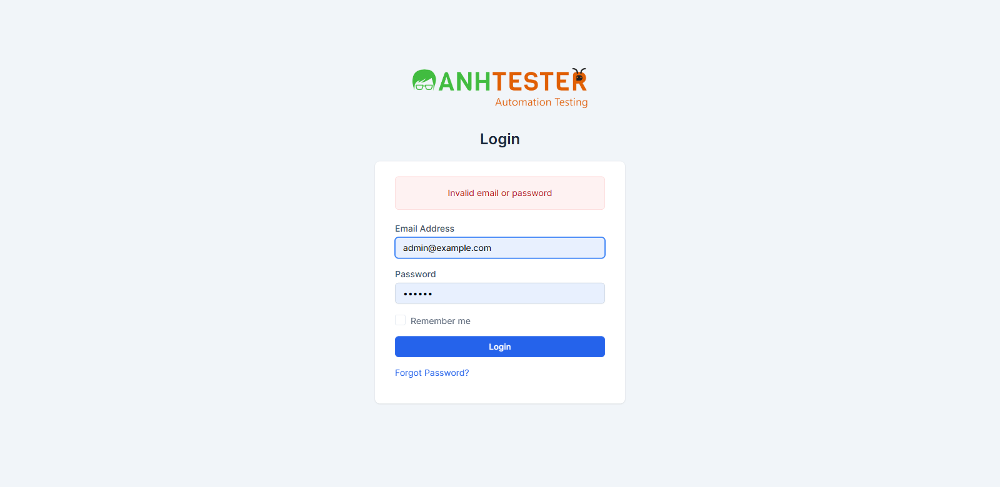
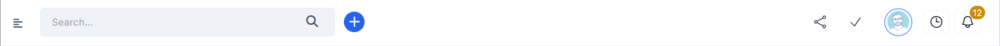

# Execution Report — Login · Ticket CRM-LOGIN-101 (TC sửa 22-10 + TC thêm 23-10-2026)

| Thông tin | Nội dung |
|---|---|
| Run ID | run_1792735612 |
| Nền tảng | `web` |
| Loại nguồn | `Bộ TC` |
| Nguồn TC | `docs/testcases/login/web/parts/part_02_web_forgot_phien.md` (036) · `docs/testcases/login/web/parts/part_04_web_khoa_tai_khoan.md` (066 → 083) |
| Phạm vi | 19 TC — `CRM_LOGIN_TC_036` (sửa theo `CRM-LOGIN-101`, 23-10-2026) · `CRM_LOGIN_TC_066` → `083` (thêm 23-10-2026) · loại 0 TC `@Deprecated` |
| Môi trường | `https://crm.anhtester.com` — môi trường demo |
| Build / Version | Dev báo đã triển khai `CRM-LOGIN-101` (user xác nhận 23-10-2026, chưa có số build) |
| Tài khoản | Tài khoản Project Manager (`EMAIL_PM` trong `.env`, role Admin) — 🔒 user tự nhập mật khẩu đúng. **Không** dùng tài khoản Admin |
| Người thực hiện | tnphonglan (agent hỗ trợ — Playwright MCP, headed, viewport theo `--viewport-size`) |
| Bắt đầu → Kết thúc | 23-10-2026 13:06 → 13:18 (12 phút) — **dừng sớm** theo quyết định của user sau 2 FAIL cùng nguyên nhân (cơ chế khoá REQ-46 không hoạt động) |
| Môi trường dùng chung? | Có — auto-skip TC phá huỷ đang BẬT. TC khoá tài khoản Project Manager chạy tuần tự, cách nhau ≥ 15 phút (`RISK-LOGIN-09`) |
| Tag `@Skip` | Điều kiện của tag (tính năng chưa triển khai + thiếu tài khoản Project Manager) đã được user gỡ 23-10-2026 → TC đủ điều kiện được chạy; TC thiếu điều kiện khác chấm BLOCKED |

## 1. Tổng kết

| Trạng thái | Số lượng | Tỷ lệ |
|---|---|---|
| ✅ PASS | 1 | 5.3% |
| ❌ FAIL | 2 | 10.5% |
| ⚠️ BLOCKED | 13 | 68.4% |
| ⏭️ SKIPPED | 3 | 15.8% |
| **Tổng** | **19** | 100% |

> **Pass rate (không tính SKIPPED):** 1/16 = 6.3% · Thực chạy: 3 TC (072 · 036 · 067).
>
> **Kết luận:** cơ chế khoá tài khoản của ticket `CRM-LOGIN-101` **chưa hoạt động** trên môi trường demo dù Dev báo đã triển khai. Sai mật khẩu 5 lần liên tiếp không khoá tài khoản: lần thứ 6 vẫn `Invalid email or password` (036), mật khẩu đúng ngay sau đó vẫn vào Dashboard (036 · 067). 8 TC phụ thuộc trạng thái "đang bị khoá" bị chặn theo.

## 2. Kết quả từng TC

| TC ID | Test Scenario | Kết quả | Bước fail | Ghi chú |
|---|---|---|---|---|
| CRM_LOGIN_TC_072 | Email không có trong hệ thống không bị khoá dù gửi sai 6 lần liên tiếp | ✅ PASS | — | 13:07 · email `auto_login_20261023_072@auto.test` · cả 6 lần `Invalid email or password`, lần 6 không có thông báo khoá. Ghi nhận: trang demo tự điền sẵn email/mật khẩu mẫu vào form sau mỗi lần nạp lại — không ảnh hưởng kết quả |
| CRM_LOGIN_TC_036 | Đăng nhập sai mật khẩu 5 lần liên tiếp thì tài khoản bị khoá — thông báo khoá hiện từ lần thử thứ 6 | ❌ FAIL | 6 | Xem chi tiết FAIL #1. Bước 1 → 4 đạt (lần 1 → 5 đều `Invalid email or password`). Lần thử thứ 6 không có thông báo khoá |
| CRM_LOGIN_TC_067 | Đang bị khoá thì nhập đúng mật khẩu vẫn không đăng nhập được | ❌ FAIL | 4 | Xem chi tiết FAIL #2. Bước 1 → 3 đạt. Sau 5 lần sai, mật khẩu đúng vẫn vào thẳng Dashboard |
| CRM_LOGIN_TC_066 | Tài khoản đang bị khoá thì mọi lần gửi form Login đều hiện thông báo khoá nguyên văn | ⚠️ BLOCKED | — | Phụ thuộc cơ chế khoá REQ-46 — đã FAIL ở 036 · 067 |
| CRM_LOGIN_TC_068 | Hết 15 phút khoá thì đăng nhập đúng thành công trở lại | ⏭️ SKIPPED | — | `@PersonalOnly` — chờ 15 phút thật, QA tự chạy ngoài workflow |
| CRM_LOGIN_TC_069 | Đăng nhập thành công khi mới sai 4 lần thì bộ đếm lần sai về 0 | ⚠️ BLOCKED | — | Phụ thuộc cơ chế khoá REQ-46 — không có khoá thì TC PASS mà không chứng minh được bộ đếm về 0 |
| CRM_LOGIN_TC_070 | Khoá một email không chặn email khác đăng nhập từ cùng trình duyệt, cùng mạng | ⚠️ BLOCKED | — | Phụ thuộc cơ chế khoá REQ-46 (bước 3 phải xác nhận đã khoá) |
| CRM_LOGIN_TC_071 | Email đang bị khoá vẫn bị khoá khi đăng nhập từ mạng khác | ⚠️ BLOCKED | — | Không có thiết bị/mạng thứ hai · phụ thuộc cơ chế khoá REQ-46 |
| CRM_LOGIN_TC_073 | Bộ đếm lần sai không phân biệt hoa/thường | ⚠️ BLOCKED | — | Phụ thuộc cơ chế khoá REQ-46 |
| CRM_LOGIN_TC_074 | Thử đăng nhập trong lúc đang khoá không dời mốc mở khoá | ⏭️ SKIPPED | — | `@PersonalOnly` — chờ 15 phút thật |
| CRM_LOGIN_TC_075 | Hết thời gian khoá thì bộ đếm lần sai về 0 | ⏭️ SKIPPED | — | `@PersonalOnly` — chờ 15 phút thật, 2 chu kỳ khoá |
| CRM_LOGIN_TC_076 | Gửi form bỏ trống Password không tính vào bộ đếm lần sai | ⚠️ BLOCKED | — | Phụ thuộc cơ chế khoá REQ-46 |
| CRM_LOGIN_TC_077 | Tài khoản đang bị khoá vẫn dùng được Forgot Password | ⚠️ BLOCKED | — | Không có hộp thư của tài khoản Project Manager · phụ thuộc cơ chế khoá REQ-46 |
| CRM_LOGIN_TC_078 | Đặt lại mật khẩu khi đang bị khoá không mở khoá sớm | ⚠️ BLOCKED | — | Không có hộp thư của tài khoản Project Manager · phụ thuộc cơ chế khoá REQ-46 |
| CRM_LOGIN_TC_079 | Khoá tài khoản không đẩy phiên đang mở ở trình duyệt khác ra ngoài | ⚠️ BLOCKED | — | Phụ thuộc cơ chế khoá REQ-46 (bước 3 phải thấy thông báo khoá) |
| CRM_LOGIN_TC_080 | Cookie ghi nhớ đăng nhập vẫn tự đăng nhập khi tài khoản đang bị khoá | ⚠️ BLOCKED | — | Phụ thuộc cơ chế khoá REQ-46 (bước 3 phải thấy thông báo khoá) |
| CRM_LOGIN_TC_081 | Email của contact không bị khoá dù gửi sai 6 lần liên tiếp | ⚠️ BLOCKED | — | Chưa có tài khoản contact test (`AMB-LOGIN-20`) |
| CRM_LOGIN_TC_082 | Staff bị vô hiệu hoá không bị khoá dù gửi sai 6 lần liên tiếp | ⚠️ BLOCKED | — | Chưa có tài khoản staff vô hiệu hoá (`AMB-LOGIN-19`) |
| CRM_LOGIN_TC_083 | Bộ đếm lần sai bỏ khoảng trắng đầu/cuối email | ⚠️ BLOCKED | — | Phụ thuộc cơ chế khoá REQ-46 |

## 3. Chi tiết TC FAIL

### FAIL #1 — CRM_LOGIN_TC_036 · Đăng nhập sai mật khẩu 5 lần liên tiếp thì tài khoản bị khoá

| | |
|---|---|
| REQ ID | REQ-LOGIN-46 |
| Priority | Medium (Risk Level High) |
| Bước fail | Bước 6 — lần thử thứ 6 |
| Pre-Condition | Đạt — 13:09 tài khoản Project Manager đăng nhập thành công (user tự nhập mật khẩu) → vào `/admin/` Dashboard → Logout qua menu ảnh đại diện → về trang Login |
| Các bước đạt | 13:10:18 → 13:10:35: lần sai 1 → 5 (`Wrong_20261022_01` → `05`), mỗi lần ở lại `/admin/authentication` với khung đỏ `Invalid email or password`; lần 5 chưa có thông báo khoá ✅ |
| **Expected** | Bước 6: vẫn ở `/admin/authentication`, không vào Dashboard, hiện thông báo nguyên văn `Your account is locked. Please try again in 15 minutes.` |
| **Actual** | 13:10:40 lần thử thứ 6 (`Wrong_20261022_06`): ở lại `/admin/authentication`, không vào Dashboard, nhưng chỉ có **một** khung đỏ `Invalid email or password`. **Không** có thông báo khoá |
| Evidence |  — ô Email/Password trong ảnh là dữ liệu mẫu do trang demo tự điền sau khi nạp lại, không phải dữ liệu tester nhập |
| Kiểm khoá ngầm | 13:12:05 (≈ 1,5 phút sau lần sai thứ 5) user đăng nhập bằng mật khẩu đúng → **vào thẳng Dashboard** `/admin/`, không có thông báo nào → tài khoản **không bị khoá**, không phải khoá ngầm mà thiếu thông báo. Hệ thống vẫn chạy hành vi cũ "không giới hạn số lần sai" |
| Tái hiện được? | Có — xem TC 067 (cùng nguyên nhân) |

### FAIL #2 — CRM_LOGIN_TC_067 · Đang bị khoá thì nhập đúng mật khẩu vẫn không đăng nhập được

| | |
|---|---|
| REQ ID | REQ-LOGIN-52 |
| Priority | Critical |
| Bước fail | Bước 4 |
| Pre-Condition | Đạt — tài khoản Project Manager đăng nhập thành công lúc 13:12:05 (lần kiểm khoá ngầm của FAIL #1) rồi Logout lúc 13:13. Từ đó tới khi bắt đầu TC không có lần gửi form nào (xem ghi chú sự cố ở dưới) |
| Các bước đạt | 13:15:40 → 13:15:55: lần sai 1 → 5 (`Wrong_20261023_067_01` → `05`), mỗi lần `Invalid email or password` ✅ · Bước 3: 13:16 user tự nhập mật khẩu đúng, bấm `Login` → trang chuyển đi ✅ |
| **Expected** | Bước 4: vẫn ở `/admin/authentication`, không vào `/admin/`, không thấy menu bên trái; hiện `Your account is locked. Please try again in 15 minutes.` |
| **Actual** | 13:16:25: thanh địa chỉ `/admin/`, tiêu đề tab `Dashboard`, menu bên trái hiển thị, mục Dashboard đang chọn. Không có thông báo nào — đăng nhập thành công dù vừa sai 5 lần liên tiếp |
| Evidence |  ·  — chụp riêng header và menu, không chụp nội dung Dashboard (số liệu nghiệp vụ) |
| Tái hiện được? | Có — cùng nguyên nhân với FAIL #1 (lần thứ 2 trong buổi chạy) |
| Sự cố trong lúc chạy | 13:13 → 13:15: cửa sổ Chrome bị hộp thoại của trình duyệt che (bật lên sau khi user tự gõ mật khẩu), Playwright không bấm được nút `Login` — không có request nào gửi đi, không lần sai nào được tính. User đóng hộp thoại, TC 067 chạy lại từ bước 1 lúc 13:15:39 |

## 4. TC BLOCKED

| TC ID | Nguyên nhân chặn | Cần gì để chạy được |
|---|---|---|
| 066 · 069 · 070 · 073 · 076 · 079 · 080 · 083 | Cần tài khoản ở trạng thái "đang bị khoá" — cơ chế khoá REQ-46 không hoạt động (FAIL #1 · #2). User chọn dừng buổi chạy 13:18 thay vì chạy tiếp các TC chắc chắn FAIL cùng nguyên nhân | Dev sửa / triển khai lại `CRM-LOGIN-101`, báo build → chạy lại |
| 071 | Không có thiết bị / mạng thứ hai có IP công khai khác · cơ chế khoá | Điều kiện #9 ở index TC + Dev sửa khoá |
| 077 · 078 | Không có hộp thư đọc được của tài khoản Project Manager (`AMB-LOGIN-01` ⏭️) · cơ chế khoá | Điều kiện #2 ở index TC + Dev sửa khoá |
| 081 | Chưa có tài khoản contact test (`AMB-LOGIN-20`) | Điều kiện #3 ở index TC |
| 082 | Chưa có tài khoản staff bị vô hiệu hoá (`AMB-LOGIN-19`) | Điều kiện #3 ở index TC |

## 5. Dữ liệu đã tạo & dọn dẹp

| Dữ liệu | ID | Nơi tạo | Đã xoá? |
|---|---|---|---|
| — | — | — | Không tạo bản ghi nào. Buổi chạy chỉ gửi form Login: 6 lần với email không tồn tại `auto_login_20261023_072@auto.test`, 11 lần sai + 3 lần đúng (13:09 · 13:12 · 13:16 — user tự nhập) trên tài khoản Project Manager |

> Trạng thái cuối: 13:18 đã Logout tài khoản Project Manager. Tài khoản **không** bị khoá (xem FAIL #1) nên người khác dùng chung không bị ảnh hưởng. Tài khoản Admin không được dùng trong buổi chạy.

## 6. Đề xuất bước tiếp theo

- **FAIL #1 (036 — REQ-46) · FAIL #2 (067 — REQ-52), cùng một nguyên nhân** → gộp thành **1 bug** "Cơ chế khoá tài khoản sau 5 lần sai không hoạt động" bằng `/create-bug-report`, đính cả 3 ảnh evidence. Severity đề xuất: Critical — ticket chống dò mật khẩu không có tác dụng (`RISK-LOGIN-04`)
- Hỏi Dev xác nhận **build / ngày** đã triển khai `CRM-LOGIN-101` lên `crm.anhtester.com`. Hành vi quan sát trùng hệt hành vi cũ "không giới hạn số lần sai", nên nhiều khả năng bản triển khai chưa lên đúng môi trường
- Dev sửa xong → `/retest-fixed-bugs` mode FULL: retest 036 · 067, rồi chạy lại 8 TC BLOCKED vì khoá. TC khoá tài khoản cách nhau ≥ 15 phút (`RISK-LOGIN-09`)
- 3 TC `@PersonalOnly` (068 · 074 · 075) — QA tự chạy sau khi khoá hoạt động
- Chuẩn bị điều kiện cho 071 · 077 · 078 · 081 · 082 (index TC: Điều kiện #2 · #3 · #9)
- **Lưu ý khi chạy lại:** sau khi user tự gõ mật khẩu, Chrome bật hộp thoại (lưu mật khẩu / cảnh báo mật khẩu bị lộ) chặn mọi thao tác của Playwright — nhắc người nhập đóng hộp thoại ngay, hoặc tắt trình quản lý mật khẩu của profile Playwright
