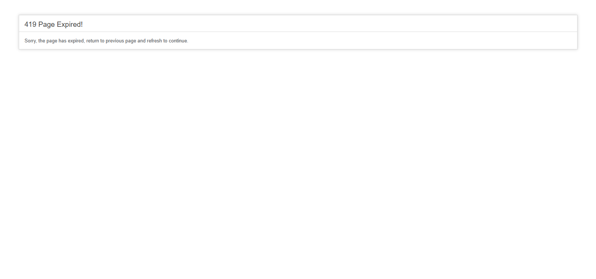
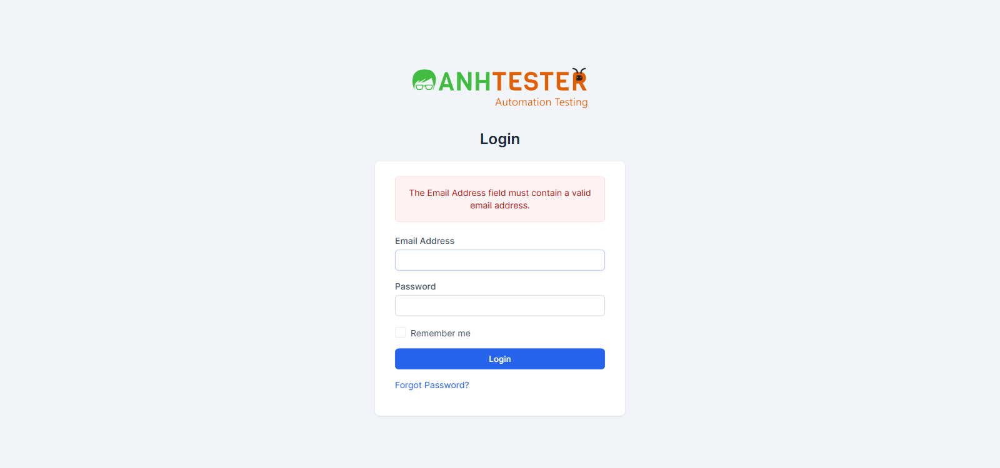
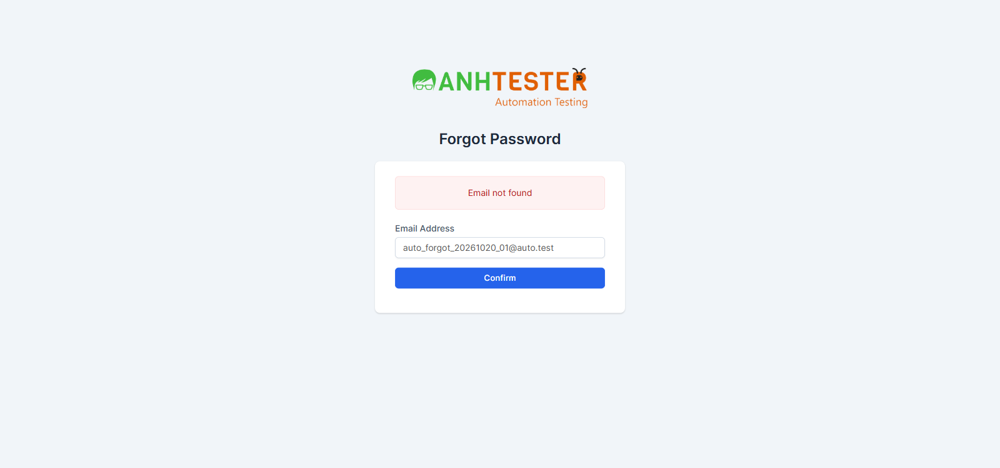
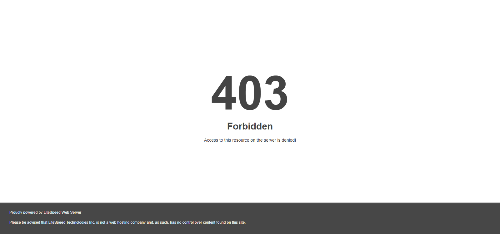

# Execution Report — Login · Bộ TC `CRM_LOGIN_TC_001` → `083`

| Thông tin | Nội dung |
|---|---|
| Run ID | run_1794453634 |
| Nền tảng | `web` |
| Loại nguồn | `Bộ TC` |
| Nguồn TC | `docs/testcases/login/web/parts/part_01_web_smoke_form_login.md` (001 → 025) · `docs/testcases/login/web/parts/part_02_web_forgot_phien.md` (026 → 048) · `docs/testcases/login/web/parts/part_03_web_technical_nonfunc.md` (049 → 065) · `docs/testcases/login/web/parts/part_04_web_khoa_tai_khoan.md` (066 → 083) |
| Phạm vi | 83 TC (`CRM_LOGIN_TC_001` → `083`), chia 2 đợt ghi chung một report: **đợt 1** `001 → 040` (12-11-2026 10:20 → 10:30) · **đợt 2** `041 → 083` (12-11-2026, bắt đầu 10:34). Loại 0 TC `@Deprecated` · TC `@Skip` chấm BLOCKED theo quy ước của bộ TC · TC `@PersonalOnly` chấm SKIPPED (048 · 068 · 074 · 075 — QA tự chạy ngoài workflow) |
| Môi trường | `https://crm.anhtester.com/admin/authentication` — môi trường demo dùng chung |
| Build / Version | Không có thông tin |
| Tài khoản | Admin (🔒 không ghi giá trị). **Đợt 2:** agent **không** tự nhập mật khẩu — tester đăng nhập thủ công trên cửa sổ Playwright (tab cách ly), agent tiếp tục từ phiên đã đăng nhập. Mọi phép thử lỗi / Forgot Password dùng email `@auto.test` không tồn tại |
| Trình duyệt | Chromium (Playwright MCP), headed, viewport 1600×750, **context cách ly mới** (không cookie, không mật khẩu đã lưu). Không có Edge / Firefox trong công cụ chạy |
| Người thực hiện | Tester (agent hỗ trợ) |
| Bắt đầu → Kết thúc | 12-11-2026 10:20 → ~10:45 (đợt 1: 10:20 → 10:30 · đợt 2: ~10:34 → ~10:45, có 5 phút chờ thật của TC 056) |
| Môi trường dùng chung? | Có — auto-skip TC phá huỷ đang BẬT (không có TC nào trong 001 → 083 dính auto-skip phá huỷ) |

> ⚠️ **Lưu ý môi trường:** trình duyệt mặc định của Playwright MCP đang có mật khẩu đã lưu — ô Email/Password bị tự điền `:-webkit-autofill`, trái Pre-Condition (`RISK-LOGIN-02`). Toàn bộ lần chạy dùng tab trong context cách ly nên không bị ảnh hưởng. Đầu buổi chạy agent đã xoá cookie/localStorage của tab mặc định (đang có phiên đăng nhập sẵn).

## 1. Tổng kết

| Trạng thái | Số lượng | Tỷ lệ |
|---|---|---|
| ✅ PASS | 49 | 59.0% |
| ❌ FAIL | 4 | 4.8% |
| ⚠️ BLOCKED | 26 | 31.3% |
| ⏭️ SKIPPED | 4 | 4.8% |
| **Tổng** | **83** | 100% |

> **Pass rate (không tính SKIPPED):** 49/79 = 62.0%
> **Trên số TC thực chạy xong (PASS + FAIL = 53):** 49/53 = 92.5%
>
> **Tách theo đợt:** đợt 1 (`001 → 040`): PASS 30 · FAIL 3 · BLOCKED 7 · SKIPPED 0. Đợt 2 (`041 → 083`): PASS 19 · FAIL 1 · BLOCKED 19 · SKIPPED 4 (048 · 068 · 074 · 075).
>
> 4 FAIL: **1 bug hệ thống đã biết** (028 `@KnownBug`), **3 FAIL do hệ thống lệch Expected** (015-b, 016, 053-d) — 016 nhiều khả năng là **TC giả định sai** (xem mục 6); 053-d là hành vi máy chủ chặn (403) khác Expected.
>
> 26 BLOCKED chiếm 31% — phần lớn do `CRM-LOGIN-101` (khoá tài khoản, `066 → 083`) chưa triển khai lên demo và thiếu tài khoản test riêng / hộp thư.

## 2. Kết quả từng TC

| TC ID | Test Scenario | Kết quả | Bước fail | Ghi chú |
|---|---|---|---|---|
| CRM_LOGIN_TC_001 | Trang Login hiển thị đủ thành phần, đúng nhãn, đúng trạng thái mặc định | ✅ PASS | — | Đủ 6 mục Bảng kiểm. Tab: `Perfex CRM \| Anh Tester Demo - Login` |
| CRM_LOGIN_TC_002 | Ô Password che ký tự, không có nút hiện mật khẩu | ✅ PASS | — | 15 ký tự gõ → `type=password`, không có nút/icon nào trong ô |
| CRM_LOGIN_TC_003 | Trang Forgot Password hiển thị đủ thành phần | ✅ PASS | — | Chỉ có logo là liên kết duy nhất; ô Email không có viền chọn |
| CRM_LOGIN_TC_004 | Liên kết "Forgot Password?" mở trang Forgot Password | ✅ PASS | — | Chuyển trong cùng tab |
| CRM_LOGIN_TC_005 | Logo là liên kết về trang chủ phía khách hàng | ✅ PASS | — | `@NeedsVerify`: `href` = `/`, con trỏ bàn tay. Sau bấm, hệ thống chuyển tiếp sang `/authentication/login` (tiêu đề `Please login`, cổng khách hàng) — không phải trang quản trị. Đã xác nhận trên UI — đề nghị gỡ `@NeedsVerify`, bổ sung vào Expected: đích cuối là `/authentication/login` do máy chủ chuyển hướng. Thanh trạng thái góc dưới trình duyệt không chụp được — đã đối chiếu thuộc tính `href` thay thế |
| CRM_LOGIN_TC_006 | Đăng nhập thành công bằng Admin, không tích Remember me | ✅ PASS | — | `/admin/`, tiêu đề `Dashboard`, menu trái + avatar hiển thị |
| CRM_LOGIN_TC_007 | Menu avatar có đủ 5 mục | ✅ PASS | — | `My Profile · My Timesheets · Edit Profile · Language · Logout` |
| CRM_LOGIN_TC_008 | Bấm Logout về trang Login | ✅ PASS | — | Không hộp thoại xác nhận, không khung đỏ |
| CRM_LOGIN_TC_009 | Bỏ trống Email → thông báo bắt buộc | ✅ PASS | — | 1 khung `The Email Address field is required.` |
| CRM_LOGIN_TC_010 | Bỏ trống Password → thông báo bắt buộc | ✅ PASS | — | 1 khung `The Password field is required.`, ô Email trống lại |
| CRM_LOGIN_TC_011 | Bỏ trống cả hai → 2 khung đỏ | ✅ PASS | — | 2 khung: Password + Email (không đối chiếu thứ tự) |
| CRM_LOGIN_TC_012 | Email chỉ khoảng trắng → như bỏ trống | ✅ PASS | — | `@NeedsVerify`: trình duyệt tự bỏ khoảng trắng của ô email (giá trị rỗng), form vẫn gửi → 1 khung `The Email Address field is required.`. Đã xác nhận trên UI — đề nghị gỡ `@NeedsVerify` |
| CRM_LOGIN_TC_013 | Password chỉ khoảng trắng → như bỏ trống | ✅ PASS | — | `@NeedsVerify`: 3 dấu chấm, 1 khung `The Password field is required.`. Đã xác nhận trên UI — đề nghị gỡ `@NeedsVerify` |
| CRM_LOGIN_TC_014 | Email sai định dạng bị trình duyệt chặn | ✅ PASS | — | Đủ 6 biến thể a–f: không nạp lại, không khung đỏ, email + password giữ nguyên |
| CRM_LOGIN_TC_015 | Email không tồn tại → thông báo chung | ❌ FAIL | 5 · biến thể `b` | Biến thể `a`, `c`, `d` PASS. Xem FAIL #1 |
| CRM_LOGIN_TC_016 | Email rất dài không gây lỗi trang | ❌ FAIL | 6 · biến thể `a`, `b`, `c`, `d` | Không lỗi trang, đuôi `@auto.test` còn nguyên, nhưng thông báo khác Expected ở cả 4 biến thể. Xem FAIL #2 |
| CRM_LOGIN_TC_017 | Password cực trị / ký tự đặc biệt xử lý bình thường | ✅ PASS | — | Đủ 5 biến thể a–e: `Invalid email or password`, không lỗi máy chủ |
| CRM_LOGIN_TC_018 | Sau đăng nhập lỗi, ô Email bị xoá trống | ✅ PASS | — | 2 biến thể a, b đều trống. 🔧 Thẻ `input[name=email]` trong DOM sau khi nạp lại không có thuộc tính `value` (kiểm bằng DOM, tương đương View Source) |
| CRM_LOGIN_TC_019 | Sau đăng nhập lỗi, ô Password bị xoá trống | ✅ PASS | — | 2 biến thể a, b đều 0 ký tự |
| CRM_LOGIN_TC_020 | Email viết HOA / thừa khoảng trắng vẫn đăng nhập được | ✅ PASS | — | `@NeedsVerify`: cả 2 biến thể vào Dashboard. Biến thể `b`: ô email kiểu email tự bỏ khoảng trắng đầu/cuối ngay lúc nhập nên máy chủ không nhận khoảng trắng (cùng gốc `ASM-LOGIN-15`). Đã xác nhận trên UI — đề nghị gỡ `@NeedsVerify` |
| CRM_LOGIN_TC_021 | Remember me tích/bỏ tích bằng chuột và phím Space | ✅ PASS | — | Mặc định chưa tích → tích → bỏ tích → Tab tới ô → Space tích; không gửi form |
| CRM_LOGIN_TC_022 | Enter trong ô Password gửi form | ✅ PASS | — | 1 khung `Invalid email or password` |
| CRM_LOGIN_TC_023 | Ô Password cho dán, không cho sao chép ra | ✅ PASS | — | Dán → 10 chấm; gõ thêm → 12 chấm; Ctrl+C trong ô Password rồi dán vào Email vẫn ra `PasteMe_01` |
| CRM_LOGIN_TC_024 | Bấm Login 2 lần liên tiếp không gây lỗi | ✅ PASS | — | Chỉ 1 khung `Invalid email or password` |
| CRM_LOGIN_TC_025 | Mất mạng khi bấm Login, có mạng lại gửi lại được | ✅ PASS | — | 🔧 giả lập offline bằng context: trình duyệt báo `ERR_INTERNET_DISCONNECTED`, không treo. Có mạng lại → form Login bình thường, gửi lại ra `Invalid email or password` |
| CRM_LOGIN_TC_026 | Forgot Password: bỏ trống → `Email not found` | ✅ PASS | — | Form gửi đi, 1 khung `Email not found` |
| CRM_LOGIN_TC_027 | Forgot Password: email sai định dạng bị trình duyệt chặn | ✅ PASS | — | Đủ 4 biến thể a–d: không nạp lại, không khung đỏ |
| CRM_LOGIN_TC_028 | Forgot Password: email không tồn tại → thông báo trung tính | ❌ FAIL | 4 | `@KnownBug` — dự kiến FAIL (`AMB-LOGIN-03`). Xem FAIL #3 |
| CRM_LOGIN_TC_029 | Forgot Password: email đã nhập được giữ nguyên | ✅ PASS | — | 4 biến thể a–d: giữ đúng từng ký tự, có thông báo phía trên form, không lỗi máy chủ. Lưu ý: a–c hiện `Email not found` (lỗi REQ-39 của 028), d hiện `The Email Address field must contain a valid email address.` — nội dung thông báo kiểm ở 028 |
| CRM_LOGIN_TC_030 | Forgot Password: email tồn tại → cùng thông báo trung tính | ⚠️ BLOCKED | — | `@Skip` — cần tài khoản staff test riêng (`AMB-LOGIN-01`) |
| CRM_LOGIN_TC_031 | Forgot Password: email tồn tại nhận được email đặt lại | ⚠️ BLOCKED | — | `@Skip` — cần tài khoản staff test riêng có hộp thư đọc được |
| CRM_LOGIN_TC_032 | Link trong email đặt lại mật khẩu dùng được | ⚠️ BLOCKED | — | `@Skip` — phụ thuộc 031, cần hộp thư |
| CRM_LOGIN_TC_033 | Forgot Password: email contact xử lý như không tồn tại | ⚠️ BLOCKED | — | `@Skip` — cần tài khoản contact có hộp thư |
| CRM_LOGIN_TC_034 | Forgot Password: staff vô hiệu hoá xử lý như không tồn tại | ⚠️ BLOCKED | — | `@Skip` — cần staff vô hiệu hoá có hộp thư |
| CRM_LOGIN_TC_035 | Sai mật khẩu với email tồn tại → thông báo chung | ⚠️ BLOCKED | — | `@Skip` — cần tài khoản staff test riêng, cấm thử sai trên tài khoản `.env` |
| CRM_LOGIN_TC_036 | Sai mật khẩu 5 lần → khoá, thông báo từ lần thứ 6 | ⚠️ BLOCKED | — | `@Skip` — tính năng khoá (`CRM-LOGIN-101`) chưa xác nhận triển khai; chạy sẽ khoá tài khoản Project Manager dùng chung 15 phút |
| CRM_LOGIN_TC_037 | Đăng nhập xong luôn về Dashboard | ✅ PASS | — | Mở `/admin/clients` chưa đăng nhập → Login; đăng nhập xong → `/admin/` (Dashboard), không phải Customers |
| CRM_LOGIN_TC_038 | Đã đăng nhập mở Login → về Dashboard | ✅ PASS | — | Không hiện form, `/admin/`, menu trái hiển thị |
| CRM_LOGIN_TC_039 | Đã đăng nhập mở Forgot Password → về Dashboard | ✅ PASS | — | Không hiện form, `/admin/`, menu trái hiển thị |
| CRM_LOGIN_TC_040 | Tích Remember me → được cấp cookie `autologin` | ✅ PASS | — | 🔧 đã kiểm: `autologin` có giá trị (không chép) · `Secure` ✅ · `SameSite=Lax` · `HttpOnly` ❌ (đúng hiện trạng `AMB-LOGIN-11`) · hạn ≈ 62 ngày |
| CRM_LOGIN_TC_041 | Có ghi nhớ đăng nhập thì mất phiên vẫn tự vào thẳng Dashboard | ✅ PASS | — | Xoá `sp_session`, giữ `autologin` → danh sách cookie chỉ còn `csrf_cookie_name` + `autologin`. Mở `/admin/` vào thẳng Dashboard (menu trái + avatar). 🔧 đã kiểm: trình duyệt được cấp `sp_session` mới (giá trị khác cũ). Đăng nhập do tester thao tác tay |
| CRM_LOGIN_TC_042 | Không tích Remember me thì mất phiên phải đăng nhập lại | ✅ PASS | — | 🔧 đã kiểm: sau đăng nhập không tích, cookie chỉ có `csrf_cookie_name` + `sp_session` — **không** có `autologin`. Xoá `sp_session`, mở `/admin/` → `/admin/authentication`, tiêu đề `Login`, không tự đăng nhập lại |
| CRM_LOGIN_TC_043 | Đăng xuất làm mất hiệu lực ghi nhớ đăng nhập | ✅ PASS | — | Đăng nhập có Remember me → Logout → mở `/admin/` vẫn ở Login, không tự đăng nhập. 🔧 cookie `autologin` **vẫn còn trong trình duyệt** sau Logout nhưng không còn dùng được (máy chủ không chấp nhận) — đạt vế "không còn dùng được" |
| CRM_LOGIN_TC_044 | Sau đăng xuất, mở trang nội bộ bị đưa về Login | ✅ PASS | — | `/admin/clients` → `/admin/authentication`, tiêu đề `Login`, không có menu trái |
| CRM_LOGIN_TC_045 | Sau đăng xuất, bấm Back không hiện lại trang nội bộ | ✅ PASS | — | Back 3 lần (Expected yêu cầu 2): luôn dừng ở `/admin/authentication`, tiêu đề `Login`, 0 phần tử menu trái |
| CRM_LOGIN_TC_046 | Có bộ đếm giờ đang chạy thì Logout hỏi xác nhận | ⚠️ BLOCKED | — | `@Skip` — chưa được phép bật bộ đếm giờ trên tài khoản dùng chung (`AMB-LOGIN-17`) |
| CRM_LOGIN_TC_047 | Đăng xuất ở tab này thì tab khác cũng mất quyền truy cập | ✅ PASS | — | Tab B mở `/admin/clients` (Customers) → tab A Logout → tab B bấm Dashboard ở menu trái bị đưa về `/admin/authentication`. Không có bộ đếm giờ đang chạy |
| CRM_LOGIN_TC_048 | Phiên đăng nhập hết hạn sau 8 giờ không hoạt động | ⏭️ SKIPPED | — | `@PersonalOnly` — chờ 8 giờ 10 phút thật, QA tự chạy ngoài workflow |
| CRM_LOGIN_TC_049 | Chưa đăng nhập mở trang nội bộ bị đưa về Login | ✅ PASS | — | Đủ 4 biến thể a–d (`/admin/` · `/admin/clients` · `/admin/invoices/invoice` · `/admin/profile`): đều dừng ở `/admin/authentication`, tiêu đề `Login`, 0 khung đỏ, 0 menu trái |
| CRM_LOGIN_TC_050 | Contact đăng nhập khu Admin bị từ chối | ⚠️ BLOCKED | — | `@Skip` — cần tài khoản contact test (`AMB-LOGIN-20`) |
| CRM_LOGIN_TC_051 | Staff vô hiệu hoá không đăng nhập được | ⚠️ BLOCKED | — | `@Skip` — cần tài khoản staff vô hiệu hoá (`AMB-LOGIN-19`) |
| CRM_LOGIN_TC_052 | Chuỗi tiêm SQL trong ô Email không vượt qua được đăng nhập | ✅ PASS | — | Đủ 3 biến thể a–c: `Invalid email or password`, không vào Dashboard, không lỗi máy chủ / cơ sở dữ liệu |
| CRM_LOGIN_TC_053 | Chuỗi tiêm SQL / script trong ô Password không vượt qua đăng nhập, không chạy script | ❌ FAIL | 5 · biến thể `d` | Biến thể `a`, `b`, `c` PASS (không hộp thoại nào bật). Biến thể `d` bị máy chủ trả **403 Forbidden**. Xem FAIL #4 |
| CRM_LOGIN_TC_054 | Forgot Password: chuỗi đặc biệt hiển thị lại an toàn dạng chữ | ✅ PASS | — | Đủ 4 biến thể a–d: HTTP 200, không lỗi cơ sở dữ liệu, không hộp thoại; ô Email giữ đúng nguyên văn (`c` vẫn `{{7*7}}`, `d` vẫn `${7*7}`, không thành `49`). Cả 4 hiện `Email not found` (lỗi REQ-39 của 028) |
| CRM_LOGIN_TC_055 | Cookie phiên được bảo vệ khỏi script, chỉ gửi qua HTTPS | ✅ PASS | — | 🔧 đã kiểm `sp_session`: 40 ký tự · `HttpOnly` ✅ · `Secure` ✅ · `SameSite=Lax` |
| CRM_LOGIN_TC_056 | Hạn cookie phiên dời theo mỗi lần nạp trang (lần nạp gần nhất + 8 giờ) | ✅ PASS | — | 🔧 T1 = 11:38:43 (đăng nhập 03:38:43 + 8h). Chờ thật 5 phút 24 giây, nạp lại lúc 03:44:07 → T2 = 11:44:07 = giờ nạp + 8h; T2 muộn hơn T1 ≈ 5,4 phút. Mốc giờ theo UTC |
| CRM_LOGIN_TC_057 | Form Login kèm mã chống giả mạo ẩn, đổi theo từng phiên | ✅ PASS | — | 🔧 trường ẩn `csrf_token_name` (`type=hidden`): 32 ký tự hex · cookie `csrf_cookie_name`: 32 ký tự hex, `HttpOnly` ✅ · `Secure` ✅ · `SameSite=Lax` · hạn ≈ 61 phút. 4 ký tự cuối của mã ở 2 context khác nhau (hai phiên) khác nhau |
| CRM_LOGIN_TC_058 | Gửi form Login với mã chống giả mạo bị sửa/xoá thì hệ thống từ chối | ✅ PASS | — | `@NeedsVerify`: cả `a` (giá trị `000…0`) và `b` (xoá hẳn trường) đều bị HTTP 403, trang tiêu đề `Error`, nguyên văn `419 Page Expired! Sorry, the page has expired, return to previous page and refresh to continue.` — không phải khung `Invalid email or password`. Đã xác nhận trên UI — đề nghị gỡ `@NeedsVerify`, chép nguyên văn vào Expected (`ASM-LOGIN-08`). Ảnh:  |
| CRM_LOGIN_TC_059 | Form Forgot Password kèm mã chống giả mạo ẩn | ✅ PASS | — | 🔧 trường ẩn `csrf_token_name` `type=hidden`, 32 ký tự hex |
| CRM_LOGIN_TC_060 | Đăng xuất làm trình duyệt nhận phiên mới | ✅ PASS | — | 🔧 6 ký tự cuối `sp_session` trước ≠ sau Logout; toàn chuỗi cũng khác. Về `/admin/authentication`. (Lần chạy đầu bị mất mốc do trình duyệt đóng — đã chạy lại trọn trong một lệnh) |
| CRM_LOGIN_TC_061 | Để mã chống giả mạo hết hạn rồi đăng nhập — vẫn có lối đăng nhập lại | ✅ PASS | — | `@NeedsVerify`: giả lập bằng xoá `csrf_cookie_name`. Bước 4: HTTP 403, `419 Page Expired! Sorry, the page has expired, return to previous page and refresh to continue.` — không treo, không trang trắng. Bước 5 (nạp lại trang, nhập lại): `Invalid email or password`. Đã xác nhận trên UI — đề nghị gỡ `@NeedsVerify` (`ASM-LOGIN-07`). Ảnh:  |
| CRM_LOGIN_TC_062 | Thao tác trang Login bằng bàn phím, đúng thứ tự Tab | ✅ PASS | — | `@NeedsVerify`: thứ tự Email → Password → Remember me → nút Login → Forgot Password đúng; Space tích được; Shift+Tab về Login; Enter gửi form → `Invalid email or password`. Viền chọn: ô Email/Password/nút Login có viền; Remember me có viền hệ điều hành. **Liên kết Forgot Password? không có viền chọn** (`outline: none`, chỉ chữ đậm màu hơn nhẹ) — Expected bước 8 chỉ yêu cầu "được chọn" nên vẫn PASS, ghi nhận để xét khả năng truy cập (xem mục 6). Ảnh `CRM_LOGIN_TC_062_buoc8_forgot_focus.png` |
| CRM_LOGIN_TC_063 | Thao tác trang Forgot Password bằng bàn phím | ✅ PASS | — | `@NeedsVerify`: Tab 1 vào logo, Tab 2 vào ô Email (có viền); gõ + Enter gửi form, ô Email giữ nguyên chuỗi, thông báo `Email not found` phía trên form. Thứ tự Tab trang này: logo → ô Email. Đề nghị gỡ `@NeedsVerify` (`ASM-LOGIN-10`) |
| CRM_LOGIN_TC_064 | Trang Login hiển thị và dùng được ở các kích thước màn hình | ✅ PASS | — | `@NeedsVerify`: đủ 5 biến thể a–e (1920×1080 · 1366×768 · 768×1024 · 375×812 · 1366×768 phóng 125% ≈ viewport 1093×614): đủ 7 thành phần, không thanh cuộn ngang, 0 cặp phần tử chồng nhau, gõ được ô Email. Xem ảnh 375px bằng mắt: không đè chữ. Lưu ý: kích thước đặt bằng `setViewportSize` (giả lập viewport, 1920×1080 lớn hơn cửa sổ headed — cố ý, chỉ trong TC này, đã trả về 1600×750) |
| CRM_LOGIN_TC_065 | Đăng nhập và chặn email sai định dạng trên Edge và Firefox | ⚠️ BLOCKED | — | `@NeedsVerify` — công cụ chạy (Playwright MCP) chỉ có Chromium, không có Edge / Firefox (`ASM-LOGIN-11`) |
| CRM_LOGIN_TC_066 | Tài khoản đang bị khoá — mọi lần gửi form hiện thông báo khoá | ⚠️ BLOCKED | — | `@Skip` — `CRM-LOGIN-101` chưa triển khai lên demo (Điều kiện #7 · #8) |
| CRM_LOGIN_TC_067 | Đang khoá thì nhập đúng mật khẩu vẫn không đăng nhập được | ⚠️ BLOCKED | — | `@Skip` — như 066 |
| CRM_LOGIN_TC_068 | Hết 15 phút khoá thì đăng nhập đúng thành công trở lại | ⏭️ SKIPPED | — | `@PersonalOnly` (kiêm `@Skip`) — chờ 15 phút khoá, tính năng chưa triển khai; QA tự chạy |
| CRM_LOGIN_TC_069 | Đăng nhập thành công khi mới sai 4 lần thì bộ đếm về 0 | ⚠️ BLOCKED | — | `@Skip` — như 066 |
| CRM_LOGIN_TC_070 | Khoá một email không chặn email khác cùng trình duyệt, cùng mạng | ⚠️ BLOCKED | — | `@Skip` — như 066 |
| CRM_LOGIN_TC_071 | Email đang bị khoá vẫn bị khoá khi đăng nhập từ mạng khác | ⚠️ BLOCKED | — | `@Skip` — như 066 và cần mạng thứ hai có IP khác (Điều kiện #9) |
| CRM_LOGIN_TC_072 | Email không có trong hệ thống không bị khoá dù sai 6 lần | ⚠️ BLOCKED | — | `@Skip` — như 066 (kiểm bộ đếm khoá, chưa có tính năng) |
| CRM_LOGIN_TC_073 | Bộ đếm lần sai không phân biệt hoa/thường | ⚠️ BLOCKED | — | `@Skip` — như 066 |
| CRM_LOGIN_TC_074 | Thử đăng nhập trong lúc đang khoá không dời mốc mở khoá | ⏭️ SKIPPED | — | `@PersonalOnly` (kiêm `@Skip`) — chờ 15 phút khoá; QA tự chạy |
| CRM_LOGIN_TC_075 | Hết thời gian khoá thì bộ đếm về 0 | ⏭️ SKIPPED | — | `@PersonalOnly` (kiêm `@Skip`) — chờ 2 chu kỳ khoá 15 phút (`ASM-LOGIN-13`); QA tự chạy |
| CRM_LOGIN_TC_076 | Bỏ trống Password không tính vào bộ đếm lần sai | ⚠️ BLOCKED | — | `@Skip` — như 066 |
| CRM_LOGIN_TC_077 | Đang khoá vẫn dùng được Forgot Password | ⚠️ BLOCKED | — | `@Skip` — như 066 và cần hộp thư Project Manager (Điều kiện #2) |
| CRM_LOGIN_TC_078 | Đặt lại mật khẩu khi đang khoá không mở khoá sớm | ⚠️ BLOCKED | — | `@Skip` `@NeedsVerify` — như 077 |
| CRM_LOGIN_TC_079 | Khoá tài khoản không đẩy phiên đang mở ra ngoài | ⚠️ BLOCKED | — | `@Skip` — như 066 |
| CRM_LOGIN_TC_080 | Cookie ghi nhớ vẫn tự đăng nhập khi đang khoá | ⚠️ BLOCKED | — | `@Skip` `@TechCheck` — như 066 |
| CRM_LOGIN_TC_081 | Email contact không bị khoá dù sai 6 lần | ⚠️ BLOCKED | — | `@Skip` — như 066 và cần tài khoản contact (Điều kiện #3) |
| CRM_LOGIN_TC_082 | Staff vô hiệu hoá không bị khoá dù sai 6 lần | ⚠️ BLOCKED | — | `@Skip` — như 066 và cần staff vô hiệu hoá (Điều kiện #3) |
| CRM_LOGIN_TC_083 | Bộ đếm bỏ khoảng trắng đầu/cuối email | ⚠️ BLOCKED | — | `@Skip` `@NeedsVerify` — như 066 |

## 3. Chi tiết TC FAIL

### FAIL #1 — CRM_LOGIN_TC_015 · Email đúng định dạng nhưng không tồn tại bị từ chối với thông báo chung

| | |
|---|---|
| REQ ID | REQ-LOGIN-12 |
| Priority | High |
| Bước fail | Bước 5 · biến thể `b` (`auto_login_20261020_04@auto` — tên miền không có dấu chấm) — biến thể `a`, `c`, `d` PASS |
| **Expected** | Vẫn ở `/admin/authentication`, hiện đúng 1 khung đỏ `Invalid email or password` |
| **Actual** | Trình duyệt **không** chặn (email hợp lệ theo chuẩn HTML), máy chủ trả khung đỏ `The Email Address field must contain a valid email address.` — là thông báo kiểm định dạng, không phải thông báo chung |
| Evidence |  |
| Tái hiện được? | Có — chạy 2 lần đều cho kết quả này |

### FAIL #2 — CRM_LOGIN_TC_016 · Email Address rất dài vẫn được xử lý bình thường, không gây lỗi trang

| | |
|---|---|
| REQ ID | REQ-LOGIN-12 |
| Priority | Medium |
| Bước fail | Bước 6 · biến thể `a` (254 ký tự), `b` (255), `c` (256), `d` (1000) — **cả 4 biến thể** |
| **Expected** | 1 khung đỏ `Invalid email or password`; không trang lỗi máy chủ (`ASM-LOGIN-05`) |
| **Actual** | Không lỗi trang, ô Email giữ nguyên đuôi `@auto.test` (đúng 3/4 ý Expected), nhưng khung đỏ là `The Email Address field must contain a valid email address.` ở cả 4 biến thể. Phần trước `@` dài 244 → 990 ký tự, vượt giới hạn 64 ký tự của chuẩn email — máy chủ báo sai định dạng |
| Evidence |  (biến thể `a`) |
| Tái hiện được? | Có — biến thể `a` chạy lại 2 lần cùng kết quả |
| Ghi chú | Expected dựa trên giả định `ASM-LOGIN-05` (máy chủ coi như email không tồn tại). Hành vi thực tế (từ chối sớm vì định dạng) có thể là hợp lý → **đối chiếu lại TC / REQ-12 trước khi báo bug** |

### FAIL #3 — CRM_LOGIN_TC_028 · Forgot Password: email không tồn tại nhận thông báo trung tính

| | |
|---|---|
| REQ ID | REQ-LOGIN-39 |
| Priority | High |
| Bước fail | Bước 4 |
| **Expected** | Thông báo trung tính `Nếu địa chỉ email này có tài khoản trong hệ thống, chúng tôi đã gửi liên kết đặt lại mật khẩu tới đó. Vui lòng kiểm tra hộp thư (và cả thư mục Spam).`, **không** hiện `Email not found` |
| **Actual** | Khung đỏ `Email not found` — tiết lộ email không có tài khoản (cho phép dò tài khoản). Cùng hành vi ở 029 biến thể a, b, c |
| Evidence |  |
| Tái hiện được? | Có — 4 lần (028 + 029 a/b/c) |
| Ghi chú | `@KnownBug` (`AMB-LOGIN-03`) — **dự kiến FAIL**, PO đã chốt là lỗi, chờ Dev sửa |

### FAIL #4 — CRM_LOGIN_TC_053 · Chuỗi tiêm SQL / mã script trong ô Password không vượt qua được đăng nhập, không chạy script

| | |
|---|---|
| REQ ID | REQ-LOGIN-12 |
| Priority | High |
| Bước fail | Bước 5 · biến thể `d` (`">`) — biến thể `a`, `b`, `c` PASS |
| **Expected** | Vẫn ở trang Login, khung đỏ `Invalid email or password`, không vào Dashboard, không bật hộp thoại, **không** có trang báo lỗi máy chủ |
| **Actual** | Máy chủ trả **HTTP 403 Forbidden** (trang LiteSpeed `Access to this resource on the server is denied!`), không còn trang Login, không có khung đỏ. Không vào Dashboard, không bật hộp thoại nào (đúng 2/4 ý Expected) |
| 🔧 Ghi chú kỹ thuật | Request `POST /admin/authentication` trả `403`. Nhiều khả năng do tường lửa web (WAF) của máy chủ chặn chuỗi `onerror=` — biến thể `c` (`<script>…`) không bị chặn |
| Evidence |  |
| Tái hiện được? | Có — 3/3 lần |
| Ghi chú | Hệ thống **an toàn** (không chạy script, không vào được) nhưng trải nghiệm lệch Expected: người dùng nhận trang lỗi thay vì thông báo chung. Cần PO xác nhận 403 do WAF có chấp nhận được không, hay sửa Expected của 053-d — chạy `/review-testcases` mode FIX trước khi báo bug |

## 4. TC BLOCKED

| TC ID | Nguyên nhân chặn | Cần gì để chạy được |
|---|---|---|
| CRM_LOGIN_TC_030 | Tag `@Skip` — chưa có tài khoản staff test riêng | Tài khoản staff test riêng (Điều kiện #1, `AMB-LOGIN-01`) |
| CRM_LOGIN_TC_031 | Tag `@Skip` — chưa có tài khoản staff test riêng có hộp thư đọc được | Tài khoản staff test + hộp thư test đọc được (Điều kiện #1 · #2) |
| CRM_LOGIN_TC_032 | Tag `@Skip` — phụ thuộc email của 031 | Như 031 + chờ 031 chạy được |
| CRM_LOGIN_TC_033 | Tag `@Skip` — chưa có tài khoản contact có hộp thư | Tài khoản contact test + hộp thư (Điều kiện #2 · #3) |
| CRM_LOGIN_TC_034 | Tag `@Skip` — chưa có staff vô hiệu hoá có hộp thư | Staff vô hiệu hoá + hộp thư (Điều kiện #2 · #3) |
| CRM_LOGIN_TC_035 | Tag `@Skip` — cấm thử sai mật khẩu trên tài khoản `.env` dùng chung | Tài khoản staff test riêng (Điều kiện #1) |
| CRM_LOGIN_TC_036 | Tag `@Skip` — tính năng khoá tài khoản (`CRM-LOGIN-101`) chưa xác nhận lên môi trường; chạy sẽ khoá tài khoản Project Manager dùng chung 15 phút | Dev triển khai `CRM-LOGIN-101` (Điều kiện #8), chạy tuần tự bằng tài khoản Project Manager |
| CRM_LOGIN_TC_046 | Tag `@Skip` — không được bật bộ đếm giờ trên tài khoản dùng chung | PO cho phép bật bộ đếm giờ trên tài khoản test (Điều kiện #4, `AMB-LOGIN-17`) |
| CRM_LOGIN_TC_050 | Tag `@Skip` — chưa có tài khoản contact test | Tài khoản contact test (Điều kiện #3, `AMB-LOGIN-20`) |
| CRM_LOGIN_TC_051 | Tag `@Skip` — chưa có staff vô hiệu hoá | Staff vô hiệu hoá (Điều kiện #3, `AMB-LOGIN-19`) |
| CRM_LOGIN_TC_065 | Công cụ chạy chỉ có Chromium, không có Edge / Firefox | Chạy tay trên Edge và Firefox, hoặc gắn thêm trình duyệt cho Playwright MCP (`ASM-LOGIN-11`) |
| CRM_LOGIN_TC_066 · 067 · 069 · 070 · 072 · 073 · 076 · 079 · 080 | Tag `@Skip` — `CRM-LOGIN-101` (khoá tài khoản) chưa triển khai lên demo; chạy sẽ khoá tài khoản Project Manager dùng chung 15 phút | Dev triển khai `CRM-LOGIN-101` (Điều kiện #8) + `EMAIL_PM` · `PASSWORD_PM` trong `.env` (Điều kiện #7); chạy tuần tự cách nhau ≥ 15 phút |
| CRM_LOGIN_TC_071 | Như nhóm trên, thêm cần IP công khai thứ hai | Điều kiện #7 · #8 · #9 (mạng khác / proxy) |
| CRM_LOGIN_TC_077 · 078 | Như nhóm trên, thêm cần hộp thư của tài khoản Project Manager | Điều kiện #2 · #7 · #8 (078 còn đổi `PASSWORD_PM`) |
| CRM_LOGIN_TC_081 · 082 | Như nhóm trên, thêm cần tài khoản contact / staff vô hiệu hoá | Điều kiện #3 · #8 |
| CRM_LOGIN_TC_083 | Như nhóm trên; Expected khó quan sát qua giao diện (`ASM-LOGIN-15`) | Điều kiện #7 · #8 — nên kiểm ở tầng API |

> **TC SKIPPED (không tính BLOCKED):** 048 · 068 · 074 · 075 — tag `@PersonalOnly`, QA tự chạy ngoài workflow (chờ 8 giờ / 15 phút thật). 068 · 074 · 075 còn mang `@Skip` vì `CRM-LOGIN-101` chưa triển khai.

## 5. Dữ liệu đã tạo & dọn dẹp

| Dữ liệu | ID | Nơi tạo | Đã xoá? |
|---|---|---|---|
| Không có bản ghi nghiệp vụ nào được tạo | — | — | ➖ |

> Toàn bộ lần gửi form lỗi dùng email `@auto.test` không tồn tại nên không tạo tài khoản, không gửi email thật. Các phiên đăng nhập Admin đã được đăng xuất / xoá cookie ở cuối mỗi nhóm TC. Cookie ghi nhớ `autologin` tạo ở 040 nằm trong context cách ly, mất khi đóng context. Không có số liệu hệ thống nào thay đổi → môi trường nguyên trạng.
>
> **Đợt 2 (041 → 083):** các tab cách ly đã đóng. Phiên đăng nhập Remember me ở 041 → 047 đã Logout (cookie `autologin` bị vô hiệu); phiên ở 060 đã Logout. Còn **2 phiên Admin chỉ bị xoá cookie phía trình duyệt, chưa Logout phía máy chủ** (phiên dùng cho 055/056/042 và phiên bị mất khi trình duyệt tự đóng lúc chờ) — chúng tự hết hạn sau ≤ 8 giờ, không ai dùng được vì cookie đã mất. Không bản ghi nghiệp vụ nào được tạo.

## 6. Đề xuất bước tiếp theo

- **FAIL #3 (028, High, `@KnownBug`)** → sinh bug report bằng `/create-bug-report` (nếu chưa có bug cho `AMB-LOGIN-03`).
- **FAIL #1 (015-b, High)** → có thể báo bug (thông báo kiểm định dạng lộ ra thay vì thông báo chung); trước đó nên chốt với PO đây có phải hành vi mong muốn không.
- **FAIL #2 (016, Medium)** → **không** báo bug ngay: nhiều khả năng Expected sai (`ASM-LOGIN-05`). Chạy `/review-testcases` mode FIX để đối chiếu lại TC 016, và 015-b cho cùng lý do.
- Gỡ `@NeedsVerify` cho **005 · 012 · 013 · 020** (đã xác nhận trên UI); riêng 005 cập nhật Expected: đích cuối là `/authentication/login` (cổng khách hàng, tiêu đề `Please login`) do máy chủ chuyển hướng từ `/`.
- **FAIL #4 (053-d, High)** → **không** báo bug ngay: hệ thống an toàn nhưng máy chủ trả 403 (nhiều khả năng WAF chặn `onerror=`). Cần PO chốt 403 có chấp nhận được không; chạy `/review-testcases` mode FIX để sửa Expected của 053-d hoặc báo bug nếu muốn thông báo chung.
- Gỡ `@NeedsVerify` cho **058 · 061 · 062 · 063 · 064** (đã xác nhận trên UI). 058 · 061: chép nguyên văn `419 Page Expired! Sorry, the page has expired, return to previous page and refresh to continue.` (HTTP 403) vào Expected (`ASM-LOGIN-07` · `08`). 062: ghi nhận liên kết `Forgot Password?` **không có viền chọn khi focus** (`outline: none`) — đề xuất báo Dev nếu cần đạt tiêu chí truy cập bàn phím.
- 043: cookie `autologin` còn nằm trong trình duyệt sau Logout nhưng không còn dùng được — Dev nên xoá hẳn cookie khi Logout cho sạch.
- **065** cần Edge / Firefox: chạy tay hoặc bổ sung trình duyệt cho công cụ chạy. **Đợt 2 yêu cầu tester đăng nhập thủ công** (agent không tự nhập mật khẩu) — muốn chạy hoàn toàn tự động thì cần quy trình đăng nhập được uỷ quyền riêng.
- 19 BLOCKED + 4 SKIPPED của `066 → 083` phụ thuộc `CRM-LOGIN-101` lên demo (Điều kiện #7 · #8).
- 7 TC BLOCKED (030 → 036) cần các điều kiện ở mục 4 mới chạy được.
- Trình duyệt mặc định của Playwright MCP đang lưu mật khẩu Admin (autofill) — nên xoá để lần chạy sau không phải dùng context cách ly.
