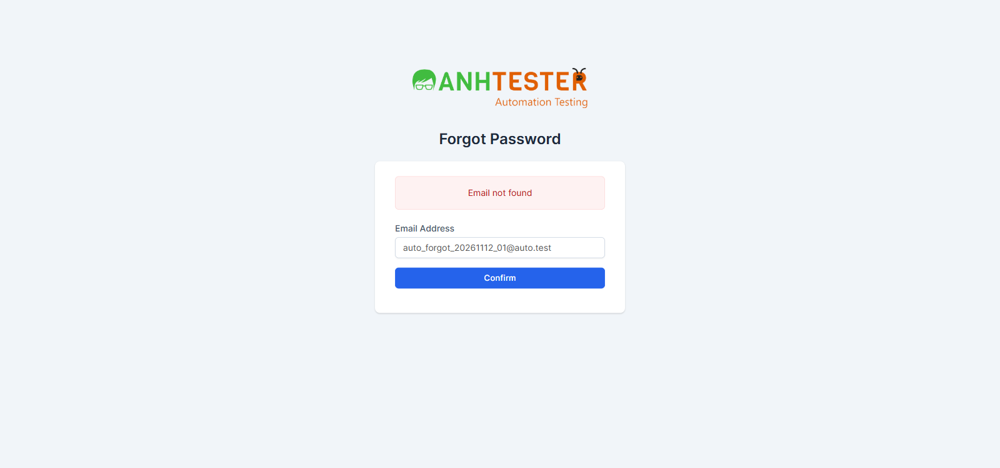

# Execution Report — Login · Checklist Regression (28 mục)

| Thông tin | Nội dung |
|---|---|
| Run ID | run_1794460519 |
| Nền tảng | `web` |
| Loại nguồn | `Checklist regression` · `CL-regression_20261112` |
| Nguồn checklist | `docs/checklists/login/web/checklist_regression_20261112.md` |
| Phạm vi | 28 mục (toàn bộ checklist) |
| Môi trường | `https://crm.anhtester.com/admin/authentication` — môi trường demo dùng chung |
| Build / Version | Không có thông tin |
| Tài khoản | Admin (🔒 không ghi giá trị). Agent **không** tự nhập mật khẩu — tester đăng nhập thủ công trên cửa sổ Playwright ở các mục 8, 21, 25, 28; mọi phép thử lỗi dùng email `@auto.test` không tồn tại |
| Trình duyệt | Chromium (Playwright MCP), headed, viewport 1600×750, **context cách ly mới** `regression_run` (không cookie, không mật khẩu đã lưu) |
| Người thực hiện | Tester (agent hỗ trợ) |
| Bắt đầu → Kết thúc | 12-11-2026 12:15 → 12:20 (~5 phút, chưa tính thời gian chờ tester đăng nhập) |
| Môi trường dùng chung? | Có — auto-skip TC phá huỷ đang BẬT (checklist không có mục phá huỷ nào) |

## 1. Tổng kết

| Trạng thái | Số lượng | Tỷ lệ |
|---|---|---|
| ✅ PASS | 27 | 96.4% |
| ❌ FAIL | 1 | 3.6% |
| ⚠️ BLOCKED | 0 | 0% |
| ⏭️ SKIPPED | 0 | 0% |
| **Tổng** | **28** | 100% |

> **Pass rate (không tính SKIPPED):** 27/28 = 96.4%
>
> **Đây là kết quả chạy checklist**, không phải bộ TC — không cộng vào pass rate của bộ TC `CRM_LOGIN_TC_001 → 083`. Mã mục là mã gốc `CL-regression_20261112-<nn>` (khác với bảng ánh xạ ghi trong file checklist ở run `run_1794453634`).
>
> Kết quả trùng run bộ TC trước: 27 PASS, 1 FAIL ở mục 19 (`@KnownBug`).

## 2. Kết quả từng mục

| TC ID | Hạng mục kiểm tra | Kết quả | Priority | REQ ID | TC ID liên quan | Ghi chú |
|---|---|---|---|---|---|---|
| CL-regression_20261112-01 | Đối chiếu thành phần trang Login | ✅ PASS | P2 | REQ-LOGIN-01, 02, 04, 05 | CRM_LOGIN_TC_001 | Logo + tiêu đề + Email (viền xanh, chọn sẵn) + Password + Remember me chưa tích + nút Login xanh + Forgot Password?; tiêu tab có `Login`; không khung đỏ |
| CL-regression_20261112-02 | Gõ vào ô Password | ✅ PASS | P1 | REQ-LOGIN-03 | CRM_LOGIN_TC_002 | `type=password`, 15 ký tự, không có biểu tượng hiện mật khẩu |
| CL-regression_20261112-03 | Bấm Forgot Password? | ✅ PASS | P2 | REQ-LOGIN-07, 36 | CRM_LOGIN_TC_003, 004 | Cùng tab → `/admin/authentication/forgot_password`; tiêu đề `Forgot Password`; Email trống; nút `Confirm` xanh |
| CL-regression_20261112-04 | Để trống cả hai ô, bấm Login | ✅ PASS | P1 | REQ-LOGIN-10 | CRM_LOGIN_TC_011 | 2 khung đỏ nhạt đúng nội dung; vẫn ở trang Login |
| CL-regression_20261112-05 | Email không tồn tại + mật khẩu bất kỳ | ✅ PASS | P1 | REQ-LOGIN-12, 14, 15 | CRM_LOGIN_TC_015 | 1 khung `Invalid email or password`; 2 ô trống lại |
| CL-regression_20261112-06 | Forgot Password để trống Email, Confirm | ✅ PASS | P2 | REQ-LOGIN-37 | CRM_LOGIN_TC_026 | 1 khung `Email not found` |
| CL-regression_20261112-07 | Chưa đăng nhập, gõ `/admin/clients` | ✅ PASS | P1 | REQ-LOGIN-19 | CRM_LOGIN_TC_049 | Dừng ở `/admin/authentication`, không sidebar, không bảng, không khung đỏ |
| CL-regression_20261112-08 | Đăng nhập Admin, không tích Remember me | ✅ PASS | P1 | REQ-LOGIN-17 | CRM_LOGIN_TC_006 | Tester đăng nhập thủ công. `/admin/`, tab `Dashboard`, menu trái + ảnh đại diện; không khung đỏ |
| CL-regression_20261112-09 | Bấm ảnh đại diện | ✅ PASS | P2 | REQ-LOGIN-30 | CRM_LOGIN_TC_007 | Đúng 5 mục My Profile · My Timesheets · Edit Profile · Language ► · Logout. Không có bộ đếm giờ đang chạy. Evidence: `evidence/CL-regression_20261112-09_menu_avatar.png` |
| CL-regression_20261112-10 | Bấm Logout | ✅ PASS | P1 | REQ-LOGIN-31 | CRM_LOGIN_TC_008 | Đăng xuất ngay, không hộp thoại; `/admin/authentication`, form hiện, không khung đỏ |
| CL-regression_20261112-11 | Trống Email, có Password | ✅ PASS | P1 | REQ-LOGIN-08 | CRM_LOGIN_TC_009 | 1 khung `The Email Address field is required.`; ô Password trống lại |
| CL-regression_20261112-12 | Có Email, trống Password | ✅ PASS | P1 | REQ-LOGIN-09, 14 | CRM_LOGIN_TC_010 | 1 khung `The Password field is required.`; Email trống lại |
| CL-regression_20261112-13 | Email `abc` thiếu `@` | ✅ PASS | P1 | REQ-LOGIN-11 | CRM_LOGIN_TC_014 | Bong bóng trình duyệt "Please include an '@'…"; trang không nạp lại; không khung đỏ; Email còn `abc`, Password còn 15 ký tự. Làm lại trên trang sạch vì lần đầu còn khung đỏ cũ của mục 12 |
| CL-regression_20261112-14 | Password toàn ký tự đặc biệt | ✅ PASS | P2 | REQ-LOGIN-12 | CRM_LOGIN_TC_017 | 27 ký tự ẩn; trang nạp lại; 1 khung `Invalid email or password`; không trang lỗi máy chủ |
| CL-regression_20261112-15 | Remember me bấm 2 lần, Tab, Space | ✅ PASS | P2 | REQ-LOGIN-04 | CRM_LOGIN_TC_021 | Lần 1 tích, lần 2 bỏ; Tab → focus Remember me (focus-visible); Space → tích; trang không gửi form |
| CL-regression_20261112-16 | Enter trong ô Password | ✅ PASS | P1 | REQ-LOGIN-16 | CRM_LOGIN_TC_022 | Trang nạp lại, 1 khung `Invalid email or password` |
| CL-regression_20261112-17 | Bấm Login hai lần nhanh | ✅ PASS | P2 | REQ-LOGIN-12 | CRM_LOGIN_TC_024 | Nạp xong, không treo; chỉ 1 khung `Invalid email or password` |
| CL-regression_20261112-18 | Forgot Password, Email `abc`, Confirm | ✅ PASS | P2 | REQ-LOGIN-38 | CRM_LOGIN_TC_027 | Bong bóng trình duyệt "Please include an '@'…"; trang không nạp lại; không khung đỏ; Email còn `abc` |
| CL-regression_20261112-19 | Forgot Password, email không tồn tại, đọc thông báo | ❌ FAIL | P1 | REQ-LOGIN-39 | CRM_LOGIN_TC_028 | `@KnownBug` `AMB-LOGIN-03` — xem FAIL #1 |
| CL-regression_20261112-20 | Forgot Password, ô Email sau khi nạp lại | ✅ PASS | P2 | REQ-LOGIN-40 | CRM_LOGIN_TC_029 | Trang nạp lại, không lỗi máy chủ; ô Email giữ đúng `auto_forgot_20261112_02@auto.test`. Ghi nhận: thông báo vẫn là `Email not found` (lỗi của mục 19) |
| CL-regression_20261112-21 | Chưa đăng nhập gõ `/admin/clients`, rồi đăng nhập | ✅ PASS | P2 | REQ-LOGIN-18 | CRM_LOGIN_TC_037 | Bị đưa về `/admin/authentication`; tester đăng nhập thủ công → `/admin/`, tab `Dashboard`, không phải `/admin/clients` |
| CL-regression_20261112-22 | Đang đăng nhập, gõ `/admin/authentication` | ✅ PASS | P2 | REQ-LOGIN-20 | CRM_LOGIN_TC_038 | Về `/admin/`, tab `Dashboard`, không form đăng nhập, có menu trái |
| CL-regression_20261112-23 | Đang đăng nhập, gõ `/admin/authentication/forgot_password` | ✅ PASS | P2 | REQ-LOGIN-21 | CRM_LOGIN_TC_039 | Về `/admin/`, tab `Dashboard`, không form Forgot Password, có menu trái |
| CL-regression_20261112-24 | Tab B giữ trang, tab A Logout, tab B bấm Dashboard | ✅ PASS | P1 | REQ-LOGIN-32 | CRM_LOGIN_TC_047 | Tab B hiện Customers trước Logout; sau Logout, bấm Dashboard → `/admin/authentication`, form Login, không có menu. Đã đóng tab B |
| CL-regression_20261112-25 | Đăng nhập, Logout, gõ thẳng `/admin/clients` | ✅ PASS | P1 | REQ-LOGIN-32 | CRM_LOGIN_TC_044 | Tester đăng nhập thủ công. Sau Logout gõ `/admin/clients` → `/admin/authentication`, tiêu đề `Login`, không menu, không bảng |
| CL-regression_20261112-26 | Back (←) hai lần ngay sau mục 25 | ✅ PASS | P1 | REQ-LOGIN-33 | CRM_LOGIN_TC_045 | Sau 2 lần Back vẫn `/admin/authentication`, form Login, không menu, không dữ liệu nội bộ |
| CL-regression_20261112-27 | Chưa đăng nhập, gõ `/admin/invoices/invoice` và `/admin/profile` | ✅ PASS | P1 | REQ-LOGIN-19 | CRM_LOGIN_TC_049 | Cả 2 đường dẫn → `/admin/authentication`, tiêu đề `Login`, không khung đỏ, không nội dung nội bộ |
| CL-regression_20261112-28 | Đăng nhập có Remember me, Logout, gõ `/admin/` | ✅ PASS | P1 | REQ-LOGIN-29 | CRM_LOGIN_TC_043 | Tester đăng nhập thủ công có tích Remember me (có cookie `autologin`). Sau Logout gõ `/admin/` → `/admin/authentication`, form Login, không vào Dashboard. 🔧 Cookie `autologin` vẫn còn trong trình duyệt nhưng không dùng để tự đăng nhập lại |

## 3. Chi tiết mục FAIL

### FAIL #1 — CL-regression_20261112-19 · Forgot Password, email không tồn tại, đọc thông báo

| | |
|---|---|
| REQ ID | REQ-LOGIN-39 |
| TC ID liên quan | CRM_LOGIN_TC_028 |
| Priority | P1 |
| Bước fail | Bước 2 — đọc thông báo sau khi bấm `Confirm` |
| **Expected** | Nguyên văn `Nếu địa chỉ email này có tài khoản trong hệ thống, chúng tôi đã gửi liên kết đặt lại mật khẩu tới đó. Vui lòng kiểm tra hộp thư (và cả thư mục Spam).`; **không** hiện `Email not found` |
| **Actual** | 1 khung đỏ `Email not found` (email `auto_forgot_20261112_01@auto.test` không tồn tại); không có thông báo trung tính |
| Ghi chú | `@KnownBug` — `AMB-LOGIN-03`: hệ thống tiết lộ email có/không có tài khoản (user enumeration). Checklist đã ghi trước "Dự kiến FAIL" |
| Evidence |  |
| Tái hiện được? | Có — lặp lại ở mục 20 (email `…_02@auto.test`) và mục 6 |

## 4. Mục BLOCKED

Không có.

## 5. Dữ liệu đã tạo & dọn dẹp

| Dữ liệu | ID | Nơi tạo | Đã xoá? |
|---|---|---|---|
| Không tạo bản ghi nào (module Login chỉ gửi form xác thực; email `@auto.test` không tồn tại nên không sinh dữ liệu) | — | — | — |

> Phiên đăng nhập: tab cách ly `regression_run` đã đóng; mục 28 để lại cookie `autologin` chỉ trong context cách ly đó — đã bị huỷ cùng tab. Lần cuối trạng thái hệ thống: đã đăng xuất.

## 6. Đề xuất bước tiếp theo

- FAIL #1 (P1, `@KnownBug` `AMB-LOGIN-03`) → đã có trong danh mục lỗi? Nếu chưa, sinh bug report bằng `/create-bug-report` (đặt tại `docs/bugs/login/web/`, trỏ về `CL-regression_20261112-19` + `CRM_LOGIN_TC_028` + `REQ-LOGIN-39`); nếu bug đã tồn tại thì retest sau khi Dev sửa.
- Checklist này **không** bảo vệ các biến thể `015-b` và TC `016` (đã FAIL ở run bộ TC `run_1794453634`) — cần thêm mục hoặc xử lý trước khi báo bug.
- Phần ghi "Kết quả chạy — `run_1794453634`" trong file checklist là ánh xạ từ run bộ TC; kết quả chuẩn của checklist nằm ở report này.
